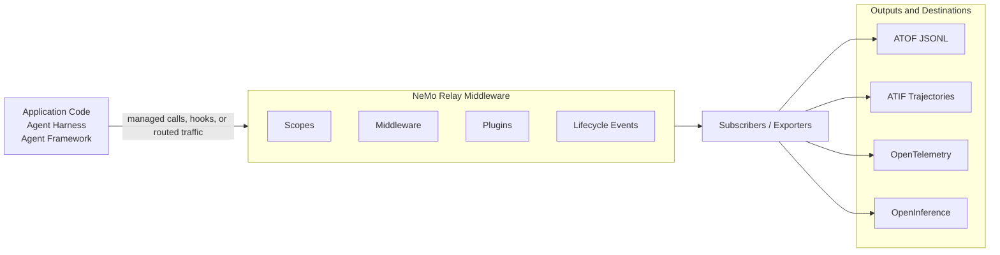

<!--
SPDX-FileCopyrightText: Copyright (c) 2026, NVIDIA CORPORATION & AFFILIATES. All rights reserved.
SPDX-License-Identifier: Apache-2.0
-->

# NVIDIA NeMo Relay

[](https://github.com/NVIDIA/NeMo-Relay/blob/main/LICENSE)
[](https://github.com/NVIDIA/NeMo-Relay/)
[](https://github.com/NVIDIA/NeMo-Relay/releases)
[](https://app.codecov.io/gh/NVIDIA/NeMo-Relay)
[](https://pypi.org/project/nemo-relay/)
[](https://www.npmjs.com/package/nemo-relay-node)
[](https://crates.io/crates/nemo-relay)
[](https://crates.io/crates/nemo-relay-adaptive)
[](https://crates.io/crates/nemo-relay-cli)
[](https://deepwiki.com/NVIDIA/NeMo-Relay)

NVIDIA NeMo Relay is a library that wraps your agents' model and
tool calls so you can observe, control, and tune them, without rewriting the
agent stack you already have.

## Learn by Example

- **Watch the livestream:** [Inside Hermes Agent Traces with NeMo Relay | Nemotron Labs](https://www.youtube.com/watch?v=7HTRAsVX10E).
- **Follow the tutorial:** [Tracing Agent Harness Behavior with NVIDIA NeMo Relay](https://developer.nvidia.com/blog/tracing-agent-harness-behavior-with-nvidia-nemo-relay/).

  Run Hermes Agent examples, inspect model and tool traces in Arize Phoenix,
  and use trace evidence to evaluate harness changes.

## Quick Start

> [!TIP]
> Browse the [full Quick Starts](https://docs.nvidia.com/nemo/relay/getting-started/quick-start)
> for coding agents, frameworks, and application APIs. The walkthrough below
> records a local coding-agent session with Relay's observability plugin.

### Set Up With Your Coding Agent

Your coding agent can guide installation and your first recorded session.
Install the onboarding skills for the agent you use. These commands use `npx`,
which is included with Node.js.

<details>
<summary>Codex</summary>

```bash
npx skills add nvidia/skills \
  --skill nemo-relay-install \
  --skill nemo-relay-get-started \
  --agent codex
```

</details>

<details>
<summary>Claude Code</summary>

```bash
npx skills add nvidia/skills \
  --skill nemo-relay-install \
  --skill nemo-relay-get-started \
  --agent claude-code
```

</details>

Then ask your agent to install NeMo Relay and capture a local session. Refer to
the [full skill list](skills/README.md) for instrumentation, plugins, and
troubleshooting. The manual setup follows below.

### Prerequisites

- A [supported operating system and agent version](https://docs.nvidia.com/nemo/relay/reference/support-matrix).
- Codex or Claude Code installed and working with its configured provider login
  or API credentials.
- An interactive terminal for the setup wizard and plugin editor.
- A trusted Git repository where the agent can inspect files or make changes.

Follow these steps to record a local session:

> ### Install the CLI
>
> <details>
> <summary>Linux or macOS</summary>
>
> ```bash
> curl -fsSL https://raw.githubusercontent.com/NVIDIA/NeMo-Relay/main/install.sh | sh
> export PATH="$HOME/.local/bin:$PATH"
> nemo-relay --version
> ```
>
> </details>
>
> <details>
> <summary>Windows PowerShell</summary>
>
> ```powershell
> irm https://raw.githubusercontent.com/NVIDIA/NeMo-Relay/main/install.ps1 | iex
> nemo-relay --version
> ```
>
> </details>
>
> The installer detects your operating system and CPU architecture, downloads
> the matching prebuilt CLI from GitHub Releases, and verifies its SHA-256
> checksum. The default destination is `$HOME/.local/bin` on Linux and macOS, or
> `%LOCALAPPDATA%\nemo-relay\bin` on Windows. The PowerShell installer also
> updates Windows PATH.
>
> **Version selection:** The installer selects the **latest stable GitHub
> release** by default. This repository's `main` branch tracks Relay development
> and can be ahead of that release. Use `nemo-relay --version` to check what you
> installed. For release pinning with `NEMO_RELAY_VERSION`, refer to
> [Installation](https://docs.nvidia.com/nemo/relay/getting-started/installation).
> To work from `main`, follow [source development](CONTRIBUTING.md#source-development).
>
> ### Enable Local Observability
>
> Run setup, select your coding agent, and accept **Configure Relay plugins now?**
> to open the plugin editor:
>
> ```bash
> nemo-relay config
> ```
>
> Enable **Observability**, then **ATOF**. Add a file sink with `output_directory`
> set to `logs`, `filename` to `events.jsonl`, and `mode` to `overwrite`. Preview
> from the top-level menu with `p` and save with `s`. Setup writes your user-scoped
> Relay configuration.
>
> ### Run and Inspect a Session
>
> From your trusted repository, launch your coding agent through Relay:
>
> <details>
> <summary>Codex</summary>
>
> ```bash
> nemo-relay codex
> ```
>
> Follow the [Codex quick start](https://docs.nvidia.com/nemo/relay/getting-started/quick-start/codex)
> for complete configuration, verification, and troubleshooting.
>
> </details>
>
> <details>
> <summary>Claude Code</summary>
>
> ```bash
> nemo-relay claude
> ```
>
> Follow the [Claude Code quick start](https://docs.nvidia.com/nemo/relay/getting-started/quick-start/claude-code)
> for complete configuration, verification, and troubleshooting.
>
> </details>
>
> Ask the agent to inspect a file or make a small change, then exit. Open
> `logs/events.jsonl` in that working repository to inspect the captured model,
> tool, and session events.

## Choose Your Path

Pick the row closest to what you are trying to do.

| Goal | Start With | How Relay Attaches |
|---|---|---|
| Observe Codex or Claude Code on your machine | Quick start for [Codex](https://docs.nvidia.com/nemo/relay/getting-started/quick-start/codex) or [Claude Code](https://docs.nvidia.com/nemo/relay/getting-started/quick-start/claude-code) | The Relay CLI connects to these supported agents' hooks and provider traffic. No application code changes. |
| Use Hermes Agent | [Hermes Agent quick start](https://docs.nvidia.com/nemo/relay/getting-started/quick-start/hermes) | Relay is built into Hermes Agent and reads standard Relay plugin configuration. No CLI or separate plugin needed. |
| Use OpenClaw | [OpenClaw Plugin Guide](https://docs.nvidia.com/nemo/relay/supported-integrations/openclaw-plugin) | The `nemo-relay-openclaw` plugin maps OpenClaw hooks to Relay events and pre-tool guardrails. |
| Instrument LLM or tool calls your application owns | [Python](https://docs.nvidia.com/nemo/relay/getting-started/quick-start/python), [Node.js](https://docs.nvidia.com/nemo/relay/getting-started/quick-start/nodejs), or [Rust](https://docs.nvidia.com/nemo/relay/getting-started/quick-start/rust) quick start | Direct SDK instrumentation runs the full lifecycle and middleware sequence around your callbacks. |
| Use LangChain, LangGraph, Deep Agents, or Google ADK | [Supported Integrations](https://docs.nvidia.com/nemo/relay/supported-integrations/about) | Maintained integrations use public framework APIs. |
| Export traces, trajectories, or raw events | [Observability](https://docs.nvidia.com/nemo/relay/configure-plugins/observability/about) | Exporters consume one event stream and write ATOF, ATIF, OpenTelemetry, or OpenInference. |
| Run Relay as a shared, administrator-managed service | [Daemon](https://docs.nvidia.com/nemo/relay/daemon/about) | A background daemon gives every user and coding agent one managed entry point, locally or on a remote Linux server. |
| Build a framework, host, or provider integration | [Integrate into Frameworks](https://docs.nvidia.com/nemo/relay/integrate-into-frameworks/about) | Wrap the framework's tool and LLM call sites. |
| Package reusable exporters, middleware, or policy | [Build Plugins](https://docs.nvidia.com/nemo/relay/build-plugins/about) | Ship language-binding, native, or gRPC worker plugins that turn on from configuration. |
| Develop or test this repository | [CONTRIBUTING.md](CONTRIBUTING.md) | Build from source. |

## How Relay Fits

Relay connects agent activity through one shared runtime model for observation,
policy, plugins, and lifecycle events. Attach it to supported agents and
frameworks, or instrument your application directly.

- **See the connected run.** Keep observed model calls, tools, skills, and
  subagents linked in one hierarchical execution history.
  [Scopes and execution history](https://docs.nvidia.com/nemo/relay/about-nemo-relay/concepts/scopes).
- **Keep the stack you have.** Connect supported frameworks and coding agents,
  or instrument your application through the Python, Node.js, and Rust SDKs.
  [Integrations](https://docs.nvidia.com/nemo/relay/supported-integrations/about).
- **Export in open formats.** Export events, trajectories, traces, logs, and
  metrics through ATOF, ATIF, and OpenTelemetry, including OpenInference
  projections. [Observability](https://docs.nvidia.com/nemo/relay/configure-plugins/observability/about).
- **Enforce policy at the call.** Apply guardrails where Relay controls
  execution, and redact sensitive telemetry before export. Available controls
  depend on the integration.
  [Middleware and guardrails](https://docs.nvidia.com/nemo/relay/about-nemo-relay/concepts/middleware).
- **Instrument once, extend with plugins.** Configure policies, exporters, and
  optimization without rewriting your integration. Use
  [built-in plugins](https://docs.nvidia.com/nemo/relay/configure-plugins/about),
  or [build your own](https://docs.nvidia.com/nemo/relay/build-plugins/about) with
  native plugins or separate worker processes.
- **Capture and route model traffic.** Observe provider requests through Relay's
  gateway and extend model routing with plugins such as NeMo Switchyard.
  [Provider gateway](https://docs.nvidia.com/nemo/relay/nemo-relay-cli/gateway-reference).
- **Tune cost and latency.** Use adaptive hints, prompt-cache planning, response
  caching, and tool-parallelism analysis to tune runtime behavior.
  [Adaptive optimization](https://docs.nvidia.com/nemo/relay/configure-plugins/adaptive/about).
- **Run Relay as a shared service.** Deploy local or remote daemon services with
  shared configuration, per-user workers, and operational diagnostics.
  [Managed deployments](https://docs.nvidia.com/nemo/relay/daemon/about).



**Relay is not a dashboard.** Arize Phoenix, CoreWeave Weights & Biases, Langfuse, LangSmith, and other observability products store and explore agent runs; Relay sits inside the run and feeds them through the export path you configure. It also doesn't replace your agent framework, model provider, or guardrail authoring system.  Check the [Ecosystem guide](https://docs.nvidia.com/nemo/relay/about-nemo-relay/ecosystem) for more details.

## How It Works

Relay builds on a small set of runtime concepts:

- **Scopes** give runs, turns, tools, LLM calls, and subagents clear
  parent-child relationships, automatic cleanup, and request isolation.
- **Marks** record point-in-time events, such as session starts, compaction, or
  skill loads.
- **Managed LLM and tool calls** apply the same lifecycle and middleware rules
  around every callback.
- **Middleware** blocks, sanitizes, transforms, routes, retries, or replaces
  execution where policy requires it.
- **Plugins** turn on observability, guardrail, PII redaction, adaptive, model
  pricing, and exporter behavior from configuration.
- **Events and subscribers** deliver every output from the same runtime
  activity.

Every output comes from one canonical event stream:

| Output | Use It For |
|---|---|
| [ATOF JSONL](https://docs.nvidia.com/nemo/relay/configure-plugins/observability/atof) | The raw, canonical lifecycle event stream. Start here when debugging. |
| [ATIF trajectories](https://docs.nvidia.com/nemo/relay/configure-plugins/observability/atif) | Replay, analysis, and evaluation of completed runs. |
| [OpenTelemetry](https://docs.nvidia.com/nemo/relay/configure-plugins/observability/opentelemetry) | Traces, logs, and metrics for OTLP-compatible backends. |
| [OpenInference](https://docs.nvidia.com/nemo/relay/configure-plugins/observability/openinference) | OpenInference-compatible tracing tools. |

How much Relay can do depends on where the real call happens:

| If… | Use | What Relay Can Do |
|---|---|---|
| The call can be routed through Relay | **Managed execution** | Run middleware, then invoke the real function. Full observe and control. |
| The framework keeps control but emits before/after notifications | **Lifecycle hooks** | Translate hooks into Relay events. Observe, but not execute or rewrite. |
| A supported coding agent sends model requests itself | **Gateway** | The Relay CLI routes that agent's provider traffic to record LLM calls. Use it only with the supported coding agents. |

Refer to [Concepts](https://docs.nvidia.com/nemo/relay/about-nemo-relay/concepts)
for the deeper model.

## Support Status

Python, Node.js, and Rust are fully supported; Rust is the source of truth for
runtime behavior. Go and the C FFI are experimental and source-first.

<table width="100%">
  <thead>
    <tr>
      <th width="40%" align="left">Coding Agent</th>
      <th width="20%" align="center">Observability</th>
      <th width="20%" align="center">Security</th>
      <th width="20%" align="center">Optimization</th>
    </tr>
  </thead>
  <tbody>
    <tr><td>Claude Code</td><td align="center">✅</td><td align="center">✅</td><td align="center">Partial</td></tr>
    <tr><td>Codex</td><td align="center">✅</td><td align="center">✅</td><td align="center">Partial</td></tr>
    <tr><td>Hermes Agent (built in)</td><td align="center">✅</td><td align="center">✅</td><td align="center">Partial</td></tr>
    <tr><td>OpenClaw</td><td align="center">✅</td><td align="center">Partial</td><td align="center">–</td></tr>
    <tr><td>pi (PoC)</td><td align="center">Partial</td><td align="center">✅</td><td align="center">–</td></tr>
  </tbody>
</table>

<table width="100%">
  <thead>
    <tr>
      <th width="40%" align="left">Framework</th>
      <th width="20%" align="center">Observability</th>
      <th width="20%" align="center">Security</th>
      <th width="20%" align="center">Optimization</th>
    </tr>
  </thead>
  <tbody>
    <tr><td>LangChain</td><td align="center">✅</td><td align="center">✅</td><td align="center">✅</td></tr>
    <tr><td>LangGraph</td><td align="center">✅</td><td align="center">✅</td><td align="center">✅</td></tr>
    <tr><td>Deep Agents</td><td align="center">✅</td><td align="center">✅</td><td align="center">✅</td></tr>
    <tr><td>Google ADK</td><td align="center">✅</td><td align="center">✅</td><td align="center">✅</td></tr>
  </tbody>
</table>

Refer to the [Support Matrix](https://docs.nvidia.com/nemo/relay/reference/support-matrix)
for minimum versions, platforms, and current limitations.

## Documentation

Full documentation lives at [docs.nvidia.com/nemo/relay](https://docs.nvidia.com/nemo/relay).
Browse the major sections below.

| Section | Covers |
|---|---|
| [About NVIDIA NeMo Relay](https://docs.nvidia.com/nemo/relay/about-nemo-relay/overview) | Overview, architecture, concepts, ecosystem, and release history. |
| [Getting Started](https://docs.nvidia.com/nemo/relay/getting-started/about) | Installation, configuration, deployment, and [Quick Starts](https://docs.nvidia.com/nemo/relay/getting-started/quick-start). |
| [User Guides](https://docs.nvidia.com/nemo/relay/dev/user-guides/about) | Enterprise workflows and runnable examples for applying Relay to deployment goals. |
| [Instrument Applications](https://docs.nvidia.com/nemo/relay/instrument-applications/about) | Add scopes, tool calls, and model calls to application code you own. |
| [NVIDIA NeMo Relay CLI](https://docs.nvidia.com/nemo/relay/nemo-relay-cli/about) | Install and configure the CLI, manage coding-agent integrations, and troubleshoot local runs. |
| [Daemon](https://docs.nvidia.com/nemo/relay/daemon/about) | Deploy and operate a shared, administrator-managed Relay service. |
| [Supported Integrations](https://docs.nvidia.com/nemo/relay/supported-integrations/about) | Use maintained integrations for frameworks and agent harnesses. |
| [Use Plugins](https://docs.nvidia.com/nemo/relay/configure-plugins/about) | Configure, manage, and initialize observability, adaptive, PII redaction, and other plugins. |
| [Integrate into Frameworks](https://docs.nvidia.com/nemo/relay/integrate-into-frameworks/about) | Attach Relay at framework or provider invocation boundaries. |
| [Build Plugins](https://docs.nvidia.com/nemo/relay/build-plugins/about) | Author and package language-binding, native, and worker plugins. |
| [Contribute](https://docs.nvidia.com/nemo/relay/contribute/about) | Source development, testing, documentation, and review workflows. |
| Reference | [APIs](https://docs.nvidia.com/nemo/relay/reference/api), [support matrix](https://docs.nvidia.com/nemo/relay/reference/support-matrix), [event format](https://docs.nvidia.com/nemo/relay/reference/atof-event-format), and [diagnostics](https://docs.nvidia.com/nemo/relay/reference/diagnostics). |
| Resources | [Troubleshooting](https://docs.nvidia.com/nemo/relay/resources/troubleshooting), [support and FAQs](https://docs.nvidia.com/nemo/relay/resources/support-and-faqs), [glossary](https://docs.nvidia.com/nemo/relay/resources/glossary), and [community](https://docs.nvidia.com/nemo/relay/resources/community). |

## Community and Support

- **Questions and ideas:** start a thread in
  [GitHub Discussions](https://github.com/NVIDIA/NeMo-Relay/discussions).
- **Bugs and feature requests:** open an
  [issue](https://github.com/NVIDIA/NeMo-Relay/issues).
- **Security vulnerabilities:** report them privately as described in
  [SECURITY.md](SECURITY.md); do not open a public issue.
- **Common problems:** check [Support and FAQs](https://docs.nvidia.com/nemo/relay/resources/support-and-faqs).

## Contributing

Contributions are welcome. For source builds, tests, and the contribution
workflow, refer to [CONTRIBUTING.md](CONTRIBUTING.md) and
[Development Setup](https://docs.nvidia.com/nemo/relay/contribute/development-setup).

## License

NVIDIA NeMo Relay is licensed under the [Apache License 2.0](LICENSE).
