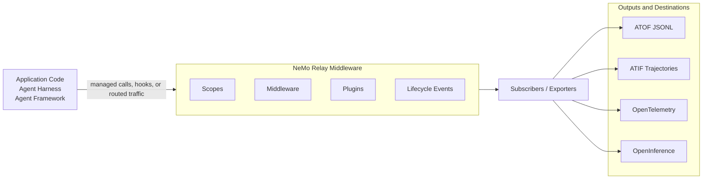

<!--
SPDX-FileCopyrightText: Copyright (c) 2026, NVIDIA CORPORATION & AFFILIATES. All rights reserved.
SPDX-License-Identifier: Apache-2.0
-->

# NVIDIA NeMo Relay

[](https://github.com/NVIDIA/NeMo-Relay/blob/main/LICENSE)
[](https://github.com/NVIDIA/NeMo-Relay/)
[](https://github.com/NVIDIA/NeMo-Relay/releases)
[](https://app.codecov.io/gh/NVIDIA/NeMo-Relay)
[](https://pypi.org/project/nemo-relay/)
[](https://www.npmjs.com/package/nemo-relay-node)
[](https://crates.io/crates/nemo-relay)
[](https://crates.io/crates/nemo-relay-adaptive)
[](https://crates.io/crates/nemo-relay-cli)
[](https://deepwiki.com/NVIDIA/NeMo-Relay)

NVIDIA NeMo Relay is a library that wraps your agents' model and
tool calls so you can observe, control, and tune them, without rewriting the
agent stack you already have.

- **See every agent run.** Capture model calls, tool calls, turns, and subagents
  from Hermes Agent, Claude Code, Codex, OpenClaw, pi, LangChain, Google ADK, or
  your own code as one event stream, then export it as raw events,
  trajectories, OpenTelemetry, or OpenInference.
- **Enforce policy at the call.** Middleware and guardrails can block,
  sanitize, redact, or rewrite a tool or model call before it runs, not after
  the fact.
- **Keep the stack you have.** Relay attaches to supported agents and
  frameworks through the Relay CLI or maintained integrations, and to your own
  code through SDKs for Python, Node.js, and Rust.
- **Extend it with plugins.** Turn on built-in observability, PII redaction, model pricing, resource metrics, and adaptive tuning from one `plugins.toml` file, or build your own exporters, middleware, and policies as custom plugins.
- **Tune cost and latency.** Model pricing estimates the cost of each call, and
  adaptive plugins tune caching and request hints from observed behavior.

> [!NOTE]
> NeMo Relay is beta software. APIs and behavior may change with each release.
> Review the [Release Notes](https://docs.nvidia.com/nemo/relay/about-nemo-relay/release-notes)
> and [Migration Guides](https://docs.nvidia.com/nemo/relay/reference/migration-guides)
> before upgrading.

## Quick Start

Put Relay in front of a supported coding agent you already use:

```bash
curl -fsSL https://raw.githubusercontent.com/NVIDIA/NeMo-Relay/main/install.sh | sh
nemo-relay claude    # or: nemo-relay codex
```

On Windows, install with
`irm https://raw.githubusercontent.com/NVIDIA/NeMo-Relay/main/install.ps1 | iex`.

On first run, Relay walks you through setup in your terminal. After that, each
run launches the agent with Relay attached and removes it when the agent exits.
To record and inspect a complete run, follow the
[Claude Code](https://docs.nvidia.com/nemo/relay/getting-started/quick-start/claude-code)
or [Codex](https://docs.nvidia.com/nemo/relay/getting-started/quick-start/codex)
quick start.

For other harnesses and frameworks, check our [quick starts](https://docs.nvidia.com/nemo/relay/getting-started/quick-start#agent-harnesses).

## Learn by Example

- **Watch the livestream:** [Inside Hermes Agent Traces with NeMo Relay | Nemotron Labs](https://www.youtube.com/watch?v=7HTRAsVX10E).
- **Follow the tutorial:** [Tracing Agent Harness Behavior with NVIDIA NeMo Relay](https://developer.nvidia.com/blog/tracing-agent-harness-behavior-with-nvidia-nemo-relay/).

  Run Hermes Agent examples, inspect model and tool traces in Arize Phoenix,
  and use trace evidence to evaluate harness changes.

## How Relay Fits

An agent request touches many components: an entry point starts work, a model is
called, tools run, and subagents branch off. Relay gives all of them one shared
runtime contract for scopes, policy, plugins, and lifecycle events, instead of
asking every layer to invent its own wrappers and trace vocabulary.



**Relay is not a dashboard.** Arize Phoenix, CoreWeave Weights & Biases, Langfuse, LangSmith, and other observability products store and explore agent runs; Relay sits inside the run and feeds them through the export path you configure. It also doesn't replace your agent framework, model provider, or guardrail authoring system.  Check the [Ecosystem guide](https://docs.nvidia.com/nemo/relay/about-nemo-relay/ecosystem) for more details.

## Choose Your Path

Pick the row closest to what you are trying to do.

| Goal | Start With | How Relay Attaches |
|---|---|---|
| Observe Codex, Claude Code, or pi on your machine | Quick start for [Codex](https://docs.nvidia.com/nemo/relay/getting-started/quick-start/codex), [Claude Code](https://docs.nvidia.com/nemo/relay/getting-started/quick-start/claude-code), or [pi](https://docs.nvidia.com/nemo/relay/getting-started/quick-start/pi) | The Relay CLI connects to these supported agents' hooks and provider traffic. No application code changes. |
| Use Hermes Agent | [Hermes Agent quick start](https://docs.nvidia.com/nemo/relay/getting-started/quick-start/hermes) | Relay is built into Hermes Agent and reads standard Relay plugin configuration. No CLI or separate plugin needed. |
| Use OpenClaw | [OpenClaw Plugin Guide](https://docs.nvidia.com/nemo/relay/supported-integrations/openclaw-plugin) | The `nemo-relay-openclaw` plugin maps OpenClaw hooks to Relay events and pre-tool guardrails. |
| Instrument LLM or tool calls your application owns | [Python](https://docs.nvidia.com/nemo/relay/getting-started/quick-start/python), [Node.js](https://docs.nvidia.com/nemo/relay/getting-started/quick-start/nodejs), or [Rust](https://docs.nvidia.com/nemo/relay/getting-started/quick-start/rust) quick start | Direct SDK instrumentation runs the full lifecycle and middleware sequence around your callbacks. |
| Use LangChain, LangGraph, Deep Agents, or Google ADK | [Supported Integrations](https://docs.nvidia.com/nemo/relay/supported-integrations/about) | Maintained integrations use public framework APIs. |
| Export traces, trajectories, or raw events | [Observability](https://docs.nvidia.com/nemo/relay/configure-plugins/observability/about) | Exporters consume one event stream and write ATOF, ATIF, OpenTelemetry, or OpenInference. |
| Run Relay as a shared, administrator-managed service | [Daemon](https://docs.nvidia.com/nemo/relay/daemon/about) | A background daemon gives every user and coding agent one managed entry point, locally or on a remote Linux server. |
| Build a framework, host, or provider integration | [Integrate into Frameworks](https://docs.nvidia.com/nemo/relay/integrate-into-frameworks/about) | Wrap the framework's tool and LLM call sites. |
| Package reusable exporters, middleware, or policy | [Build Plugins](https://docs.nvidia.com/nemo/relay/build-plugins/about) | Ship language-binding, native, or gRPC worker plugins that turn on from configuration. |
| Develop or test this repository | [CONTRIBUTING.md](CONTRIBUTING.md) | Build from source. |

## Install

Install the component that matches where Relay attaches, then follow the quick start for your agent, framework, or language from the table above.

```bash
# CLI for supported coding agents (Claude Code, Codex, pi)
curl -fsSL https://raw.githubusercontent.com/NVIDIA/NeMo-Relay/main/install.sh | sh

# Python 3.11+ (add extras for langchain, langgraph, deepagents, google-adk)
uv add nemo-relay

# Node.js 24.13.1+
npm install nemo-relay-node

# Rust
cargo add nemo-relay
```

On Windows, install the CLI with the
[PowerShell installer](https://docs.nvidia.com/nemo/relay/getting-started/installation#cli).
Refer to [Installation](https://docs.nvidia.com/nemo/relay/getting-started/installation)
for platforms, version pinning, and integration packages, or to
[Quick Starts](https://docs.nvidia.com/nemo/relay/getting-started/quick-start)
for a first run in a few minutes.

### Set Up With Your Coding Agent

Relay publishes agent skills that let Claude Code, Codex, Cursor, and other
compatible coding agents install Relay, pick the right integration path, and
debug missing events for you:

```bash
npx skills add nvidia/skills \
  --skill nemo-relay-install \
  --skill nemo-relay-get-started \
  --agent claude-code
```

Then ask your agent to get you started with NeMo Relay. Change `--agent` to
`codex`, `cursor`, or another supported target. The full skill set covers
instrumentation, plugins, and troubleshooting; refer to [`skills/`](skills/README.md)
for the list.

Coding agents can also read the docs directly through
[`llms.txt`](https://docs.nvidia.com/nemo/relay/llms.txt) or the docs MCP
server at `https://docs.nvidia.com/nemo/relay/_mcp/server`.

## How It Works

Relay builds on a small set of runtime concepts:

- **Scopes** give runs, turns, tools, LLM calls, and subagents clear
  parent-child relationships, automatic cleanup, and request isolation.
- **Marks** record point-in-time events, such as session starts, compaction, or
  skill loads.
- **Managed LLM and tool calls** apply the same lifecycle and middleware rules
  around every callback.
- **Middleware** blocks, sanitizes, transforms, routes, retries, or replaces
  execution where policy requires it.
- **Plugins** turn on observability, guardrail, PII redaction, adaptive, model
  pricing, and exporter behavior from configuration.
- **Events and subscribers** deliver every output from the same runtime
  activity.

Every output comes from one canonical event stream:

| Output | Use It For |
|---|---|
| [ATOF JSONL](https://docs.nvidia.com/nemo/relay/configure-plugins/observability/atof) | The raw, canonical lifecycle event stream. Start here when debugging. |
| [ATIF trajectories](https://docs.nvidia.com/nemo/relay/configure-plugins/observability/atif) | Replay, analysis, and evaluation of completed runs. |
| [OpenTelemetry](https://docs.nvidia.com/nemo/relay/configure-plugins/observability/opentelemetry) | Traces, logs, and metrics for OTLP-compatible backends. |
| [OpenInference](https://docs.nvidia.com/nemo/relay/configure-plugins/observability/openinference) | OpenInference-compatible tracing tools. |

How much Relay can do depends on where the real call happens:

| If… | Use | What Relay Can Do |
|---|---|---|
| The call can be routed through Relay | **Managed execution** | Run middleware, then invoke the real function. Full observe and control. |
| The framework keeps control but emits before/after notifications | **Lifecycle hooks** | Translate hooks into Relay events. Observe, but not execute or rewrite. |
| A supported coding agent sends model requests itself | **Gateway** | The Relay CLI routes that agent's provider traffic to record LLM calls. Use it only with the supported coding agents. |

Refer to [Concepts](https://docs.nvidia.com/nemo/relay/about-nemo-relay/concepts)
for the deeper model.

## Support Status

Python, Node.js, and Rust are fully supported; Rust is the source of truth for
runtime behavior. Go and the C FFI are experimental and source-first.

| Coding Agent | Observability | Security | Optimization |
|:--|:--:|:--:|:--:|
| Claude Code | ✅ | ✅ | Partial |
| Codex | ✅ | ✅ | Partial |
| Hermes Agent (built in) | ✅ | ✅ | Partial |
| OpenClaw | ✅ | Partial | – |
| pi (experimental) | Partial | ✅ | – |

| Framework | Observability | Security | Optimization |
|:--|:--:|:--:|:--:|
| LangChain | ✅ | ✅ | ✅ |
| LangGraph | ✅ | ✅ | ✅ |
| Deep Agents | ✅ | ✅ | ✅ |
| Google ADK | ✅ | ✅ | ✅ |

Refer to the [Support Matrix](https://docs.nvidia.com/nemo/relay/reference/support-matrix)
for minimum versions, platforms, and current limitations.

## Documentation

Full documentation lives at [docs.nvidia.com/nemo/relay](https://docs.nvidia.com/nemo/relay).

| Task | Start With |
|---|---|
| Understand the runtime model | [Overview](https://docs.nvidia.com/nemo/relay/about-nemo-relay/overview) and [Agent Runtime Primer](https://docs.nvidia.com/nemo/relay/about-nemo-relay/agent-runtime-primer) |
| Install packages | [Installation](https://docs.nvidia.com/nemo/relay/getting-started/installation) |
| Configure plugin files | [Plugin Configuration Files](https://docs.nvidia.com/nemo/relay/configure-plugins/plugin-configuration-files) |
| Tune performance with adaptive behavior | [Adaptive](https://docs.nvidia.com/nemo/relay/configure-plugins/adaptive/about) |
| Debug trace incidents | [Troubleshooting Guide](https://docs.nvidia.com/nemo/relay/resources/troubleshooting) |
| Look up APIs | [APIs](https://docs.nvidia.com/nemo/relay/reference/api) |
| See what changed | [Release Notes](https://docs.nvidia.com/nemo/relay/about-nemo-relay/release-notes) |

## Community and Support

- **Questions and ideas:** start a thread in
  [GitHub Discussions](https://github.com/NVIDIA/NeMo-Relay/discussions).
- **Bugs and feature requests:** open an
  [issue](https://github.com/NVIDIA/NeMo-Relay/issues).
- **Security vulnerabilities:** report them privately as described in
  [SECURITY.md](SECURITY.md); do not open a public issue.
- **Common problems:** check [Support and FAQs](https://docs.nvidia.com/nemo/relay/resources/support-and-faqs).

## Contributing

Contributions are welcome. For source builds, tests, and the contribution
workflow, refer to [CONTRIBUTING.md](CONTRIBUTING.md) and
[Development Setup](https://docs.nvidia.com/nemo/relay/contribute/development-setup).

## License

NVIDIA NeMo Relay is licensed under the [Apache License 2.0](LICENSE).
