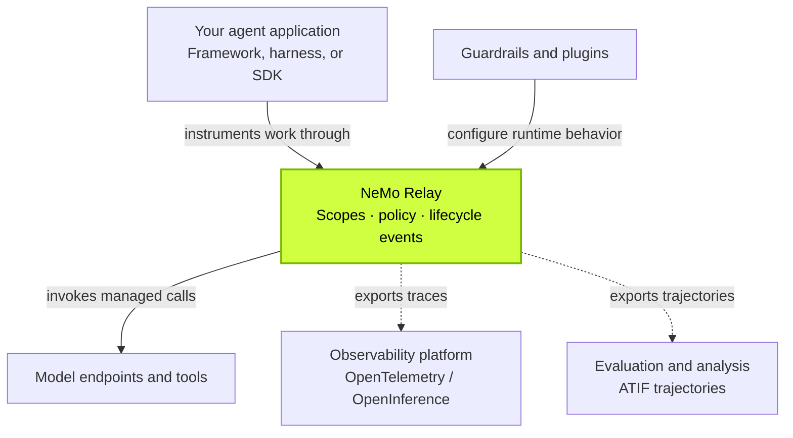

{/* SPDX-FileCopyrightText: Copyright (c) 2026, NVIDIA CORPORATION & AFFILIATES. All rights reserved.
SPDX-License-Identifier: Apache-2.0 */}

NVIDIA NeMo Relay is an **agent execution runtime** that adds observability and
control to existing agent systems. It connects instrumented LLM calls, tool
calls, and subagent activity through shared lifecycle events, with export paths
to your observability and evaluation tools.

<CardGroup cols={3}>
<Card title="Trace agent runs" icon="regular waveform-lines" href="/configure-plugins/observability/about">
Follow model calls, tools, and nested subagents in one shared event model.
</Card>
<Card title="Apply runtime policy" icon="regular shield-check" href="/about-nemo-relay/concepts/middleware">
Use guardrails and intercepts to check, block, or transform managed calls.
</Card>
<Card title="Keep your tools" icon="regular puzzle-piece" href="/supported-integrations/about">
Add Relay to a supported framework or harness without rebuilding your agent stack.
</Card>
</CardGroup>

## Where Relay Fits

Your framework or harness decides what the agent does next. Relay observes and,
where the integration supports it, controls the work that happens along the way.

Solid arrows show configuration and managed execution; dotted arrows show data
export. Hook-based integrations can report lifecycle events while the framework
retains execution. Capture and policy support depend on the integration.

## How NeMo Relay Relates to Other Tooling

| Part of your stack | Examples | What Relay adds |
|---|---|---|
| **Agent frameworks and harnesses** orchestrate work. | LangChain, LangGraph, Deep Agents, Google ADK, OpenClaw | [Maintained integrations](/supported-integrations/about) capture supported lifecycles and expose runtime controls. |
| **Application code and provider SDKs** call models and tools. | Your own agent loop, model clients, internal tools | [SDK instrumentation](/instrument-applications/about) gives calls shared scopes, lifecycle events, and middleware. |
| **Telemetry standards** describe trace data. | OpenTelemetry GenAI, OpenInference | [Exporters](/configure-plugins/observability/opentelemetry) translate Relay events into compatible spans for your telemetry pipeline. |
| **Observability platforms** store and explore runs. | Arize Phoenix, Langfuse, LangSmith | Export traces through a compatible OTLP ingestion path; backend configuration and supported attributes vary. |
| **Evaluation and experiment tools** compare outcomes. | Your existing evaluation pipeline or experiment tracking dashboard | [ATIF trajectories](/configure-plugins/observability/atif) provide run data for analysis. Import and comparison remain the downstream tool's responsibility. |

**Tracing multi-agent workflows:** instrumented subagent scopes preserve
parent-child relationships alongside tool and LLM calls. Supported integrations
reduce custom callbacks and separate wrappers by standardizing lifecycle events
across framework boundaries.

**Investigating production regressions:** exported run data can help teams
compare behavior before and after an agent harness change. Relay supplies the
execution evidence; your monitoring or evaluation system performs the
comparison and detects regressions.

<Tip>
You can adopt Relay without rewriting your agent stack. Some coding-agent paths
use hooks or a sidecar without application code changes; SDK paths require
instrumentation. Choose a [quick start](/getting-started/quick-start) for your
existing agent or framework.
</Tip>

## Integrations and Ecosystem Connections

Choose an existing integration or connect your own application through the SDK.

| Agent or tool | Connection | Coverage |
|---|---|---|
| [LangChain](/supported-integrations/langchain), [LangGraph](/supported-integrations/langgraph), [Deep Agents](/supported-integrations/deepagents) | Maintained framework integrations | Observability, security middleware, and optimization. |
| [Google ADK](/supported-integrations/google-adk) | ADK plugin | Model and tool observability, guardrails, and optimization. |
| [OpenClaw](/supported-integrations/openclaw-plugin) | Hook-based plugin | Observability and pre-tool guardrails; partial security coverage and no optimization. |
| [Codex](/getting-started/quick-start/codex), [Claude Code](/getting-started/quick-start/claude-code) | CLI hooks and local gateway | Turn, tool, and model observability; model capture requires traffic through the gateway. |
| [Hermes Agent](/getting-started/quick-start/hermes) | Native Relay integration | Session, model, and tool events using Relay plugin configuration. |
| [pi](/getting-started/quick-start/pi) | Proof-of-concept extension | Turn and tool events; model capture depends on provider redirection. |
| Arize Phoenix, Langfuse, LangSmith | Compatible OTLP ingestion | [Export traces](/configure-plugins/observability/opentelemetry) to an existing backend; configure its endpoint and supported projection. |

For feature-level support, see the [framework support matrix](/supported-integrations/about#support-matrix).

## Extend Relay With Plugins

Plugins package reusable runtime behavior so teams and ecosystem partners can
extend Relay through configuration.

| Plugin source | Examples | How to use them |
|---|---|---|
| **Built-in** — included with Relay | [Observability](/configure-plugins/observability/about), [Adaptive](/configure-plugins/adaptive/about), [PII Redaction](/configure-plugins/pii-redaction/about), [Model Pricing](/configure-plugins/model-pricing), [Resource Metrics](/configure-plugins/resource-metrics) | [Configure](/configure-plugins/plugin-configuration-files) event export, adaptive behavior, sensitive-data redaction, cost estimates, and resource monitoring. |
| **First-party** — published separately by NVIDIA | [NeMo Switchyard](/configure-plugins/switchyard) routes requests across models and providers. | [Install and manage](/configure-plugins/discoverable-plugins) separately released plugins with the Relay CLI. |
| **Custom** — built by your team or ecosystem partners | Exporters for other backends, organization-specific policy checks, or request routing. | [Build a plugin](/build-plugins/about) and reuse it across Relay-enabled applications. |

Start with an application-owned plugin, or distribute a native plugin or worker
when separate packaging is useful. Plugins can subscribe to events or apply
middleware; their available controls depend on the host integration's execution
boundary.

## How NeMo Relay Fits in the NVIDIA Agent Toolkit Ecosystem

[NVIDIA Agent Toolkit](https://blogs.nvidia.com/blog/enterprise-platforms-agent-toolkit/)
brings together tools for building, running, securing, and improving agents.
Relay contributes **execution visibility and runtime control**, connecting
agent activity to observability, evaluation, and improvement workflows.

| Purpose | NVIDIA components | Relationship to Relay |
|---|---|---|
| **Sandbox agent execution** | [OpenShell](https://docs.nvidia.com/openshell/about/overview) | Enforces filesystem, network, and process restrictions. Relay adds visibility and middleware around instrumented model calls, tools, and subagent activity within the agent application. |
| **Manage agent improvement** | [NeMo Helix](https://docs.nvidia.com/nemo-helix/latest/documentation/home/) | Provides a control plane for evaluating, optimizing, and hardening agents. Relay exports OTLP traces and ATIF trajectories to Helix's NeMo Intake service for storage, querying, and review. |
| **Analyze execution evidence** | [NeMo Compass](https://github.com/NVIDIA-NeMo/nemo-compass) | Finds recurring problems in recorded traces, including tool failures and patterns in poor evaluation outcomes. Analyzes Relay evidence through ATIF files or Intake. Currently a research preview. |
| **Prepare data** | [NeMo Data Designer](https://docs.nvidia.com/nemo/microservices/latest/generate-synthetic-data/index.html) and [Curator](https://docs.nvidia.com/nemo/curator/latest/) | Create and prepare datasets upstream of agent execution. Relay records the agent's instrumented work at runtime. |
| **Train and customize models** | [NeMo Framework](https://docs.nvidia.com/nemo-framework/user-guide/latest/nemotoolkit/index.html) and [NeMo Customizer](https://docs.nvidia.com/nemo/microservices/latest/fine-tune/index.html) | Produce models an agent can use. Relay instruments client calls to their deployed endpoints. |
| **Retrieve knowledge** | [NeMo Retriever](https://docs.nvidia.com/nemo/retriever/latest/) | Supplies retrieval capabilities for RAG. Retrieval calls can be instrumented as tools in an agent run. |
| **Apply safety and policy** | [NeMo Guardrails](https://docs.nvidia.com/nemo/guardrails/latest/) | Defines safety behavior. Applications can connect policy checks through Relay middleware; there is no built-in NeMo Guardrails plugin. |
| **Evaluate effectiveness** | [NeMo Evaluator](https://docs.nvidia.com/nemo/evaluator/latest/) | Evaluates model and agent quality. Relay's execution data complements quality scores, with export and ingestion configured separately. |

Related NVIDIA infrastructure, **[NIM](https://docs.nvidia.com/nim/large-language-models/latest/introduction.html)**
and **[Dynamo](https://docs.nvidia.com/dynamo/)**, serves model inference. Relay
can instrument requests to those endpoints while they handle model serving.
These relationships describe complementary roles, not a bundled integration
with every product.

<Note>
Relay can enforce policy on autonomous agent actions when the integration
exposes the relevant execution boundary. Lifecycle notifications alone provide
observability; they do not automatically enable blocking or request rewriting.
See the [integration support matrix](/supported-integrations/about#support-matrix)
for feature coverage.
</Note>
