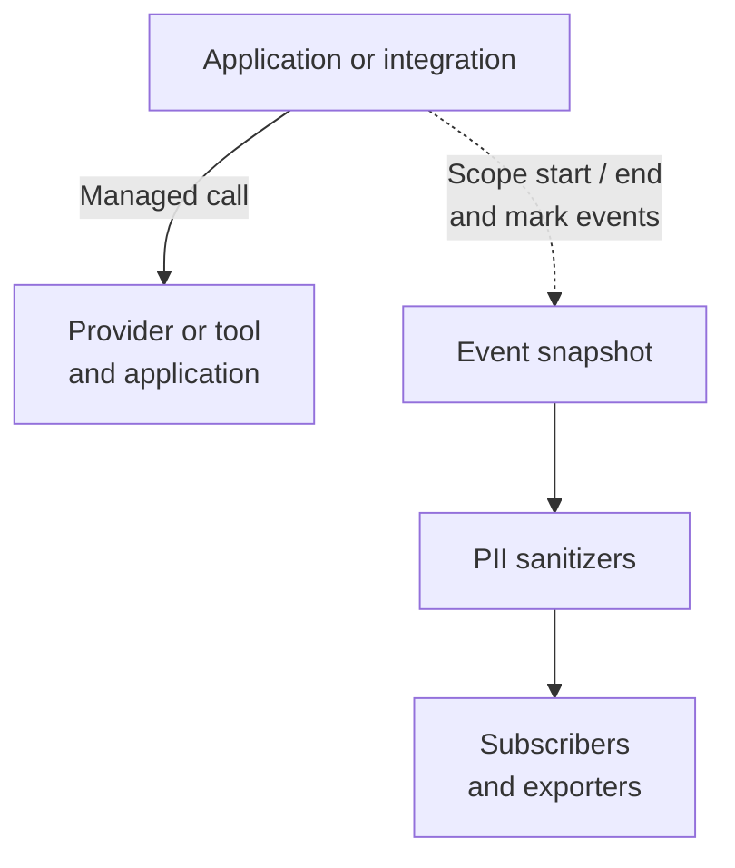

import { MermaidStyles } from "@/components/MermaidStyles";

{/* SPDX-FileCopyrightText: Copyright (c) 2026, NVIDIA CORPORATION & AFFILIATES. All rights reserved.
SPDX-License-Identifier: Apache-2.0 */}

The PII redaction plugin removes or transforms sensitive values in NeMo Relay
observability data before subscribers and exporters receive it. Use it to redact
email addresses, remove private fields, mask or hash selected text, or remove
conversational content from exported trajectories.

Configure the first-party `pii_redaction` component in `plugins.toml` or through
`nemo-relay plugins edit` to share a privacy policy across applications.

## Where Redaction Runs

Relay records a unit of work as a [scope](/about-nemo-relay/concepts/scopes).
Opening and closing a scope produces start and end events. Managed LLM and tool
calls have their own scopes, with request data on the start event and result
data on the end event. A mark records an observation within the active scope
without opening another scope.

The plugin sanitizes the observable fields of these events before subscribers
and exporters receive them. The provider or tool receives the real request,
and the application receives the real result.

<MermaidStyles />



Each event is sanitized during queued publication, before delivery. The diagram
shows the data boundary rather than execution timing.

The plugin installs [sanitize guardrails](/about-nemo-relay/concepts/middleware#guardrails).
These are Relay's existing hooks for transforming observability data. Use the
plugin for declarative policies with built-in detectors and actions. Register
custom sanitize middleware when your policy needs application code, runtime
state, or external lookups.

## What Data the Plugin Covers

| Surface | Data Covered |
| --- | --- |
| LLM scope start and end | Request data at start, response data at end, and scope metadata. LLM selectors use the active codec's representation. |
| Tool scope start and end | Arguments at start; result values and result annotations at end; scope metadata on both. Results and annotations are sanitized as separate JSON documents. |
| Marks within the active scope | `data`, `category_profile`, and `metadata`, each sanitized independently when the mark is published. |
| Other scope starts and ends | `data`, `category_profile`, and `metadata`. With a single policy, starts require `input` or `tool_input`; ends require `output` or `tool_output`. |

With `profiles`, each enabled profile applies to all supported surfaces. To
control which surfaces are sanitized, configure a single policy directly under
`[components.config]`, without `profiles`. In that form, `input`, `output`,
`mark`, `tool_input`, and `tool_output` control the sanitizer surfaces and default
to `true`.

LLM selectors use codec-specific payload boundaries. Request and response codec
capabilities differ, and codec conversion can canonicalize the emitted request.
Refer to
[Path Semantics](/configure-plugins/pii-redaction/configuration#path-semantics)
for payload boundaries and normalized selector examples.

## Example: Redact Email Addresses

This `plugins.toml` profile replaces detected email addresses in observability
text with `[REDACTED]`. Omitting path selectors lets the detector inspect every
string leaf in ordinary payloads. For typed metric marks, it sanitizes descriptions
and string attributes while preserving measurement names. Refer to
[Typed Metric Marks](/configure-plugins/pii-redaction/configuration#typed-metric-marks)
for the metric-specific rules.

```toml
version = 1

[[components]]
kind = "pii_redaction"
enabled = true

[[components.config.profiles]]
mode = "builtin"

[components.config.profiles.builtin]
action = "redact"
detector = "email"
```

For a tool call with `{"contact":"alice@example.com"}` as its arguments:

| Recipient | Arguments |
| --- | --- |
| Tool implementation | `{"contact":"alice@example.com"}` |
| Subscribers and exporters | `{"contact":"[REDACTED]"}` |

Built-in detectors use deterministic patterns. They identify configured formats
such as email addresses or API keys; they do not identify every kind of private
information. Refer to
[Detector Presets](/configure-plugins/pii-redaction/configuration#detector-presets)
for the supported formats.

## Choose a Policy

| Goal | Policy |
| --- | --- |
| Replace detected sensitive text | Use `redact` with a built-in detector or custom pattern. |
| Remove a known field or container | Use `remove` with an exact path or glob selector. |
| Keep a transformed value | Use `hash`, `mask`, or `regex_replace`, according to what the consumer needs. |
| Remove conversational content while keeping trajectory analytics | Use the existing `trajectory_context` preset. |

Exact paths select a specific JSON node. Globs can select multiple nodes, with
each `*` matching one object key or array index. String actions operate on
selected string values; selecting a container does not select its descendants.
Recursive `**` selectors and JSONPath expressions are not supported.

## Relation to Raw Middleware

This plugin uses the same sanitize-guardrail middleware family documented in
[Middleware](/about-nemo-relay/concepts/middleware).

The difference between raw middleware and `pii_redaction` is the layer of
abstraction:

- Raw middleware asks you to register sanitize callbacks directly in code.
- `pii_redaction` gives you a first-party, config-driven privacy contract on
  top of those same runtime hooks.

Choose `pii_redaction` when you want a reusable built-in policy surface.
Choose raw middleware when you need bespoke callback logic that does not fit
the plugin contract.

## Plugin Versus Middleware

Use this matrix when deciding whether to use the built-in `pii_redaction`
plugin or raw sanitize-guardrail middleware directly.

| Area | `pii_redaction` Plugin | Raw Middleware |
| --- | --- | --- |
| Configuration interface | Declarative config through `plugins.toml`, bindings helpers, and the CLI editor | Callback registration in application code |
| Best fit | Reusable privacy policy shared across apps or teams | App-specific logic tied to runtime state or custom heuristics |
| Built-in actions | `remove`, `redact`, `regex_replace`, `hash`, `mask` | You implement the behavior yourself |
| Built-in detectors | Supported | You implement the matcher yourself |
| Codec-aware LLM handling | Supported for the documented codecs | You handle normalization and provider shapes yourself |
| Validation and editor support | Supported | Not provided |
| Cross-runtime consistency | First-party contract across Relay surfaces | Depends on each app's callback code |
| Flexibility | Limited to the plugin contract | Full control over sanitize behavior |
| When to choose it | You want the fastest path to a supported privacy surface | You need behavior the plugin contract does not express |

Continue with
[PII Redaction Configuration](/configure-plugins/pii-redaction/configuration)
for action semantics, selectors, profiles, and the trajectory preset. The
shipped `builtin` backend implements these policies; `local_model` is an
extension point that requires a runtime-provided backend.
