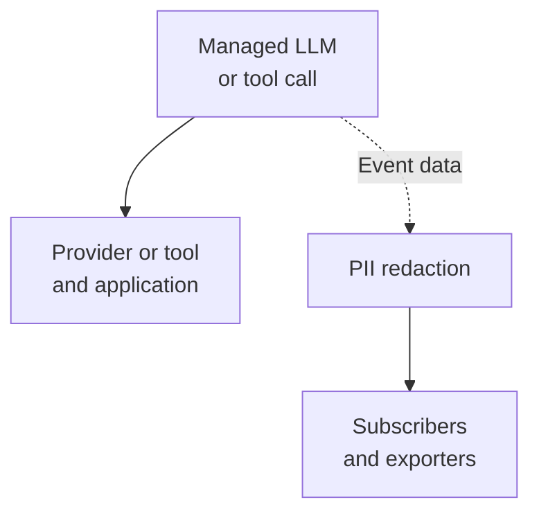

{/* SPDX-FileCopyrightText: Copyright (c) 2026, NVIDIA CORPORATION & AFFILIATES. All rights reserved.
SPDX-License-Identifier: Apache-2.0 */}

The PII redaction plugin removes or transforms sensitive values in NeMo Relay
observability data before subscribers and exporters receive it. Use it to redact
email addresses, remove private fields, mask or hash selected text, or remove
conversational content from exported trajectories.

Configure the first-party `pii_redaction` component in `plugins.toml` or through
`nemo-relay plugins edit` to share a privacy policy across applications.

## Where Redaction Runs

Relay records observability data alongside managed LLM and tool calls. The plugin
applies your policy to that event data. The provider or tool receives the real
request, and the application receives the real result.

<MermaidStyles />



The same privacy policy can also sanitize marks and scope events. This diagram
shows the data boundary; request and response events are sanitized separately.
Other Relay middleware can change execution independently of this plugin.

The plugin installs
[sanitize guardrails](/about-nemo-relay/concepts/middleware#guardrails).
These are Relay's existing hooks for transforming observability data. Use the
plugin for declarative policies with built-in detectors and actions. Register
custom sanitize middleware when your policy needs application code, runtime
state, or external lookups.

## What Data the Plugin Covers

| Surface | Data Covered |
| --- | --- |
| Managed LLM calls | Request and response observability payloads, plus scope metadata. LLM selectors use the active codec's representation. |
| Managed tool calls | Request arguments, result values, result annotations, and scope metadata. Tool results and annotations are sanitized as separate JSON documents. |
| Marks | `data`, `category_profile`, and `metadata`, each sanitized independently. |
| Other scopes | `data`, `category_profile`, and `metadata` on scope-start and scope-end events. |

Every enabled profile covers these surfaces. Legacy single-policy configuration
can toggle them with `input`, `output`, `mark`, `tool_input`, and `tool_output`.
All five default to `true`.

LLM selectors use codec-specific payload boundaries. Request and response codec
capabilities differ, and codec conversion can canonicalize the emitted request.
Refer to
[Path Semantics](/configure-plugins/pii-redaction/configuration#path-semantics)
for payload boundaries and normalized selector examples.

## Example: Redact Email Addresses

This `plugins.toml` profile replaces detected email addresses in observability
text with `[REDACTED]`. Omitting path selectors lets the detector inspect every
string leaf in each supported payload.

```toml
version = 1

[[components]]
kind = "pii_redaction"
enabled = true

[[components.config.profiles]]
mode = "builtin"

[components.config.profiles.builtin]
action = "redact"
detector = "email"
```

For a tool call with `{"contact":"alice@example.com"}` as its arguments:

| Recipient | Arguments |
| --- | --- |
| Tool implementation | `{"contact":"alice@example.com"}` |
| Subscribers and exporters | `{"contact":"[REDACTED]"}` |

Built-in detectors use deterministic patterns. They identify configured formats
such as email addresses or API keys; they do not identify every kind of private
information. Refer to
[Detector Presets](/configure-plugins/pii-redaction/configuration#detector-presets)
for the supported formats.

## Choose a Policy

| Goal | Policy |
| --- | --- |
| Replace detected sensitive text | Use `redact` with a built-in detector or custom pattern. |
| Remove a known field or container | Use `remove` with an exact path or glob selector. |
| Keep a transformed value | Use `hash`, `mask`, or `regex_replace`, according to what the consumer needs. |
| Remove conversational content while keeping trajectory analytics | Use the existing `trajectory_context` preset. |

Exact paths select a specific JSON node. Globs can select multiple nodes, with
each `*` matching one object key or array index. String actions operate on
selected string values; selecting a container does not select its descendants.
Recursive `**` selectors and JSONPath expressions are not supported.

Continue with
[PII Redaction Configuration](/configure-plugins/pii-redaction/configuration)
for action semantics, selectors, profiles, and the trajectory preset. The
shipped `builtin` backend implements these policies; `local_model` is an
extension point that requires a runtime-provided backend.
