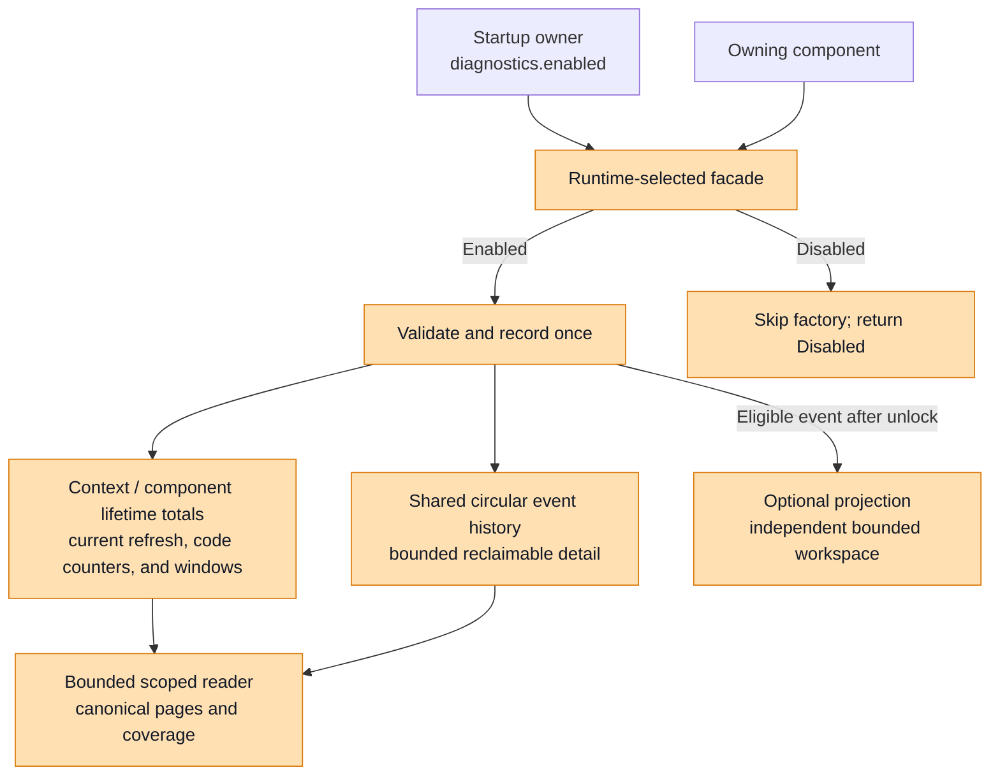
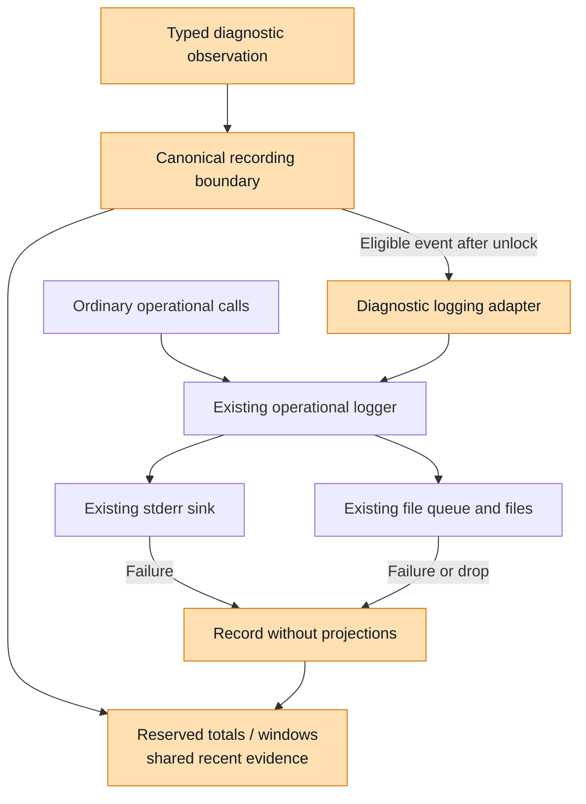
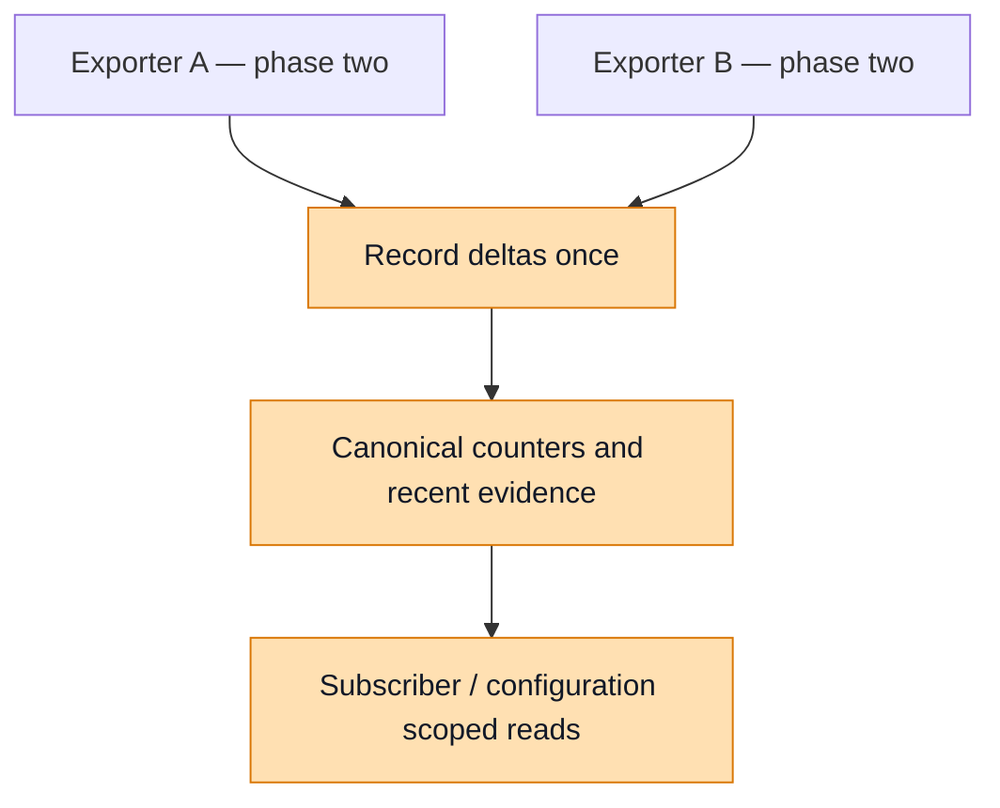

# Diagnostics Foundation: Engineering Review

## Purpose and Scope

This document presents the phase-one diagnostics architecture for engineering
review. The [full design](./diagnostics-phase-one-v2.md) remains the authoritative
build specification. This edition consolidates repeated requirements, keeps the
contracts that determine correctness and resource use, and refers detailed error
inventories and migration rules to that specification. Its Rust examples explain
the design; they are not complete API definitions or executable implementations.

The proposal creates one canonical diagnostics model and one bounded,
authoritative store per diagnostic context. Components record evidence once.
Consumers obtain scoped canonical views of the producers migrated into that
store. Phase one integrates logging and selected core/plugin operations; OTel
integration and shared legacy-report deduplication are a separate phase. Operational logging continues through Relay's existing logger
and sinks. Diagnostic retention, output delivery, and disk usage require separate budgets;
this phase bounds core-owned state and workspaces.

The working branch implements the foundation in
[types](../../crates/types/src/diagnostics.rs) and
[core](../../crates/core/src/diagnostics/mod.rs), including lifetime/current-refresh
accounting and preserved event origins. Initial schema and catalogue versions
are both `1`, independently of this document's filename. Historical links to
commit `bf89346d2363de2627f1918c4d1bc34910dae8c3` describe the earlier prototype
and migration baseline rather than the current implementation.

### The Problem Being Addressed

Relay's diagnostic evidence is split between runtime reports, operational logs,
and subsystem-specific accumulation. In the inspected feature branch, a shared
recording path coexists with OTel code/message caches, an active plugin runtime
map, report attachments, and compatibility mirroring. Those views have different
counting, message-retention, and capacity behavior. Keeping them synchronized adds
work and makes it difficult to explain what a diagnostic count actually means.

Memory bounds are also different at each stage. A diagnostic history, a pending
file-output queue, and an operational log file serve different purposes. Limiting
one does not bound the others. The prototype's encoded-byte admission can roll
back a counter update, which makes evidence retention pressure affect the
numeric account of what happened. The proposed store separates these concerns:
admitted totals continue updating while old detailed evidence is evicted.

Phase one establishes shared values/classifier contracts, centralized runtime
enablement, registration, bounded lifetime/current-refresh state, windows,
queries, and projections.
It integrates logging and selected core/plugin observations. OTel diagnostics,
legacy cache/mirror removal, and their dependent reader migration move together
to phase two. CLI deployment, daemon collection, full binding features, and
worker producers follow later. This document describes those dependencies without specifying
each later integration in full.

### Decisions That Define the Design

The foundation follows these decisions:

- **Types and core own the shared foundation.** `nemo-relay-types` owns portable
  contracts. The existing `crates/core` package, named `nemo-relay` and imported as
  `nemo_relay`, owns the service and state. No separate diagnostics crate is added.
- **Reporting changes are staged.** Canonical reads cover migrated evidence.
  Existing OTel-dependent caches, plugin reports, and mirrors remain explicitly
  legacy until phase two can migrate and deduplicate their dependencies together.
- **Enablement is centralized and runtime-only.** The startup setting
  `diagnostics.enabled` defaults to off. Producers receive ordinary handles in
  either mode, without Cargo features or enablement checks in each producer.
- **Lifetime accounting is primary.** Fixed context/component totals survive
  reload and recent-event eviction. Context totals also survive closed-component
  reclamation. One current refresh summary resets in place; a refresh generation
  is origin metadata, not a historical aggregate store.
- **Recent history is circular and shared.** Each admitted component has reserved
  accounting state. Components share the event ring and detail pool within their
  context; registration does not guarantee a private history buffer.
- **Retention starts with typed diagnostic observations.** Ordinary operational
  logs can share metadata and bounded-copy helpers without automatically entering
  the diagnostic history or incrementing its counters.
- **Health interpretation stays with the owner.** Relay supplies observations,
  timing, counts, and coverage. The embedding application or deployment owner
  decides health, readiness, alerts, and recovery actions.

A failed export followed by a successful export is two observations. Success does
not clear previous failure counts, establish recovery, or prove delivery of an
earlier lost batch. Closing a recorder means its registration closed; it does not
prove the underlying process exited. An absent event can mean eviction or missing
coverage, rather than that the operation never failed.

Retention is in memory for this phase. Restart persistence, journals, spools,
and replay remain future work. CPU attribution to Relay is also deferred; elapsed
lifetime is measured explicitly and must not be presented as consumed CPU time.

## Architecture and Responsibilities

The runtime/process owner creates a context from startup settings before logging
and component initialization. It passes recorders to producers and a reader to
consumers. The service remains usable for startup and teardown inspection even
when operational logging is unavailable.

The following diagram shows the local recording and reading boundary. Orange
identifies the shared foundation and its adapters.



There is one authoritative store per context, not one distributed store across
Relay processes. Separate embedded runtimes can own separate contexts if their
host chooses that isolation. A process-default convenience uses the same service
and semantics; it does not maintain an alternative reporting path. Explicit
readers must not silently miss producers that still choose another global
context, so context propagation is part of the foundation.

The crate and host boundaries are as follows:

| Owner | Responsibility |
| --- | --- |
| `crates/types` | Portable values and `DiagnosticClassifier<E>`, identity, catalogue, ownership, lifetime/refresh, read contracts, numeric encoding, windows, and coverage. No concrete producer-error or logger dependency. |
| `crates/core` | Startup settings/facade, enabled bounded backend, disabled handles, registration, recording, timing/lifecycle, reads/projections, and core-owned producer adapters. |
| CLI and daemon composition | Context creation, process roles, configuration plumbing, listeners, authorization, deployment observations, and remote collection. |
| Language bridges and plugin SDKs | Language/transport conversion, local source classification, ownership-preserving calls, and supported diagnostic version selection. |
| Embedding or deployment owner | Health policy, readiness decisions, required-component interpretation, restart policy, and operational response. |

These responsibilities are exposed through six reusable interfaces rather than
six new manager classes:

1. **Context construction and injection:** choose the source identity and limits,
   then pass the same context to the components being composed.
2. **Component and code registration:** reserve capacity and return compact
   handles; producers do not manage arenas, byte accounting, or eviction.
3. **Producer-owned classification:** implement the shared types trait through a
   local adapter before conversion loses structured evidence. Keep only values
   in recorded state; direct typed observations need no trait implementation.
4. **Single-owner recording:** accept an occurrence delta once, update reserved
   state, attempt retention, and optionally deliver a projection.
5. **Bounded reading:** execute portable selections with page and workspace
   limits; transport adapters reuse that engine.
6. **Authorized lifecycle transitions:** owners announce committed activation,
   reload, replacement, and closure; core applies identity and refresh semantics.

`Diagnostics`, `ComponentRecorder`, and `DiagnosticsReader` are the primary core
handles. Readers cannot record or refresh summaries. A producer's recording
capability does not grant arbitrary service reconfiguration. The existing runtime
or configuration owner controls those transitions.

## Centralized Runtime Enablement

Diagnostics compiles normally; phase one adds no Cargo feature. One runtime
startup setting, `diagnostics.enabled`, defaults to `false`. The owner constructs
the context through `Diagnostics::from_settings(source, settings)` and passes
its recorder/reader handles to components. The process-default convenience uses
that same selected mode and cannot auto-enable a service during logger or plugin
construction. An isolated embedded runtime can deliberately choose its own mode.

The facade selects an enabled or disabled backend once per context. Producers do
not receive optional service handles, check `is_enabled`, poll liveness, or
scatter feature checks around record calls. Enabled admission failures remain
explicit; composition owns their policy separately from configured disablement.

Disabled registration returns an inert recorder without reserving component,
summary, counter, history, detail, or window storage and without manufacturing an
active identity. Recording returns a normal `Disabled` disposition with no counts,
sequence, loss updates, retained event, or projection. Reads explicitly report
configured disablement instead of an available/never-observed empty snapshot.
Projection attachment returns an inert guard without active subscriptions.

Built-in producers use lazy observation/detail factories. A disabled recorder
never invokes the factory, so diagnostic-only classification, formatting, and
allocation are skipped without a producer-side branch. Enabled factories use
borrowed data or bounded writers; eager `format!` followed by truncation remains
outside the allocation guarantee. A convenience accepting an already-built
observation cannot undo its caller's prior work.

```rust
let diagnostics = Diagnostics::from_settings(source, startup.diagnostics)?;
let recorder = diagnostics.register_component(registration)?;

let outcome = recorder.record_without_projection_lazy(|| classified_observation(
    classifier.classify(&error), safe_bounded_detail(&error), 1,
));
// Factory runs synchronously only when enabled; it is never queued or retained.
// Disabled is not a recorded receipt with invented zero identifiers.
```

Install the configured process default before issuing its handles. Early
unconfigured access yields disabled handles; late installation must fail
explicitly or use a new context, never silently upgrade those handles. Startup
mode is immutable in phase one. Changing it requires a new context or owner
restart; an ordinary reload can refresh a component's current summary but
cannot silently change enablement. There is no replay/backfill for the disabled
period. Only lightweight facade/source/settings state remains when off, not the
diagnostic pools or a background service.

This flag controls the complete new service. Operational logging, OTel delivery,
and existing legacy reports retain their independent behavior and budgets.
OTel's prototype forwarding into process-default core must be inactive pending
phase two, so deferral does not accidentally integrate it or activate diagnostics.
An enabled canonical query declares OTel not integrated; it does not infer that
OTel has never failed.

## Canonical Contracts and Classification

### Identity and Ownership

A source identifies one process or explicitly owned runtime incarnation. A
component key describes a responsibility; its instance UUID and registration
generation distinguish replacements. Per-code counter identity is
`(source, component instance, canonical code)`.

Lifetime accounting is primary. One fixed summary covers the entire context;
each component instance has a lifetime summary and one resettable `since_refresh`
summary. Refresh advances a generation/time marker in place. It preserves
lifetime/code totals and the rolling window and creates no historical aggregate
row. A genuinely replaced component receives a new registration.

| Scope | Reset or retention boundary |
| --- | --- |
| Context lifetime totals | New context only; component reclamation preserves them |
| Component lifetime/code totals | New component instance; closed rows have bounded retention |
| Current `since_refresh` totals | Committed refresh resets the same reservation |
| Rolling outcome window | Time buckets age out; refresh preserves the window |
| Recent events/detail | Shared circular eviction, preserving original attribution |

A component with 100 failures before refresh and three afterward reports lifetime
103 and `since_refresh` three. Evicting details changes neither count. Reclaiming
its closed row removes per-component inspection, while the context total keeps
those failures. A generation supports this reset boundary without an archive of
old aggregate periods.

Current refresh ownership and an event's original ownership have different
scopes. `since_refresh.ownership` describes the current period. Each retained
event has a copied `DiagnosticOrigin` containing its original refresh generation
and bounded subscriber/plugin/configuration metadata. Later refreshes cannot
relabel that evidence or make its origin depend on an archived summary.
Request/session correlation is optional evidence, never an aggregate key.

```rust
struct DiagnosticSnapshot {
    schema_version: u32,
    catalogue_version: u32,
    source: SourceIdentity,
    captured_at: ObservationTime,
    sequence: DiagnosticNumber,
    lifetime: DiagnosticLifetimeSummary, // complete context, independent of filters
    components: Vec<ComponentSnapshot>,
    events: Vec<DiagnosticEvent>,
    coverage: DiagnosticCoverage,
    continuation: Option<DiagnosticCursor>,
}

// One row per retained component registration.
struct ComponentSnapshot {
    identity: ComponentIdentity,
    registered_at: ObservationTime,
    closed_at: Option<ObservationTime>,
    lifetime: DiagnosticLifetimeSummary,
    since_refresh: DiagnosticRefreshSummary,
    counters: Vec<DiagnosticCounter>, // instance-lifetime code counts
    windows: Vec<DiagnosticWindow>,   // one optional rolling outcome series
}

struct DiagnosticOrigin {
    refresh_generation: DiagnosticNumber,
    ownership: ComponentOwnership,
}
```

`DiagnosticLifetimeSummary` combines fixed `DiagnosticTotals` with elapsed time
and lifetime last-failure timing. `DiagnosticRefreshSummary` contains a generation,
start time, elapsed time, ownership, and its own fixed totals. Context lifetime
is updated directly, never reconstructed by summing retained component rows.
It survives replacement, closed-registration reclamation, and history eviction.
Component lifetime covers its instance across configurations, so a current-owner
selection cannot label those totals as exclusively belonging to that configuration.

Counts describe observations at their owning boundaries, not unique incidents
summed across stages. Reading or presenting one observation through multiple
scopes never records it again. Public vectors/strings represent bounded output,
not internal store layout.

### Code, Cause, and Context

The catalogue separates three questions: what happened, what cause is supported
by evidence, and where the operation occurred. A code identifies the observation
and owning subsystem. `FailureClass` expresses a general cause such as timeout,
invalid input, unavailable, or unknown. Component identity, execution mechanism,
operation, and lifecycle phase supply context.

Nested enums make broad selection possible without recording duplicate parent
events. Plugin failures can be common, native-specific, or worker-specific;
provider-facing failures use the Upstream domain. A common plugin invocation
failure remains common even when the plugin happens to execute in a worker.
Implementation language is metadata, not another error hierarchy.

The authoring model is fixed-size classification data rather than allocated error
text. This excerpt shows composition; the full catalogue lives in the build
specification.

```rust
enum BuiltinDiagnosticCode {
    Failure(FailureCode),
    Success(SuccessCode),
    Notice(NoticeCode),
}

enum FailureCode {
    Runtime(RuntimeFailureCode),
    Plugin(PluginFailureCode),
    Upstream(UpstreamFailureCode),
    Observability(ObservabilityFailureCode),
    Logging(LoggingFailureCode),
    // Configuration, Deployment, and Binding variants are omitted from this excerpt.
}

enum PluginFailureCode {
    Common(CommonPluginFailureCode),
    Native(NativePluginFailureCode),
    Worker(WorkerPluginFailureCode),
}

struct Classification {
    code: BuiltinDiagnosticCode,
    failure_class: Option<FailureClass>,
}
// Failure requires a supported class, including Unknown.
// Success and Notice carry no failure class.
// Extensions record through separately admitted namespaced handles.
```

Each catalogue entry defines its permitted classes. An observed ABI mismatch has
class `Incompatible`; a generic invocation failure can have `Timeout`,
`ExecutionFailed`, or `Unknown` when supported by its origin. Adapters do not
search arbitrary message text to infer causes. Code names, allowed classes, and
parent selectors come from the catalogue, so callers cannot supply a conflicting
independent parent domain.

Successes initially cover logging/sink initialization, logging shutdown, and
observed OTel export success. Notices include expected guardrail rejection,
worker cancellation, native stream completion/backpressure, configuration
inheritance, and completed-context expiration. OTel-specific catalogue entries
are vocabulary for phase two, not active phase-one integration. Severity, operation outcome, and
failure class remain distinct. An error-severity log alone does not establish a
failed operation, and a cancellation wrapper alone does not establish a broken
subsystem.

### Classification at the Source

Define `DiagnosticClassifier<E>` in types alongside the fixed classification
values. It borrows source evidence and returns data without logging, recording,
transporting, or changing the operation result. Implement it through local
adapters in the owning producer crate:

```rust
// crates/types: portable producer contract.
pub trait DiagnosticClassifier<E: ?Sized> {
    fn classify(&self, error: &E) -> Classification;
}

// crates/core: local adapter; exact mappings follow the build specification.
struct FlowErrorClassifier;
impl DiagnosticClassifier<FlowError> for FlowErrorClassifier {
    fn classify(&self, error: &FlowError) -> Classification {
        classify_flow_error(error)
    }
}
```

Core owns phase-one runtime, plugin/native, and logging implementations. OTel
implementations are phase two; CLI, bridges, and SDKs follow their integration
phases. Types imports none of those concrete errors or transport frameworks.
Local adapter types support foreign errors without Rust orphan-rule conflicts.
Concrete calls are the default; borrowed `dyn DiagnosticClassifier<FlowError>`
can support runtime selection inside a producer. Trait objects and source errors
never enter counters, event headers, or wire responses.

`FailureClass` stays an enum. Direct typed observations need no classifier, and
extensions continue using admitted handles. The interface remains available when
collection is disabled, although a lazy recorder skips its invocation. A typed
producer can author classification directly without constructing an old report
and translating it back.

Capture structured evidence before flattening. An upstream class or typed gRPC
deadline can support a specific cause; generic `worker.error` cannot recover its
source variant and stays remote/unknown. A Switchyard-owned adapter can use its
structured provider failure before native conversion, while algorithm,
translation, and configuration failures retain their actual domain. None of
these classifiers sets health or gives core a dependency on Switchyard.

### Extensions and Wire Evolution

Third-party producers register bounded namespaced extension codes and permitted
class metadata once, then reuse admitted handles. Registration count and total
metadata bytes are limited. Unqualified strings from unrelated plugins do not
establish shared meaning. Paths, request IDs, variable metadata keys, and messages
belong in bounded detail or correlation rather than new code identities.

Each canonical event carries classification directly, including its actual
failure class. A counter or descriptor cannot reconstruct that class from the
latest occurrence: one code can have mixed causes over time. Code descriptors,
identity, and allowed-class metadata are resolved through compact internal
handles; the wire response resolves them into bounded stable names.

Explicit wire identifiers are independent of Rust enum order or memory layout.
Supported envelopes preserve bounded unknown future codes/classes. Unsupported
schemas fail explicitly. `#[non_exhaustive]` helps Rust source evolution but does
not negotiate a wire protocol. Counts, sequences, and other `DiagnosticNumber`
values use lossless unsigned decimal strings in JSON; schema/catalogue versions
remain ordinary bounded integers. Compact binary DTOs use integer fields at their
transport boundary. Saturating counts carry a lower-bound marker, so readers do
not mistake overflow for an exact total.

## Bounded Recording and Retention

The backend storage, retention, lifecycle, refresh, query, and projection rules
below describe enabled contexts. Disabled handles follow
[Centralized Runtime Enablement](#centralized-runtime-enablement) and create none
of that backend state.

### What a Component Reserves

Registration reserves the component identity, fixed lifetime and current-refresh
summaries, declared lifetime code counters, bounded current ownership/code
metadata, and one optional outcome window. A recent-event slot alone cannot
admit a component. If reservation fails, reject registration explicitly and
update fixed loss accounting; existing active components keep their reservations.
Codes are admitted up front, so recording allocates no new aggregate keys.

Context lifetime, component lifetime, and current refresh use the same fixed
`DiagnosticTotals` shape:

| Counter | Meaning |
| --- | --- |
| `recorded_events_total` | One per accepted recording call, even with omitted/truncated evidence. |
| `occurrences_total` | Accepted positive occurrence deltas. |
| `history_evictions_total` | Previously retained events evicted, attributed to their original component instance for component accounting. |
| `successes_total` | Occurrences whose operation explicitly succeeded. |
| `failures_total` | Occurrences whose operation explicitly failed. |
| `unspecified_total` | Occurrences without an established operation outcome. |

One call with `count = 100` represents 100 occurrences with at most one header.
Compare lifetime recorded-event deltas over the same source/instance/interval
to identify large producers after their details expire. Rejected calls, queries,
projections, and ordinary logs do not inflate accepted totals. Incoming omission
and truncation are separate from eviction, and saturation exposes a lower bound.

`since_refresh` uses observation time: every accepted record made after the
refresh updates the current summary, including a completion whose captured
origin belongs to an earlier configuration. The event still carries that older
origin. Current refresh `history_evictions_total` counts evictions occurring
since the refresh, charged to the displaced event's original component, even
when that event was recorded before the reset. Context and component lifetime
counts remain cumulative. A fresh summary starts at zero without reconstructing
or subtracting saturated lifetime counters.

A new context or component instance starts its own lifetime counters. A successful
refresh resets only the current summary, reusing its fixed reservation. It does
not copy code counters/windows or create old-period rows. Component code counters
cover lifetime; no second per-code counter set is reserved for refresh.

### One Accepted Recording Boundary

An enabled observation contains an admitted canonical classification, explicit
operation outcome, severity, positive occurrence delta, bounded safe detail, and optional
correlation. The owning operation records it once. Code-family selection,
serialization, reading, output projection, and presentation do not record it
again.

Core validates component/code handles, then updates fixed context/component
lifetime totals, current refresh accounting, and the lifetime code counter under
a short lock. `observe_failure` counts an observed failure;
`observe_success` counts an observed success; `observe_occurrence` leaves the
operation outcome unspecified. Neither success nor an output filter undoes
previous failure totals. Invalid input, zero counts, and stale handles are
explicit errors rather than accepted evidence.

Counting and retention have separate outcomes. Once a classified observation is
accepted, its total remains updated even when recent evidence is omitted. The
receipt reports whether summary and code counters were updated, the resulting
code total, and whether evidence was retained, truncated, or dropped. Local
acceptance acknowledges neither log delivery nor collector persistence.

A phase-one logging producer can record through the centrally selected facade.
The source operation and its legacy/operational output keep their own outcomes;
only diagnostic work is lazy.

```rust
let diagnostics = Diagnostics::from_settings(source, startup.diagnostics)?;
let reader = diagnostics.reader();
let sink = diagnostics.register_component(ComponentRegistration {
    key: "logging.file_sink",
    builtin_codes: &[SINK_WRITE_FAILED],
})?;

fn on_sink_failure(recorder, error) {
    let recording = recorder.record_without_projection_lazy(|| classified_observation(
        SinkFailureClassifier.classify(error), safe_bounded_detail(error), 1,
    ));
    handle_recording_outcome(recording); // recorded, disabled, or admission/error
    // Preserve the existing operational emitter and the original operation result.
}

let view = reader.snapshot(select_key("logging.file_sink"));
// A consumer displays configured disablement/unavailability explicitly.
```

When extension registration is unavailable, an already admitted component can
explicitly report classification overflow. Core accepts the delta into its
reserved summary and marks missing-classification coverage, without adding a
code counter, retained event, or projection payload. No canonical classification
was admitted, so it cannot manufacture a canonical event. This summary-only
path is not permission to submit arbitrary codes or reinterpret invalid handles
as overflow.

Fixed rejection, overflow, and loss counters require no allocation and do not
recursively generate ordinary diagnostic events. The implemented recording
boundary updates accepted totals before optional retention. The
[foundation tests](../../crates/core/tests/diagnostics_tests.rs) cover history/detail
pressure, summary-only overflow, and allocation-free repeated refreshes.

### Shared Circular History and Detail Pool

The enabled store uses a preallocated ring of compact event headers and a fixed,
reclaimable pool of detail blocks. All components in a context share these
resources. Headers refer to registered identity/code metadata by compact handles
instead of duplicating those descriptors. Each header contains a bounded copy
of original ownership/refresh generation and its actual failure class, so refresh
cannot relabel retained evidence.

The private representation can take the following form. The names illustrate
ownership and allocation, rather than defining public collection APIs.

```rust
struct StoredOrigin {
    refresh_generation: u64,
    ownership: BoundedOwnership, // fixed owner IDs and inline bounded text
}

struct StoredObservation {
    sequence: u64,
    observed_tick: u64,
    occurrences: u64,
    component: ComponentHandle,   // slot plus generation
    origin: StoredOrigin,
    code: RegisteredCodeId,
    failure_class: Option<RegisteredFailureClassId>,
    severity: DiagnosticSeverity,
    outcome: DiagnosticOutcome,
    detail: Option<DetailHandle>,
}

struct Store {
    components: FixedSlots<ComponentSlot>,
    lifetime: FixedLifetimeSummary, // survives component-state reclamation
    counters: FixedSlots<CounterSlot>,
    recent: FixedRing<StoredObservation>,
    detail: FixedBlockPool,
    windows: FixedSlots<WindowBucket>,
    loss: ReservedLossCounters,
}
```

Full history does not make recording permanently unwritable. A new event evicts
the oldest retained event, reclaims its detail, and reuses the slot. Detail
pressure can require several evictions before the header-count limit is reached.
Oversized detail is truncated or omitted instead of growing storage or rolling
back accepted totals. Coverage distinguishes eviction, truncation, and omission.

For example, 257 single-occurrence observations from one component instance,
with a 256-slot ring and no additional detail pressure, leave 256 recent events.
The summary still reports 257 recorded events, 257 occurrences, and one history
eviction. A noisy component can displace another component's evidence because
there is no guaranteed per-component history share. Reserved summaries continue
to identify each producer's activity.

Eviction increments the context lifetime total and the displaced event owner's
component lifetime total. If B displaces A, charge component accounting to A.
Current refresh eviction accounting follows the stated counting rule. Multiple
evictions update each owner individually without creating another event or log.

Identity and code metadata remain valid while counters/events reference them.
Refresh preserves original event metadata without a historical summary. Before
reclaiming a closed registration, expire dependent history and charge evictions
while its summary remains available. Context lifetime totals survive reclamation.
Coverage exposes missing component detail; no unbounded attribution map is kept.
Generation checks prevent stale handles from resolving to replacements.

### Resource Guarantee and Its Limits

Initialization validates capacities, checked arithmetic, compiled sizes, and
alignment before allocating backing storage. Ordinary recording must not clone
whole components, allocate new storage, or serialize JSON to decide whether a
record fits. Borrowed messages and bounded structured fields are copied only up
to admitted lengths. Truncating an unrestricted owned string after allocation
cannot establish an allocation-capacity bound. Safe-content policy also remains
necessary: truncation is not redaction.

The core-owned memory account is:

```text
diagnostics-owned memory =
    component_capacity * size_of(Option<ComponentSlot>)
  + fixed_context_lifetime_summary
  + counter_capacity * size_of(Option<CounterSlot>)
  + event_capacity * size_of(Option<StoredObservation>)
  + bucket_capacity * size_of(Option<WindowSlot>)
  + detail_pool_payload_and_block_metadata
  + extension_capacity * size_of(Option<ExtensionSlot>)
  + bounded registration indexes, loss, and coverage
  + bounded projection registrations and callback references
  + concurrent_queries * query_workspace_bytes
  + bounded in-flight projection workspace
```

Fixed context lifetime state and each component slot include their summary
counters, timing, saturation markers, and padding. Refresh reuses current state;
it adds no historical summary or window reservation. Event origin copies are
included in compiled header size. Registered metadata content admission is a
logical limit alongside physical backing and must not be added twice.
Reservation and current occupancy are separately inspectable. Limits also cover
extension metadata, maximum detail, admitted window series, query page size and
concurrency, projection subscriptions, and publication workspaces.

This is an enabled-backend capacity guarantee, not a whole-process RSS ceiling.
The disabled facade does not allocate these pools. Existing OTel/plugin legacy
stores stay outside the new service's budget until phase two. Allocator/runtime overhead, stacks, caller-owned inputs and retained
snapshots, arbitrary callback captures, and independently buffered outputs have
other owners. Multiple isolated contexts multiply their budgets unless their
host assigns a shared process allowance. Logging delivery bytes, telemetry queues, and operational file sizes require
independent budgets; this phase does not establish their general byte ceilings.

Start with a mutex-protected recording boundary. Maximum detail length bounds
copying and formatting, but reclaiming several events also affects work and lock
hold time. Measure that worst case against configured capacities. Fixed memory
does not prove acceptable latency or throughput; sharding or lock-free recording
requires evidence of contention before adding complexity.

## Lifecycle, Refresh, and Time

The source survives logger reconfiguration and plugin replacement within its
runtime incarnation. A component registration has its own lifetime. A refresh
marks the start of the current resettable summary without restarting either
lifetime. Failed candidate activation, polling, and output filtering reset none
of these values. The existing owner decides when successful activation commits.

`ComponentOwner::refresh(ownership)` updates the generation, time, ownership, and
current totals in place. Context lifetime, component lifetime, per-code counters,
and the rolling window continue. Replacement uses the existing new-registration
identity mechanism. There is no separate historical counter/window reservation.

`ComponentRecorder::capture_origin()` returns an `OriginRecorder` carrying the
original bounded ownership and refresh generation for work crossing a reload.
Its completion retains that origin and remains recordable while its component is
live; preserving original metadata requires no archived numeric summary. Closed
or reclaimed component registrations remain explicit stale-handle errors.

A late completion increments context lifetime, component lifetime, and the
current `since_refresh` summary at its observation time. Its captured original
ownership/generation is evidence metadata, not an aggregate key and not the
current owner's identity. Outcome windows likewise count at observation time.
This makes “since refresh” a time-based measure of received observations rather
than a claim that all work originated under the latest configuration.

Recorder clones share one registration lease. Explicit close or final-recorder
drop closes it; a reader preserves access to retained evidence without keeping
it open. Closed component rows can be reclaimed under fixed limits. The context
lifetime summary survives that reclamation. Registration/refresh generations and
sequences never wrap; exhaustion is explicit. Sequences order state updates and
are not event counters.

Lifetime and time-since-failure use source-local monotonic time. Wall-clock
anchors support correlation, not elapsed duration across clock changes or
processes. Refresh preserves lifetime last-failure timing. Absence means no
failure observed in that lifetime scope when coverage is available, not recovery.
CPU attribution is deferred; future measurements need explicit units and scope.

One optional outcome series per component uses fixed-duration buckets, relative
to the component's monotonic start and reused as time advances. Sixty five-second
buckets give approximately five minutes. Refreshing, reading, and exporting do
not reset the series. It may span configuration changes and describes component
observations, not a current-configuration breakdown. Partial edge buckets,
batched deltas, idle intervals, saturation, and known loss need truthful coverage.
Memory depends on series/bucket counts rather than event or reload rate.

## Queries, Coverage, and Projections

### Reading Without Changing Evidence

A bounded consistent page contains at most one row per retained component
instance with lifetime/current-refresh sections. The envelope reports unfiltered
whole-context lifetime; component lifetime and code counters cover the instance,
and the window covers its rolling time interval.

Key/instance selectors choose registrations. Ownership selects component rows by
current `since_refresh.ownership`, while events match their copied original
ownership. An old-configuration query can return events without a current-owner
row; no historical aggregate is implied. `origin_generation` selects events only.
Code/family selectors narrow counters/events, and class/`after_sequence` selectors
narrow event evidence. None changes lifetime, current-refresh, or window scopes.

Hosts intersect requested selection with authorized scope. A context-wide total
is not an authorization-scoped aggregate and must not be disclosed to a caller
entitled only to narrower data. Current configuration metadata cannot relabel
component-lifetime totals as exclusively belonging to that configuration.

Query workspaces/concurrency are admitted before copying. Core reserves envelope
space, copies a bounded page, unlocks state, and serializes through a capped
writer. Caller-retained owned DTO copies have a separate budget. Continuations
expose mutation/eviction between pages; omission from a page is distinct from
store loss. Slow transports release permits through cancellation/deadlines and
cannot pin history or detail. Reading changes no producer totals or refresh state.

Coverage distinguishes never-observed, unavailable, unsupported, saturation,
truncation, omission, and eviction. Reclaiming closed component rows can remove
per-component detail; directly maintained context lifetime totals still cover
accepted observations from those components. No cache reconstructs lost rows.

### Transport and Collection Boundaries

Portable selections and response contracts live in types; core implements one
query engine. The common HTTP adapter is implemented once within CLI and reused
by gateway, broker, and Relay-worker servers. Hosts supply listeners, route
mounting, authentication/authorization, cancellation, and deadlines. Bindings
wrap the reader with language-specific lifetime/conversion handling and do not
need an HTTP server.

Query selectors are not authority. Adapters intersect requested selection with
the scope granted by the host. Native and worker plugin readers remain within
their authorized host scope; continuations cannot widen it. Observational daemon
status fields can migrate to canonical views, while discovery, credentials, and
readiness/admission retain their operational meaning. Reading diagnostics never
activates admission or makes a health decision.

A broker collector retains source identity, capture/receipt times, refresh
markers, summary scopes, and availability in its separately bounded cache.
Polling replaces cumulative lifetime values keyed by source/component-instance/code;
it does not submit totals as new occurrence deltas or derive context lifetime by
summing its retained component rows. Broker-observed RPC state must not be presented
as worker-local evidence. This preserves provenance without turning aggregation
into another occurrence producer.

### Optional Projection Delivery

Projections deliver accepted typed observations to optional consumers after the
state lock is released. They do not own diagnostic truth or depend on the event
remaining in recent history. A callback receives an independently bounded payload,
not a reference that lets slow output pin reclaimed ring/detail storage.

Subscription records, copied callback references, concurrent publications, and
payload workspaces all have explicit admission limits. Acquire a publication
workspace before materializing its payload. If none is available, omit delivery
and increment reserved projection-loss accounting without allocating a fallback
or undoing accepted summary updates. Summary-only classification overflow cannot
publish an event because it has no admitted canonical classification.

Callbacks run synchronously and can add caller latency. Concurrent writers can
invoke them concurrently or out of order. Panics are isolated and counted;
service cycles and excessively deep projection chains are suppressed. Dropping
a subscription guard stops future publication, but a callback already copied by
a publisher can finish. Adapters needing stronger shutdown ordering provide a
delivery gate. Arbitrary callback captures and caller-retained copies are outside
the core-owned capacity guarantee; built-in adapters must bound their conversions.

`record_without_projection` bypasses **all** optional projection callbacks, not
only the logging callback. It still updates accepted canonical evidence and
allows scoped reads. Producers with established operational emitters and sink
feedback use this path to prevent duplicate output or recursion. A non-logging
consumer that needs these observations reads the canonical store; the current
contract does not promise selective exclusion of one projection.

## Integration With Existing Producers and Outputs

### Operational Logging

The diagnostic logging adapter reuses the existing operational logger, filters,
formatters, stderr sink, file-delivery pools, rotation, and shutdown. `LoggingRuntime::configure_with_diagnostics` connects logging to the
selected independent context. It registers logging and sink components, uses the
source UUID for root correlation, and owns the projection guard with its logging
resources. The projection holds a weak logger reference.

The logging integration has two entry paths: typed observations can project into
the logger, while ordinary operational calls continue to enter it directly. Sink
feedback returns to core with every projection suppressed.



Output filters control delivery without undoing accepted diagnostic counts. The
adapter consumes the current observation directly; it neither polls nor replays
history. Consequently, retaining an event or evicting it cannot produce another
operational record. The [implemented projection](../../crates/core/src/logging/diagnostics.rs)
uses a fixed 16 KiB serialization buffer and reports projection loss if it cannot
fit the event.

One observation can simultaneously have a compact retained representation and a
pending output representation. Their lifetimes and capacities are different.
Slow delivery must not hold references into reclaimed detail storage. This
integration adds neither a second file writer nor another logger queue.

The relevant budgets remain distinct:

| Resource | Purpose and capacity behavior |
| --- | --- |
| Diagnostic ring and detail pool | Queryable typed evidence. Evict oldest evidence and continue; admitted numeric totals remain writable. |
| File-delivery queue | Records awaiting output. Consume them after delivery attempts and retain the established overflow policy. |
| Stderr | Immediate output with no Relay-owned history; writes can block or fail. |
| Operational files | Serialized records governed by configured append/rotation policy and separately defined disk limits. |

Existing file queues limit entries, not necessarily bytes for arbitrary ordinary
log records. A core history bound does not create a delivery-byte ceiling or
whole-process memory bound. File growth and optional-sink policy from issue 1297
remain separate output-policy work. The foundation makes those concerns
inspectable without introducing a competing logging implementation.

Each producer chooses one operational emitter. A migrated producer can use the
shared projection. A producer with established logging and rate limits uses
`record_without_projection` and retains that emitter. A sink reporting its own
write, flush, drop, initialization, or shutdown failure also bypasses projections,
so the failing output does not receive a new record about itself. Preserve the
existing emergency stderr path and its queue-drop rate limits.

Sink messages use fixed safe explanations rather than raw errors, paths, or
lost payloads. The sink interface does not acknowledge every successful write,
so the adapter records only outcomes it actually exposes. Lack of a new error
is not a success observation. Queue drops describe historical loss rather than
establishing that a queue is still full.

Diagnostic registration and projection attachment are best effort; capacity
exhaustion cannot prevent an otherwise valid logger from starting. Configured
file-sink initialization remains required and still fails logging setup when
it fails. Best-effort inspection of that startup failure must preserve the
original error if the diagnostic read is also unavailable.

Before shutdown drains sinks, the logging-specific delivery gate detaches the
projection and waits for running delivery. Reconfiguration checks identity to
suppress superseded projections. Replacement creates new component identities;
a successful relevant reload refreshes only surviving components' current
summaries, while an output-filter-only change does not reset totals. Old evidence stays associated
with its original generation and remains subject to retention. Phase one does
not add a whole-process shutdown deadline.

### Deferred OpenTelemetry Integration

OTel integration and diagnostic deduplication move to phase two. Phase one keeps
existing subscriber caches, plugin-report mirroring, legacy reads, operational
emitters, SDK queues/lineage, delivery-control counters, and flush/shutdown
behavior. The prototype's forwarding into new core remains inactive; a narrow
facade/compilation adjustment preserves legacy behavior without adopting a
partial bridge or recounting report snapshots.

The existing legacy cache is shared per independently owned subscriber/signal,
not duplicated for every exporter pipeline. Its 32-code and 1,024-character
message limits are not hard byte/allocation ceilings. Its plugin mirror updates
both an active map and `ConfigReport.runtime_diagnostics`; those dependencies
must migrate before either is deleted. Retained legacy state is a visible
transitional exception to the one-store target, outside canonical memory and
coverage guarantees.

Phase two will inject the selected context, implement producer classifiers,
register pipeline/subscriber/configuration ownership, and record deltas once.
Subscriber and plugin views then query the same counters. For example, A reporting
two failures and B reporting three must yield five through either applicable
scope; neither reading nor forwarding a cumulative snapshot creates occurrences.
Generic registered producers validate that rule in phase one, with OTel's actual
end-to-end migration and deduplication proven in phase two.

The deferred target relationship is shown below; it is not phase-one coverage.



That migration removes the old code/message cache and distinct-message sets,
plugin mirrors, report attachments, and aliases only after directly coupled
readers select canonical versions together. Existing SDK delivery behavior stays
independent. Operational error reporting/rate limiting must still work when
diagnostics is off; code totals can inform an enabled policy, while any separate
limiter keeps bounded emission state rather than another diagnostic report cache.
The later phase reviews cadence changes and preserves required delivery-error
results instead of inferring them from diagnostic availability.

### Plugin Hosts and Configuration Results

Selected plugin/core operations gain lazy recorders and producer-owned classifier
implementations in phase one. Their canonical views query component lifetime/current-refresh state and
retained event origins from core. Disabled handles skip diagnostic work; validation, activation,
required cleanup failures, and controller reconciliation keep their existing
operation semantics.

The active plugin map, `ConfigReport.runtime_diagnostics`, mirror helper, and
report-only teardown copies also serve OTel and old readers. Preserve those
existing legacy paths until phase two migrates their dependencies. A selected
plugin operation can record once canonically while retaining its existing legacy
report update; the legacy helper never records into core. Canonical readers never
fall back to it, and the two views can have different retention/refresh semantics.
No additional compatibility store is introduced.

Pre-activation/shutdown evidence uses its real registration, and successful reload
refreshes current summaries without changing lifetime/code totals, rolling
windows, or startup mode.
Controller latest-status persistence/budgets remain controller responsibilities,
not a canonical occurrence ledger. Old native/worker report reads migrate in the
separate reporting cutover; a new canonical view cannot replace reliable direct
operation/validation results.

## Reporting API Replacement and Source Classification

### What Changes and What Keeps Its Operational Meaning

The eventual reporting cutover removes duplicate state and old grouping guarantees,
not the operation contracts that control Relay execution. The essential
replacement boundary is:

| Existing surface | Treatment |
| --- | --- |
| OTel per-code/message cache and DTOs | Retain in phase one; integrate/deduplicate and replace with scoped reads in phase two. |
| Active plugin runtime map, report attachments, mirrors, and teardown copies | Retain legacy dependencies through phase one; retire with coupled readers in phase two. |
| Existing language, native, and worker-host diagnostic readers | Keep legacy semantics until the phase-two reporting cutover; new canonical readers never silently fall back. |
| Operation errors, native execution statuses, and `WorkerError` retry/cancellation behavior | Keep their operational meaning; classify diagnostic evidence at the owning source. |
| Ordered validation, direct operation results, and controller reconciliation status | Retain the information their owners require; do not use them as parallel diagnostic aggregates. |

Migrated producers use canonical values directly. Retire prototype aliases and
legacy report machinery with the owning phase-two dependencies, not by silently
dropping deferred OTel evidence in phase one. Do not replay old cached counts into the new store as
new failures. This in-memory cutover begins new lifetime counters rather than
attempting a persistent-history upgrade.

These rules matter at lossy boundaries. Preserve the original operation error,
its source chain, existing retry decisions, cancellation, stream completion,
backpressure, and daemon readiness/admission. A diagnostic classification never
changes those behaviors. Capture typed evidence before flattening when available;
otherwise report its actual information limit.

### Representative Mappings Reviewers Should Check

The full build specification inventories every relevant runtime/SDK enum,
native status, worker field, trust result, and logging/OTel code. The governing
mapping rules can be reviewed through these examples:

| Source evidence | Canonical interpretation |
| --- | --- |
| Structured upstream timeout | `upstream.timed_out` with `Timeout`; preserve existing upstream retry behavior and bound diagnostic copies of details. |
| Generic `worker.error` received after SDK flattening | `plugin.worker.remote_error` with `Unknown`; the receiver cannot recover the original variant or exception. |
| Typed gRPC deadline observed before conversion | Worker invocation timeout with `Timeout`; typed cancellation is a notice, not another failure from the wrapper. |
| Expected guardrail rejection | A notice preserving the rejection decision and returned execution result. |
| Native `StreamEnd` or `Backpressured` | Normal execution notices preserving stream/backpressure semantics, not failure classification. |
| Plugin-native validation's shared flattened code | A conservative class unless the origin still has typed serialization, callback-status, or JSON evidence. |

For example, the existing Rust SDK collapses several variants to `worker.error`,
while Python uses both `worker.error` and `worker.sdk_error`. An arbitrary message
cannot restore the missing type. Similarly, native trust failures can support
more specific classes while their typed variants are still available, but a
flattened attestation message alone does not prove a particular key or permission
failure. Variable source-code suffixes migrate at their verified producer into
one canonical code plus bounded detail, not a general string parser.

The native execution status numbers remain valid under their existing ABI.
Unknown raw values require boundary validation rather than construction of an
invalid Rust enum. Worker `code`, `message`, and `retryable` fields also retain
execution meaning; retryability is not derived from diagnostic failure class.
The complete numeric/tag inventories belong in the implementation reference,
where reviewers can inspect them without repeating the architecture narrative.

### Explicit Diagnostic Version Selection

Canonical diagnostic reads use new versioned payloads or capabilities. A native
query must not deliver a new shape through an old SDK decoder. Existing ABI
layout and execution statuses remain intact while the host/SDK diagnostic read
interface evolves explicitly. Worker diagnostic replacement likewise adds or
versions canonical messages/RPCs, with retirement/reservation rules rather than
repurposing old protobuf tags.

Supported diagnostic envelopes retain stable identities, bounded unknown values,
and truthful coverage. Unsupported versions return an explicit unsupported
outcome. An empty successful report, fallback read from a retired cache, or
silent old-decoder reinterpretation is not an acceptable substitute. Later
optional classification metadata on execution-error transports is a separate
capability decision and does not restore old diagnostic query contracts.

## Delivery and Foundation Exit Gate

Deliver in seven phases. OTel integration/report deduplication is a separate phase
immediately after the foundation, before broader host and language rollouts.

| Phase | Delivery and dependency |
| --- | --- |
| **1. Runtime-controlled foundation** | Types/classifier contracts; enabled bounded core and disabled facade; lazy logging/selected core/plugin producers; canonical reads for migrated scopes. Existing OTel-dependent reports remain legacy. |
| **2. OTel integration and report deduplication** | Context/producer integration, recording ownership, cache/mirror cleanup, and dependent existing-reader versions migrate together. Preserve delivery/execution behavior. |
| **3. CLI deployment modes** | Startup settings/context composition, command views, and common HTTP adapter; short-lived commands need no listener. |
| **4. Daemon broker and Relay workers** | Local settings/contexts, deployment evidence, authenticated collection, and bounded provenance-preserving views. |
| **5. Full language-binding integration** | Public context, settings, reader, query, and lifecycle features; earlier prototype/legacy adaptations follow the contract being changed. |
| **6. Dynamic-plugin workers** | SDK producers, observation identity, and negotiated transport without a mandatory core dependency. |
| **7. Conformance and documentation** | Complete examples/migration guidance and verify common semantics across completed surfaces. Documentation starts in phase one. |

Phase one adapts consumers of the prototype/shared contracts it changes. The
OTel-dependent Rust/Python/Node/C/Go, native, and worker report readers migrate
with phase two's report retirement, not as a blanket phase-one requirement.
Legacy views retain their stated semantics until moved; at actual retirement,
unsupported capabilities are explicit rather than empty successful responses.

A daemon Relay-worker process is a Relay runtime using core normally. A dynamic
plugin worker uses a types/worker-proto SDK; its existing diagnostics getter reads
**host** evidence, not worker-local data. That legacy getter replacement belongs
to phase two; new worker-origin observations and compact producer transport
remain phase six. Direction, provenance, and single recording ownership are
required before either side assumes deduplication.

Canonical reads are explicitly disabled when the startup setting is off and
explicitly lack OTel integration during phase one. Existing telemetry delivery
and legacy reports remain operational. A future collector replaces cumulative
snapshot values rather than resubmitting them as deltas. Optional worker-local
retention requires an explicit core-backed design, not a duplicated SDK store.

## Engineering Review and Implementation Evidence

Review the implemented foundation against the observable invariants below.
Lifetime/current-refresh contracts, bounded storage, and selected producer
adapters are implemented; deferred integrations remain in their delivery phases.
Release readiness also requires workload and delivery-performance evidence.

### Correctness and Resource Criteria

The foundation exit gate requires the following evidence:

- Startup mode comes from one runtime-only setting, default off. Disabled handles
  skip lazy factories and allocate no backend; recording creates no accepted
  totals or fake identities, reads explain disablement, and normal logging and
  telemetry remain operational. Process-default construction cannot bypass this.
- Types owns `DiagnosticClassifier<E>` and producer crates own pure local
  implementations. Trait objects/source errors never enter stored or wire data.
- Enabled registration reserves component lifetime/current-refresh accounting, metadata, declared
  counters, and admitted windows before returning a handle. Active reservations
  survive history pressure and another component's admission attempt.
- Circular history reuses headers and detail blocks within published capacity.
  Oversized input cannot retain oversized allocations. Accepted totals do not
  roll back when evidence is omitted, truncated, or evicted.
- Fixed context/component lifetime and current-refresh totals distinguish calls,
  deltas, outcomes, and displaced events. Context lifetime survives component
  reclamation, and the displaced component receives eviction attribution.
  Rejected calls and ordinary logs do not inflate accepted totals.
- Overflow-only acceptance updates reserved summary/coverage without admitting a
  code, event, or projection. Invalid and stale handles remain explicit errors;
  identity exhaustion never makes them valid again through wraparound.
- Refresh resets only the current summary/marker. Lifetime/code counters and
  rolling windows survive reload. Event origin copies preserve original ownership,
  and late completions remain recordable without historical summaries. Failed
  activation, polling, filtering, and closed-state reclamation follow the rules.
- Lifetimes use monotonic time. Fixed-window resolution, idle intervals, batched
  timing, partial edges, saturation, and unavailable history have truthful
  coverage. Elapsed time is never substituted for CPU attribution.
- Query and projection allocations are admitted before materialization. Pages,
  serialized output, callbacks, and slow transports cannot pin or bypass bounded
  history. Filters do not turn lifetime/current-refresh summaries into
  matching-event counts.
- Generic migrated producers reporting 2 + 3 failures return 5 through canonical
  scopes without forwarding totals. Queries/refreshes create no occurrences.
  OTel's end-to-end proof belongs to phase two; its absence in phase-one coverage
  is explicit and prototype forwarding stays inactive.
- Existing logging infrastructure is reused; filters do not undo evidence, sink
  feedback cannot recurse through projections, operational emitter ownership is
  singular, and logger startup errors remain reliable.
- Existing OTel-dependent reports remain explicitly legacy and independent of
  canonical budgets/queries until phase two. No new compatibility store or replay
  is introduced. Coupled readers migrate when their report contract retires.
  Execution, validation, retry/cancellation, native completion/backpressure, and
  daemon admission keep their operational meaning.

Capacity guarantees alone are insufficient performance evidence. Publish the
actual compiled storage profile, reserved/occupied bytes, saturation/loss
visibility, and measured allocation behavior. Measure recording contention,
worst-case reclamation lock time, query materialization, and projection latency
under representative load. Verify that disabled producers skip diagnostic-only
factories/allocations without enablement checks. Default capacities and operational tolerances must
be selected from that evidence rather than inferred from serialized sizes or
promised by the feature-branch prototype.

### Current Implementation Evidence

The 2026-10-19 local validation passed 6,060 canonical Rust tests, 20 focused
contract/schema tests, 36 core foundation tests, seven classifier tests, five
adapter tests, and the API example doctest. The optional performance probe passed
separately; all-features and no-default-features core checks also passed.

[Allocation and lifecycle coverage](../../crates/core/tests/diagnostics_tests.rs)
includes 128 allocation-free refreshes, preserved lifetime/code/window state,
original late-completion attribution, and global totals surviving component
reclamation and filtered/paginated reads. The default profile reserved 7,061,528
backend bytes (about 6.73 MiB) on the local Apple Silicon build, within its 32 MiB
admission ceiling. Repeated refreshes reuse that backing. Sizes depend on the
compiled layout and exclude the separately budgeted allocations described above.
The debug-build probe does not qualify production workload or delivery latency.

### Trade-Offs Reviewers Should Understand

Shared recent history uses capacity efficiently across components, but it does
not isolate a quiet component from a noisy neighbor. The reserved summary
counters preserve attribution while detailed evidence can be displaced. That
trade-off is deliberate and should not be obscured by calling a component's
accounting reservation its private event buffer.

Fixed aggregate windows bound memory independently of event rate, but their
resolution limits the intervals they can answer exactly. Closed registrations
and recent evidence have bounded retention, so per-component detail can expire.
The fixed context lifetime summary still preserves accepted totals. Historical
configuration-period aggregates require an explicit later retention policy;
another unbounded report cache would defeat the design.

Projections run after the state lock and have separate memory, but synchronous
outputs still add latency. Separating retention from delivery does not guarantee
nonblocking stderr or bounded whole-process shutdown. Likewise, keeping ordinary
operational calls out of diagnostic retention avoids capturing every log line;
a future recent-log policy must explicitly define admission, content/privacy,
and its own retention budget.

These trade-offs preserve a small, reusable foundation. Future CLI servers,
bindings, collectors, and worker producers add composition and transport around
the same state semantics rather than another cache or interpretation of health.
The full build specification remains the reference for implementing each edge
case and reviewing any later proposal to change those semantics.

## Detailed Reference Map

Use these links when a review question needs the complete contract or source
inventory. The linked build specification remains authoritative.

| Review topic | Build specification |
| --- | --- |
| Portable DTOs, identities, and summary counters | [Shared contracts](./diagnostics-phase-one-v2.md#design-overview-shared-contracts-in-types) |
| Complete nested catalogue and wire representation | [Typed classification](./diagnostics-phase-one-v2.md#core-design-typed-classification-catalogue) |
| Runtime-only startup control and disabled facade | [Central enablement](./diagnostics-phase-one-v2.md#centralized-runtime-enablement) |
| Context, registration, recording, reading, and lifecycle authority | [Six reuse interfaces](./diagnostics-phase-one-v2.md#reuse-boundaries-six-shared-interfaces) |
| Exact retention, timing, query, and projection requirements | [Core design](./diagnostics-phase-one-v2.md#design-overview-recording-state-queries-and-projections-in-core) |
| Logging, OTel, and plugin integration details | [Adapters](./diagnostics-phase-one-v2.md#design-overview-logging-opentelemetry-and-plugin-adapters) |
| Memory account, wire selection, and delivery exclusions | [Bounds and wire contract](./diagnostics-phase-one-v2.md#bounds-and-wire-contract) |
| Runtime/upstream and plugin/SDK source mappings | [Appendix A2](./diagnostics-phase-one-v2.md#a2-runtime-errors-and-upstream-failures), [A3](./diagnostics-phase-one-v2.md#a3-plugin-and-worker-sdk-errors) |
| Worker fields, native statuses, trust/validation, and logging/OTel codes | [Appendix A4](./diagnostics-phase-one-v2.md#a4-worker-protocol-fields-and-lossy-boundaries), [A5](./diagnostics-phase-one-v2.md#a5-configuration-native-and-dynamic-plugin-reports), [A6](./diagnostics-phase-one-v2.md#a6-logging-and-observability-adapter-codes) |
| Admission and canonical cutover checklist | [Appendix A7](./diagnostics-phase-one-v2.md#a7-recorder-admission-and-extension-limits), [A8](./diagnostics-phase-one-v2.md#a8-canonical-cutover-and-release-gates) |
| Full implementation acceptance criteria | [Foundation acceptance](./diagnostics-phase-one-v2.md#foundation-acceptance-criteria) |
