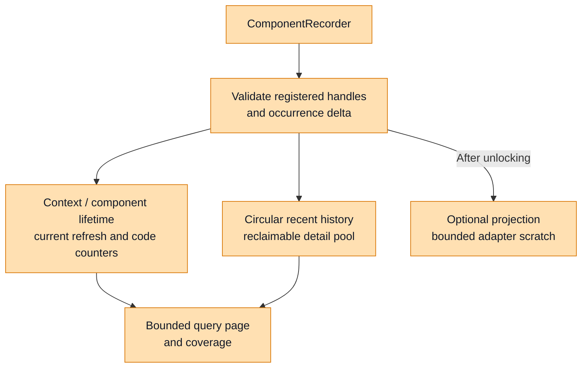
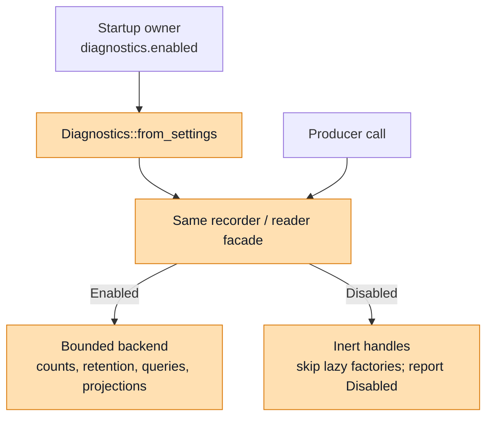
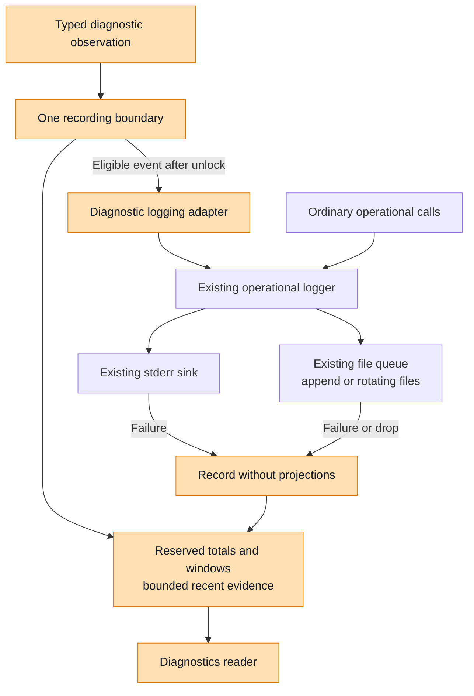
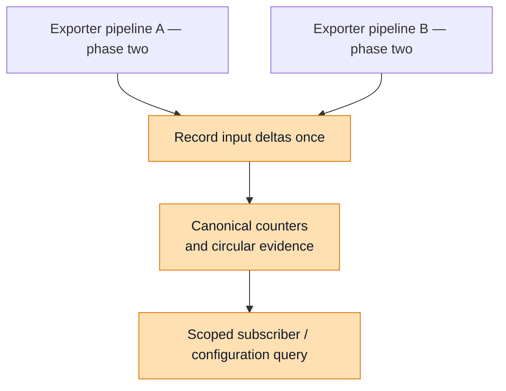
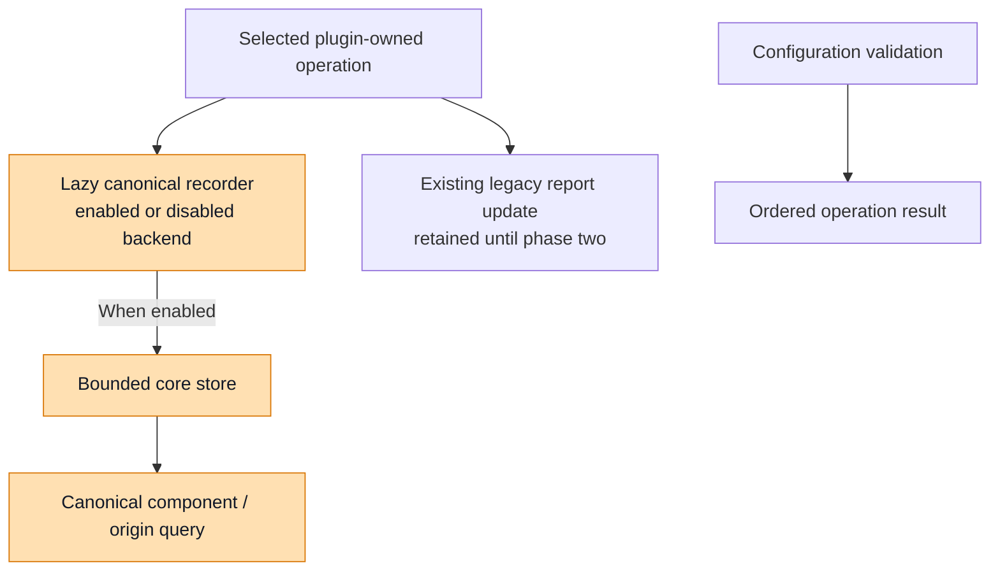

# Diagnostics Foundation Design

## Scope and Design Decisions

This design defines a shared diagnostics foundation in `nemo-relay-types` and
`crates/core` (`nemo-relay`, exposed as `nemo_relay`). Types owns portable identity,
classification, classifier interfaces, and read contracts. Core owns centralized
runtime enablement, registration, bounded state, timing, queries, and projections.
Operational logging retains its existing logger and sinks.

Phase one delivers one authoritative bounded store per enabled diagnostic context
for the producers migrated into it: logging and selected core/plugin operations.
OTel pipeline integration, diagnostic deduplication, and the shared legacy-report
cutover move to a separate phase. Existing OTel-dependent report state is an
explicit transitional exception, not part of the new service's store, coverage,
or memory guarantee.

This document describes the foundation implemented on
`bbednarski/diagnostics-phase-one`. Current contracts live in
[types](../../crates/types/src/diagnostics.rs), and registration, recording, and
bounded state live in [core](../../crates/core/src/diagnostics/mod.rs).
Rust examples remain architectural pseudocode; source files define exact APIs.
Historical source links to commit `bf89346d2363de2627f1918c4d1bc34910dae8c3`
identify the earlier prototype and migration baseline, not the current
implementation or a published contract on Relay main.

### Phase-One Scope and Deferred Reporting Cutover

Phase one implements the typed catalogue, the producer classifier trait, reserved
context/component lifetime totals, one current refresh summary, shared circular
history/detail storage, rolling windows, bounded reads, and projections. Logging and selected core/plugin producers use that service.
The startup setting `diagnostics.enabled` controls the complete new service;
it defaults to `false`. Diagnostics compiles normally, without a Cargo feature.

The canonical reporting contract intentionally changes report shapes, grouping,
and numeric representation. Its rollout is staged. Existing OTel caches, active
plugin report maps, `ConfigReport.runtime_diagnostics`, and mirrors needed by
those legacy readers remain until phase two can migrate their dependencies
together. Phase one adds no new compatibility ledger or alias machinery. An
already migrated plugin owner can record once in core and continue its existing
legacy-report update while old consumers remain; that legacy projection never
records another canonical occurrence.

The prototype already forwards OTel observations into a process-default core
context. That forwarding is not adopted as phase-one integration: remove or leave
it inactive when adapting the facade. OTel keeps its current subscriber reports,
plugin mirroring, delivery counters, flush/shutdown outcomes, and operational
output. A narrow compilation or facade adjustment is permitted to preserve those
paths; it must not create a partial canonical OTel bridge or replay report totals.
New core capability/coverage metadata identifies OTel as not integrated, rather
than treating absent OTel evidence as never observed or healthy.

Execution contracts remain owned by their operations: errors, retries,
cancellation, native statuses, stream completion/backpressure, daemon admission,
ordered validation/cleanup results, and controller reconciliation state retain
their meaning. The new runtime setting does not disable operational logging,
telemetry delivery, or legacy reports. During the later reporting cutover, native
payloads and worker messages change through explicit versions/capabilities,
without silently changing ABI layouts or protobuf tags.

### Recommended Approach

1. **Define producer classification contracts in types.** Owning crates implement
   pure adapters; stored classification remains fixed-size data.
2. **Select service enablement centrally at startup.** Producers receive the same
   facade and recorder interfaces in enabled and disabled modes.
3. **Make lifetime totals primary and reuse bounded evidence storage.** Context
   and component lifetime accounting survive reload and recent-event eviction.
   Context totals also survive closed-component reclamation. One current refresh
   summary resets in place; shared history/detail remain circular and optional.
   The [accounting scopes](#simplified-accounting-scopes) define reset boundaries.
4. **Reuse operational logging.** Preserve logger construction, filtering, sinks,
   delivery queues, rotation, emergency reporting, and shutdown.
5. **Stage OTel integration and deduplication separately.** Keep legacy-report
   dependencies explicit until the complete affected read path can migrate.

Retention is in memory. Persistence/replay and CPU attribution are future work.
Health, readiness, alerting, and recovery policy remain with the embedding or
deployment owner. The [sink architecture review](./diagnostics-sink-architecture-review.md)
provides the source inventory; its legacy stores are not implicitly included in
this foundation's allocation guarantee.

### Implementation Status

The working branch implements the phase-one foundation below. Later deployment,
OTel, and binding work remains staged as described in the delivery plan.

| Area | Implemented phase-one behavior | Later integration |
| --- | --- | --- |
| Contracts | Typed catalogue, producer classifier trait, lifetime/refresh summaries, and preserved observation origins. | Owning producer and transport rollout follows its phase. |
| Enablement | Runtime-only `DiagnosticsSettings.enabled`, default off; disabled handles skip factories and allocate no backend pools. | CLI/daemon configuration plumbing and public binding controls. |
| Accounting | Fixed context/component lifetime totals and one current `since_refresh` summary. Refresh preserves lifetime code counters and rolling windows. | Historical configuration aggregates require an explicit retention policy. |
| Storage | Preallocated component/counter/window slots, shared circular event history, and bounded detail/query/projection storage. No retired counting-period store. | Persistence and restart replay remain deferred. |
| Recording and output | One canonical recording boundary; existing logging outputs and selected plugin adapters are integrated. | OTel integration and report deduplication remain phase two. |
| Reading | One row per retained component instance; explicit lifetime/current-period scope and copied event-origin filters. | HTTP, deployment collection, and full binding/worker exposure follow later phases. |

Implementation references: [contracts](../../crates/types/src/diagnostics.rs),
[component state](../../crates/core/src/diagnostics/state.rs),
[refresh lifecycle](../../crates/core/src/diagnostics/lifecycle.rs), and
[bounded reads](../../crates/core/src/diagnostics/read.rs).

### Delivery Order and Foundation Exit Gate

Deliver in seven phases. The separate OTel/reporting phase follows the foundation
so its cleanup can precede broader deployment and language API rollouts.

| Phase | Delivery | Dependency |
| --- | --- | --- |
| **1. Runtime-controlled foundation and selected producers** | Types/classifier contract; core enablement, registration, bounded state, lifetime/refresh summaries, windows, queries/projections; logging and selected core/plugin adapters. | Canonical correctness for migrated scopes; existing OTel-dependent reports stay explicitly legacy. |
| **2. OTel diagnostics integration and report deduplication** | Integrate OTel through the common service; retire its cache and shared plugin mirrors/report attachments; migrate dependent existing readers together. | Preserve operation/delivery semantics; validate single recording and truthful ownership/coverage before deleting legacy state. |
| **3. CLI deployment integration** | Context/settings composition, command views, configuration plumbing, and common diagnostics HTTP adapter. | Reuse core enablement and readers. |
| **4. Daemon broker and Relay-worker integration** | Local contexts, deployment observations, authenticated collection, and bounded remote views. | Preserve provenance; replace cumulative snapshots without recounting them. |
| **5. Full language-binding integration** | Public context, settings, reader, query, and lifecycle features in affected bindings. | Existing-reader adaptations occur with the contract they migrate; full new features remain here. |
| **6. Dynamic-plugin worker integration** | Worker producers, SDK emission, observation identity, and negotiated bounded transport. | Shared classifier contracts; no mandatory core dependency for SDK emission. |
| **7. Cross-mode conformance and documentation** | Examples, migration guidance, and common semantics across completed surfaces. | Contract documentation and enablement behavior begin in phase one. |

Phase one must update consumers of any prototype/shared API it changes, but it
does not require retirement of the OTel-dependent report DTOs. Phase two accounts
for their coupled Rust/Python/Node/C/Go, native, and worker-host readers and
serializers. Until migrated, these remain explicitly legacy views; canonical
readers never silently fall back to them. During an actual capability retirement,
return an explicit unsupported result instead of an empty successful report.

Inspected reader coupling includes [Python](https://github.com/bbednarski9/NeMo-Relay/blob/bf89346d2363de2627f1918c4d1bc34910dae8c3/crates/python/src/py_types/observability.rs#L24),
[Node](https://github.com/bbednarski9/NeMo-Relay/blob/bf89346d2363de2627f1918c4d1bc34910dae8c3/crates/node/src/api/mod.rs#L966),
[C](https://github.com/bbednarski9/NeMo-Relay/blob/bf89346d2363de2627f1918c4d1bc34910dae8c3/crates/ffi/src/api/observability.rs#L39),
[native](https://github.com/bbednarski9/NeMo-Relay/blob/bf89346d2363de2627f1918c4d1bc34910dae8c3/crates/core/src/plugin/dynamic/native.rs#L1812),
and [worker-host](https://github.com/bbednarski9/NeMo-Relay/blob/bf89346d2363de2627f1918c4d1bc34910dae8c3/crates/core/src/plugin/dynamic/worker.rs#L3571)
report paths.

### Evidence and Health Ownership

The embedding application or deployment owner owns health classification,
readiness, alerting, and recovery policy. Relay records observed operation
outcomes, occurrence counts, timestamps, registration lifetimes, and coverage.
A diagnostic code identifies an observation; it is not an open issue that the
recorder must later close.

The foundation records evidence without an active/recovered condition model.
Failure recording has no activation side effect, and the common service has no
recovery operation or active-condition query. A subsequent successful operation
is independent evidence. It does not reset earlier failure counts or establish
that previously lost data was delivered. Recent events remain subject to eviction.

| Relay records | The owner decides |
| --- | --- |
| An export attempt failed, followed by a successful attempt. | Whether the exporter is sufficiently reliable for this application. |
| A sink rejected a write or a record was dropped. | Whether that loss affects application health or readiness. |
| A recording registration was created, closed, or replaced. | Whether the component is required and what action to take. |
| Evidence is unavailable, truncated, evicted, or saturated. | Whether the available evidence supports a health decision. |

## Design Overview: Shared Contracts in Types

`nemo_relay_types::diagnostics` defines the canonical authoring and read contracts.
Canonical runtime diagnostic views use these identities, codes, count semantics,
lifetime/refresh scopes, and coverage. Types has no logger handles, runtime
registry, or mutable store. Constructing or serializing a contract requires no logger initialization.

### Identity, Ownership, and Evidence Model

Lifetime accounting is the primary contract. A context keeps fixed totals for
its entire enabled lifetime. Each component instance keeps its own lifetime
totals, code counters, and one current `since_refresh` summary. A successful
reload resets that current summary and advances a generation/time marker. It
creates no archived counter or window store.

| Contract | Responsibility |
| --- | --- |
| `SourceIdentity` | Identifies one process or explicitly owned runtime incarnation. |
| `ComponentIdentity` | Identifies one registration and generation within that source. |
| `ComponentOwnership` | Bounded subscriber/plugin/configuration attribution for current refresh state or one observation's original context. |
| `DiagnosticTotals` | Fixed accepted-call, occurrence, eviction, and outcome counters, with saturation markers. |
| `DiagnosticLifetimeSummary` | Lifetime totals and monotonic timing for a context or component instance. |
| `DiagnosticRefreshSummary` | One current refresh generation, start time, ownership, elapsed time, and resettable totals. |
| `DiagnosticOrigin` | A copied refresh generation and bounded ownership for one observation, independent of the component's later refresh state. |
| `Classification` / registered code | Describes one canonical built-in or namespaced extension observation. |
| `DiagnosticClassifier<E>` | Pure producer interface returning classification values from a borrowed source error; implementations live in the owning producer crate. |
| `DiagnosticCounter` | Cumulative occurrences for one component instance and canonical code. |
| `DiagnosticEvent` | Recent evidence carrying its original component identity, origin metadata, and classification. |
| `DiagnosticWindow` | One fixed aggregate series with resolution and coverage for a component instance. |
| `DiagnosticCoverage` | Availability, saturation, retention boundaries, omission, and loss. |

The component's logical key describes its responsibility; UUID and registration
generation identify its incarnation. Counter identity is
`(source, component instance, canonical code)`. Configuration identity is
attribution metadata, not an additional counter dimension. Request/session IDs
remain optional correlation and never create aggregate keys. Failure classes
and parent domains do not automatically multiply the counter key space.

```rust
struct DiagnosticTotals {
    recorded_events_total: DiagnosticCount,
    occurrences_total: DiagnosticCount,
    history_evictions_total: DiagnosticCount,
    successes_total: DiagnosticCount,
    failures_total: DiagnosticCount,
    unspecified_total: DiagnosticCount,
}

struct DiagnosticLifetimeSummary {
    totals: DiagnosticTotals,
    elapsed_millis: DiagnosticNumber,
    last_failure_at: Option<ObservationTime>,
    since_last_failure_millis: Option<DiagnosticNumber>,
}

struct DiagnosticRefreshSummary {
    generation: DiagnosticNumber,
    started_at: ObservationTime,
    elapsed_millis: DiagnosticNumber,
    ownership: ComponentOwnership,
    totals: DiagnosticTotals,
}

struct DiagnosticOrigin {
    refresh_generation: DiagnosticNumber,
    ownership: ComponentOwnership,
}

struct DiagnosticSnapshot {
    schema_version: u32,
    catalogue_version: u32,
    source: SourceIdentity,
    captured_at: ObservationTime,
    sequence: DiagnosticNumber,
    lifetime: DiagnosticLifetimeSummary, // whole context, independent of selection
    components: Vec<ComponentSnapshot>,
    events: Vec<DiagnosticEvent>,
    coverage: DiagnosticCoverage,
    continuation: Option<DiagnosticCursor>,
}

// One row per retained component registration.
struct ComponentSnapshot {
    identity: ComponentIdentity,
    registered_at: ObservationTime,
    closed_at: Option<ObservationTime>,
    lifetime: DiagnosticLifetimeSummary,
    since_refresh: DiagnosticRefreshSummary,
    counters: Vec<DiagnosticCounter>, // component-instance lifetime
    windows: Vec<DiagnosticWindow>,   // component-instance rolling time series
}
```

The context lifetime summary is updated directly at the recording boundary. It
survives component replacement, closed-registration reclamation, history eviction,
and configuration refresh. It must not be derived by summing retained component
rows: those rows have bounded retention and can disappear. A new context starts
new context totals; a new component registration starts new component totals.
Refresh leaves both lifetime scopes and per-code lifetime counters unchanged.

Component `lifetime` describes the full instance across configurations.
`since_refresh.ownership` describes only the current counting period; it does not
relabel earlier lifetime observations as belonging to the latest configuration.
Each recent event contains its own copied `DiagnosticOrigin`, so an old
configuration's evidence remains correctly attributed after reload. Retaining
that metadata requires no historical aggregate row. Origin filters can return
old observations even when no component's current ownership matches them.

One authoritative store exists per context, not across all processes. Counts
describe observations at their owning boundaries, not unique incidents summed
across pipeline stages. Reading or presenting a cumulative value through another
scope never creates another occurrence. The canonical model covers migrated
producers only; deferred OTel evidence continues through explicitly legacy
reports until phase two.

`DiagnosticNumber` remains a lossless unsigned decimal string in JSON, and
`DiagnosticCount` exposes saturation as a lower bound. Coverage distinguishes
available, never-observed, unavailable, and unsupported evidence. Public `Vec`
and `String` fields describe bounded query output, not internal slot layout.
Constructing or serializing these values requires no logger initialization.

### Simplified Accounting Scopes

The foundation answers three primary questions: what the context has observed,
what one component instance has observed, and what has been observed since its
latest refresh. A generation marks that reset boundary and preserves event
origin. It does not name another retained numeric store. Each component has one
query row and one optional rolling outcome window.

A refresh boundary provides counts since the latest committed reload. It does
not require preserving a separate counter set or window for every earlier
configuration. The generation identifies event origin and the current reset
boundary; it adds no aggregate-key dimension or per-refresh allocation.

| State | Counting or retention scope | Reset or reclamation rule |
| --- | --- | --- |
| Context lifetime totals | All accepted observations in one context | New context only |
| Component lifetime and code totals | One registration across configuration reloads | New component instance; closed rows have bounded retention |
| `since_refresh.totals` | Observations and eviction activity after the latest refresh | Reset in place on committed refresh |
| Rolling outcome window | Fixed time buckets for one component instance | Buckets age out; refresh preserves the window |
| Recent events and detail | Shared bounded evidence with copied original attribution | Oldest evidence is evicted under pressure |

For example, a component reports 100 failures, refreshes, then reports three
more. Its lifetime `failures_total` is 103 and its `since_refresh` value is three.
Evicting those event details changes neither value. Reclaiming the closed
component removes its row, while the context lifetime failure total still
includes all 103 failures. A replacement component starts its own lifetime at
zero and contributes new observations to that same context total.

Exact historical per-configuration aggregate reports are deferred until a
consumer requires an explicit retention policy. Bounded closed-registration
retention continues to support recent inspection. Recent-event eviction preserves
a retained component's totals; closed-component metadata reclamation preserves
the context totals after that component row disappears.

### Lifetime and Since-Refresh Summary Counters

Reserve the same six-field `DiagnosticTotals` shape once for the context
lifetime, once for each component lifetime, and once for each component's current
refresh summary. These are fixed numeric fields, independent of recent evidence
or the number of reloads. There is one registered code-counter set per component
instance; the refresh summary does not duplicate it.

| Counter | Update rule |
| --- | --- |
| `recorded_events_total` | Add one per accepted recording call, including calls whose evidence is truncated or omitted. |
| `occurrences_total` | Add the accepted positive occurrence delta. |
| `history_evictions_total` | Add one when a previously retained event is evicted; attribute component accounting to the displaced event's original component instance. |
| `successes_total` | Add occurrence deltas whose operation explicitly succeeded. |
| `failures_total` | Add occurrence deltas whose operation explicitly failed. |
| `unspecified_total` | Add occurrence deltas without an established operation outcome. |

One call with `count = 100` adds one recorded event and 100 occurrences while
needing at most one history header. Rejected attempts, queries, projections, and
ordinary operational log calls do not increment accepted totals. Dropping incoming
evidence before retention, or truncating its detail, is separate loss accounting
and is not a history eviction. Each counter saturates independently and exposes
its lower-bound marker.

`since_refresh` uses observation time: every accepted record made after the
refresh updates the current summary, including a completion whose captured
origin belongs to an earlier configuration. The event still carries that older
origin. Current refresh `history_evictions_total` counts evictions occurring
since the refresh, charged to the displaced event's original component, even
when that event was recorded before the reset. Context and component lifetime
counts remain cumulative. A fresh summary starts at zero without reconstructing
or subtracting saturated lifetime counters.

Context and component lifetime values remain monotonic across refreshes. A
successful refresh resets only `since_refresh.totals`, updates its start time,
ownership, and generation, and uses the same reservation. Polling, failed
candidate activation, output filtering, and evidence reclamation never reset
these summaries. Compare component lifetime `recorded_events_total` deltas over
the same interval and instance to identify large producers after their details
have been evicted. Saturated counters cannot provide an exact delta.

Summary scopes are explicit: the envelope covers the whole context, component
lifetime covers the whole component instance, and `since_refresh` covers its
current counting period. Code, family, failure-class, origin-generation, and
event-cursor filters do not transform these summaries into matching-event totals.

### Core Design: Typed Classification Catalogue

The catalogue is the authoritative diagnostic vocabulary. Producers migrate to
registered canonical codes directly; canonical responses do not retain a second
legacy identity. Existing legacy reports keep their own codes until phase two. Existing operation-error types still carry return values, source
chains, and execution behavior. Pure classifiers interpret those source errors
where necessary. [Appendix A](#appendix-a-source-classification-and-replacement-inventory)
inventories source evidence, canonical destinations, and reporting surfaces to
retire. All catalogue types and mappings remain proposed implementation work.

The model separates three dimensions:

| Dimension | Responsibility | Example |
| --- | --- | --- |
| Code hierarchy | Identifies the observed event and its owning subsystem. | Plugin / Worker / ProtocolMismatch. |
| Failure class | Identifies a general cause when supported by evidence. | Incompatible, Timeout, InvalidInput, or Unknown. |
| Observation context | Identifies the component instance, operation, and lifecycle phase. | Plugin instance, invocation, runtime phase. |

Nested enums provide composition and broad matching in Rust. A worker-specific
code belongs to the plugin family; a consumer can select that family without
recording a second parent event. Component implementation language is metadata.
A Rust plugin may use either the native ABI or the worker protocol. A dynamic
plugin worker and the daemon's Relay worker process have different owners; the
latter belongs to deployment diagnostics.

```rust
// Proposed authoring contracts in nemo-relay-types::diagnostics.
// All enum payloads are fixed-size classifications, not allocated error text.
#[derive(Clone, Copy, Debug)]
#[non_exhaustive]
enum BuiltinDiagnosticCode {
    Failure(FailureCode),
    Success(SuccessCode),
    Notice(NoticeCode),
}

#[derive(Clone, Copy, Debug)]
#[non_exhaustive]
enum FailureCode {
    Runtime(RuntimeFailureCode),
    Configuration(ConfigurationFailureCode),
    Plugin(PluginFailureCode),
    Upstream(UpstreamFailureCode),
    Observability(ObservabilityFailureCode),
    Logging(LoggingFailureCode),
    Deployment(DeploymentFailureCode),
    Binding(BindingFailureCode),
}

#[derive(Clone, Copy, Debug)]
#[non_exhaustive]
enum PluginFailureCode {
    Common(CommonPluginFailureCode),
    Native(NativePluginFailureCode),
    Worker(WorkerPluginFailureCode),
}

enum CommonPluginFailureCode {
    ConfigurationInvalid, RegistrationFailed, RegistrationConflict, StateConflict,
    ResourceNotFound, InvocationFailed, SerializationFailed, Internal,
    ConfigurationVersionUnsupported, ComponentUnknown, ConfigurationFileMissing,
    ConfigurationSchemaFailed, IntegrityCheckFailed, AttestationFailed,
    PolicyRejected,
}

enum NativePluginFailureCode {
    LibraryLoadFailed, EntryPointMissing, AbiMismatch,
    ValidationFailed, CallbackPanicked, AbiCallFailed,
}

enum WorkerPluginFailureCode {
    LaunchFailed, HandshakeFailed, ProtocolMismatch, ConnectionLost,
    TransportFailed, ResponseInvalid, ProcessExited, ConfigurationMismatch,
    InvalidInput, SerializationFailed, RemoteError, RemoteSdkError,
    InvocationTimedOut, RpcFailed,
}

// Leaf derives are omitted here; all classification enums remain Copy.
// Other initial leaf enums are enumerated by the mapping rows in Appendix A.
// Domains with no mapped producer are expansion points, not empty enums to ship.
enum FailureClass {
    InvalidInput, InvalidState, NotFound, Conflict,
    Authentication, PermissionDenied, Unsupported, Incompatible,
    Timeout, Unavailable, ResourceExhausted, Io, ExecutionFailed,
    PolicyRejected, Internal, Unknown,
}

// Built-in authoring form; extension recording uses an admitted extension handle.
struct Classification {
    code: BuiltinDiagnosticCode,
    failure_class: Option<FailureClass>,
}
// Constructors enforce Some(class) for Failure and None for Success/Notice.
// FailureClass::Unknown means a failure is observed but its cause is unknown.

// Context does not multiply the code catalogue.
enum PluginExecution { NativeAbi, WorkerProtocol }
enum PluginPhase { Validation, Activation, Runtime, Policy }
// Adapt the existing DynamicPluginFailurePhase into PluginPhase explicitly.
// Keep operation and execution facts on bounded registration/observation metadata.
```

`SuccessCode` initially covers logging initialization/shutdown, sink initialization,
and catalogue entries for `ExportSucceeded(Signal)` for logs, traces, and metrics.
OTel entries describe the deferred phase-two vocabulary, not phase-one producers.
`NoticeCode` initially
covers `ConfigurationInherited`, `ComponentReenabled`, `GuardrailRejected`,
`WorkerCancelled`, `NativeStreamEnded`, `NativeStreamBackpressured`, and
`CompletedContextExpired(Signal)`. Cancellation or an
expected guardrail decision alone does not establish a failing subsystem.
Severity, operation outcome, and failure class remain separate. Classifications
never set health, readiness, retryability, or recovery state.

Methods such as `code.domain()`, `code.plugin_family()`, and
`code.canonical_name()` derive parent classifications and stable names from one
catalogue entry. Parent queries select existing observations; they do not record
additional occurrences. A producer cannot supply a conflicting independent
parent domain. A common plugin invocation error stays in `Plugin::Common` even
when its execution context is a worker. Worker and native leaves describe facts
specific to those mechanisms.

Each catalogue entry specifies its allowed classes. For example, an observed ABI
mismatch has class `Incompatible`; a generic invocation failure may have class
`Timeout`, `ExecutionFailed`, or `Unknown` depending on the originating evidence.
Adapters select only supported classes. They never infer a timeout, exception
class, permission failure, or ABI mismatch by searching arbitrary message text.

The following aliases keep the recording examples concise. They name catalogue
values, not additional public enum variants:

```rust
const LOG_EXPORT_FAILED: BuiltinDiagnosticCode = BuiltinDiagnosticCode::Failure(
    FailureCode::Observability(ObservabilityFailureCode::ExportFailed(Signal::Logs)),
);
const LOG_EXPORT_SUCCEEDED: BuiltinDiagnosticCode = BuiltinDiagnosticCode::Success(
    SuccessCode::ExportSucceeded(Signal::Logs),
);
const SINK_WRITE_FAILED: BuiltinDiagnosticCode = BuiltinDiagnosticCode::Failure(
    FailureCode::Logging(LoggingFailureCode::SinkWriteFailed),
);
// Explicit catalogue mappings preserve existing names where they already fit:
// LOG_EXPORT_FAILED -> "otel.logs_export_failed"
// LOG_EXPORT_SUCCEEDED -> "otel.logs_export_succeeded"
// SINK_WRITE_FAILED -> "logging.sink.write_failed"
```

### Classification at the Source

Define the shared classifier contract in `nemo_relay_types::diagnostics` alongside
`Classification`. The interface is independent of core state, logging, recording,
and transport. Each producer crate implements it through a local adapter type,
where structured source evidence is still available.

```rust
// Proposed portable contract in crates/types.
pub trait DiagnosticClassifier<E: ?Sized> {
    fn classify(&self, error: &E) -> Classification;
}

// Local adapter in crates/core; actual mappings follow Appendix A.
struct FlowErrorClassifier;

impl DiagnosticClassifier<FlowError> for FlowErrorClassifier {
    fn classify(&self, error: &FlowError) -> Classification {
        match error {
            FlowError::Upstream(failure) => classify_upstream(failure.class),
            FlowError::CallbackException { .. } => failure_classification(
                BindingCallbackException, FailureClass::ExecutionFailed,
            ),
            other => classify_runtime_variant(other),
        }
    }
}

fn on_operation_failure(error: &FlowError, recorder: &ComponentRecorder) {
    let _ = recorder.record_without_projection_lazy(|| classified_observation(
        FlowErrorClassifier.classify(error), safe_bounded_detail(error), 1,
    )); // handle recording disposition separately; preserve the operation error
}
```

Core owns adapters for runtime, plugin/native, and logging errors integrated by
phase one. CLI, binding bridges, and worker SDKs implement their classifiers in
their corresponding integration phases. OTel classifiers and pipeline wiring
belong to phase two. Types imports none of those concrete errors or frameworks.
Local adapters accommodate third-party errors without requiring an implementation
of a foreign trait on a foreign error type.

Ordinary concrete calls are the default; a borrowed
`&dyn DiagnosticClassifier<FlowError>` can support runtime selection inside a
producer if needed. No trait object or source error is retained in an event,
counter, or wire response. `FailureClass` remains an enum and `Classification`
remains fixed-size data. The trait stays usable when collection is disabled.
Direct typed observations need no classifier implementation, and extension-code
producers continue using admitted extension handles rather than inventing a
built-in code to fit this built-in classification form.

Classification borrows evidence and returns metadata only. It never records,
logs, retries, sets health, or changes the operation's outcome. A disabled
recorder does not invoke a lazy classification/detail factory. When enabled,
classify before a boundary flattens information; generic remote strings retain
conservative unknown causes, without arbitrary message-text inference.

A Switchyard-owned adapter can classify its structured upstream summary before
native conversion. Provider failures belong to Upstream; algorithm, translation,
configuration, and plugin infrastructure keep their actual domains. Core gains
no dependency on Switchyard. The operation owner still records once; classifier
invocation, query, encoding, and presentation are not additional occurrences.

### Canonical Wire Representation

Each canonical observation response carries classification directly alongside
its component identity and original refresh/configuration metadata.

```rust
// Canonical read DTO: the classification is part of the observation itself.
struct DiagnosticEvent {
    sequence: DiagnosticNumber,
    component: ComponentIdentity,
    origin: DiagnosticOrigin,
    classification: ClassificationWire,
    outcome: DiagnosticOutcome,
    severity: DiagnosticSeverity,
    count: DiagnosticNumber,
    detail: Option<DiagnosticDetail>,
    // Source time and safe correlation omitted here.
}

struct ClassificationWire {
    canonical_code: String,          // bounded built-in name or namespaced extension
    failure_class: Option<String>,  // bounded unknown values remain representable
}
```

The snapshot envelope carries independent wire-schema and catalogue versions.
Both initial version constants are `1` in the
[contracts](../../crates/types/src/diagnostics.rs); neither denotes a revision of
this design document or assumes an earlier published snapshot contract. Known failures have a supported
cause class or `unknown`; successes and notices do not acquire a failure class.
Classification is required even when detail is unavailable. Extension codes
resolve through bounded registration metadata rather than a legacy alias dictionary.

Authoring enums remain fixed-size typed values. Wire names or separately assigned
numeric IDs are explicit and stable, never Rust enum order or memory layout.
`#[non_exhaustive]` is Rust source evolution support, not wire negotiation.
Unknown future codes/classes remain bounded opaque values in a supported envelope;
an unsupported schema is rejected explicitly. Catalogue and snapshot versions
have separate meanings. Counts, sequences, and other `DiagnosticNumber` values
use lossless decimal strings in JSON; schema/catalogue version fields remain
ordinary bounded integers. Compact binary DTOs use integer fields at their
transport boundary.

The reporting break removes the need to preserve old query DTO shapes and exact
message/code breakdowns. Stable identifiers, bounded decoding, version selection,
and truthful coverage are still requirements of the new contract.

### Extension Codes and Shared Record Metadata

Built-in producers use the catalogue. Third-party producers register namespaced
extension codes with bounded names, descriptors, and class metadata; the same
unqualified string from unrelated plugins does not establish shared meaning.
Limit registration count and total metadata bytes. A typed extension handle is
resolved once during registration and reused during recording.

Move variable metadata keys, request IDs, paths, and messages into bounded detail
or correlation. They do not create new code identities. Excess classifications
use reserved overflow accounting. Canonical producers no longer need
`legacy.code.<sha256>` aliases or maps preserving obsolete report groupings.

Identity, severity, timestamps, correlation, bounded copying, and loss primitives
can be reused by ordinary operational logs. Sharing these mechanisms does not
automatically retain or count every log call. Recorder admission failures remain
separate from observed operation failures and never recursively emit diagnostics.

Code descriptors, allowed classes, and identity metadata are stored once behind
compact internal handles. Each observation retains its actual failure class;
that class cannot be reconstructed from the code or latest occurrence. Counters
retain numeric state; optional detail lives in the circular history pool. Public
pages resolve the metadata into the canonical wire model.
See [Appendix A](#appendix-a-source-classification-and-replacement-inventory) for
the source inventory and the [migration gates](#a8-canonical-cutover-and-release-gates).

## Design Overview: Recording, State, Queries, and Projections in Core

`nemo_relay::diagnostics` turns the portable contracts into an independently
owned service. A runtime owner creates `Diagnostics`, gives each producer a
scoped `ComponentRecorder`, and gives consumers a `DiagnosticsReader`.
Recording and reading use the same service, while consumers have no write
authority through their reader handles. The storage, counting, and recording
requirements below describe the enabled backend; the disabled facade follows
[central runtime enablement](#centralized-runtime-enablement) without allocating
that backend.

Evidence is held in process memory. Keeping the service independent of logging
allows startup and teardown inspection; it does not provide persistence across
process exit or establish global health, admission, retry, or restart policy.

The diagram shows the target recording boundary: reserved numeric updates,
optional recent evidence, and optional projection after the state lock is
released. Projection delivery does not require the event to remain in history.
History pressure must not undo an admitted summary update.



Orange identifies the shared foundation or its integration points in these
diagrams. Each diagram describes one component's responsibilities rather than
an entire deployment topology.

### Centralized Runtime Enablement

Diagnostics compiles as ordinary Relay code. Phase one adds no Cargo feature.
The runtime/process owner reads the startup setting
`diagnostics.enabled` once, defaulting to `false`, and constructs a context through
one settings-aware factory. Explicit embedded contexts can deliberately choose
their own setting. CLI, daemon, and binding configuration layers later map to
that same core setting; they do not create competing enablement mechanisms.

```rust
struct DiagnosticsSettings {
    enabled: bool, // false by default for the new service
    limits: DiagnosticLimits,
}

// Composition/bootstrap owns this choice. Producers receive handles only.
let diagnostics = Diagnostics::from_settings(source, startup.diagnostics)?;
let reader = diagnostics.reader();
let recorder = diagnostics.register_component(registration)?;

let outcome = recorder.record_without_projection_lazy(|| {
    // Executed synchronously only by an enabled recorder.
    classified_observation(classifier.classify(&error), bounded_detail(&error), 1)
});
```

Internally the facade selects an enabled or disabled backend once per context.
`Diagnostics`, `ComponentRecorder`, and `DiagnosticsReader` remain available in
both modes. Producers do not store optional service handles, query `is_enabled`,
poll liveness, or scatter configuration checks around record calls. Context
composition handles enablement and component-construction policy centrally;
enabled admission errors remain explicit and distinct from intentional disablement.

| Operation | Enabled context | Disabled context |
| --- | --- | --- |
| Component registration | Reserve component lifetime/refresh summaries and code capacity and return a recorder, or report admission failure. | Return a disabled recorder without allocating registry, summary, counter, event, detail, or window storage. No active component identity is manufactured. |
| Recording | Validate and update reserved state, then attempt evidence/projection. | Return `RecordOutcome::Disabled`; invoke no lazy factory and update no counts, sequences, loss state, history, or projections. |
| Reading | Return bounded canonical evidence and coverage. | Return an explicit disabled read outcome/reason instead of an available or never-observed empty snapshot. |
| Projection subscription | Admit bounded subscription state and return its guard. | Return an inert guard without registering callbacks or delivery workspaces. |

The central selection is illustrated below. Producer calls use the recorder
interface in both modes; backend selection is owned by startup composition.



Disabled recording is a normal disposition, not a dropped observation or a
health failure. It must not fabricate a recorded receipt with zero identifiers.
Readers and later transports expose configured disablement explicitly. No
recording backfill or replay occurs when a later context is enabled.

Lazy observation/detail APIs place the decision inside the facade, before
classification or formatting. Factories execute synchronously and are not queued
or retained. Enabled factories accept borrowed data or bounded writer inputs;
unrestricted `format!` followed by truncation does not satisfy the allocation
bound. An eager `record(observation)` convenience can discard an already-built
value while disabled, but cannot undo allocations made by its caller; built-in
phase-one producers use the lazy path for diagnostic-only work.

The process-default convenience must use the centrally selected startup mode.
Install that context before issuing default handles. It cannot lazily create an
active backend or let logger/plugin construction auto-enable diagnostics. An
unconfigured early access yields disabled handles; later installation must report
an already-initialized error or require a new explicit context, never silently
upgrade those handles. Missing configuration yields disabled mode. Startup
selection is immutable for that context in phase one: changing enablement
requires constructing a new context or restarting its owner, rather than a hot
toggle over existing handles. Ordinary configuration reloads refresh current
component summaries in place without changing lifetime totals or enablement.

The setting controls the complete new service: backend allocation, registrations,
retention, windows, query materialization, and projections. Disabled mode retains
only lightweight facade/source/configuration state and handles, not diagnostic
backing pools or a background service. This is not a promise of zero process
allocation; operational logging, real operation errors, and legacy OTel/plugin
reports keep their existing independent behavior and budgets.

### Reuse Boundaries: Six Shared Interfaces

Core owns local recording, retention, and query semantics. The hosting application
owns composition, transport, and interpretation. These six interfaces describe
capabilities within the existing crates and modules; they do not require six new
classes or a separate diagnostics crate. `Diagnostics`, `ComponentRecorder`, and
`DiagnosticsReader` remain the primary core handles. The compact store, detail
pool, indexes, and bucket implementation remain private to core.

The directions below are proposed integration requirements. Existing source
links identify reusable entry points rather than completed cross-crate wiring.
Shared catalogue and wire contracts belong in types; concrete error adapters stay
with the subsystem that understands the original error.

#### 1. Context Construction and Injection

The owner calls `Diagnostics::from_settings` before logging/component setup and
passes that context's recorder/reader handles to the producers it composes.
The same call pattern works when disabled. A CLI wrapper and gateway share their
process context; broker and Relay-worker processes have separate contexts;
short-lived commands need no HTTP listener. Separate embedded contexts are an
explicit host choice and have separate enabled-state budgets.

Reuse `LoggingRuntime::configure_with_diagnostics` with this selected context.
Selected core/plugin producers gain context-aware construction in phase one.
OTel injection and its producer adapters move to phase two. The process-default
facade follows startup settings and must never silently initialize an active
service. Enabled canonical readers cannot merge evidence from unrelated defaults
or fall back to legacy report stores.

Inspected seams include [service construction](https://github.com/bbednarski9/NeMo-Relay/blob/bf89346d2363de2627f1918c4d1bc34910dae8c3/crates/core/src/diagnostics/mod.rs#L335),
[logging context injection](https://github.com/bbednarski9/NeMo-Relay/blob/bf89346d2363de2627f1918c4d1bc34910dae8c3/crates/core/src/logging/mod.rs#L146),
and the [prototype OTel default lookup](https://github.com/bbednarski9/NeMo-Relay/blob/bf89346d2363de2627f1918c4d1bc34910dae8c3/crates/core/src/observability/otel_signal.rs#L126),
whose bridge is inactive pending the deferred integration.

#### 2. Component and Code Registration

For an enabled context, core admits a registration only after reserving its
component lifetime/current-refresh summaries, declared lifetime code counters,
bounded current metadata, and one optional rolling window. Types supplies the
catalogue, classification metadata, and portable identity contracts. Registration
returns compact recording handles with generation checks; callers do not manage
slots, arenas, eviction, or byte accounting themselves.

Register the codes a component uses. Dynamic extensions include a bounded producer
namespace and registration metadata, with reserved overflow accounting when
classification capacity is exhausted. Request IDs, arbitrary fields, messages,
and failure-class combinations must not create an uncontrolled aggregate-key
product. Parent catalogue families are selectors over existing observations.

CLI, bindings, and core components all reuse this registration mechanism. They
may choose a component's logical key and declared capabilities, but do not add
independent counter maps or recent-history stores. Registration admission failures
remain separate from observed failures and do not recursively generate events.

#### 3. Pure Classification Adapters

Types owns `DiagnosticClassifier<E>`, the nested catalogue, allowed classes, and
wire names. Producer-owned local adapters implement the trait and return fixed
`Classification` values without recording, formatting unrestricted strings,
transporting, or changing operation results. Direct typed observations and
admitted extension handles remain valid authoring paths.

Core implements phase-one runtime, plugin/native, and logging classifiers. OTel
implementations move to phase two; CLI, binding, and SDK adapters follow their
owning integration phases. Borrowed dynamic dispatch is optional inside the
producer, never part of retained state or the wire model. Structured evidence
selects causes; generic messages remain unknown. No classifier sets health,
readiness, retryability, or recovery policy. The [source inventory](#appendix-a-source-classification-and-replacement-inventory)
identifies the owner and destination for current and future mappings.

#### 4. Single-Owner Observation Recording

The owner of an observed operation crosses the recording boundary once, using a
registered code, explicit outcome, positive occurrence delta, and bounded detail.
Core updates reserved summaries and counters, appends recent evidence by reusing
circular slots and reclaimed detail blocks, and returns the disposition. Full
history or omitted detail does not roll back an accepted total. Queries, output
projections, and language/protocol conversions do not count it again. There is
no forwarding between mutable runtime report stores.

Reuse the prototype diagnostic logging adapter, existing logger, and sinks. A
producer with an established operational emitter uses `record_without_projection`;
a migrated producer can use the shared projection as its emitter. This method
bypasses all optional projection callbacks, not only logging. Sink feedback uses
the same method; canonical readers still see its accepted evidence. Ordinary
operational records can share identity and bounded-field helpers without automatically entering diagnostic retention.
History and delivery remain independently budgeted.

A Relay (worker) deployment process uses core in the same way as another Relay
host. The dynamic-plugin `worker` SDK has a different boundary: it currently
[depends on types and worker-proto, not core](https://github.com/bbednarski9/NeMo-Relay/blob/bf89346d2363de2627f1918c4d1bc34910dae8c3/crates/worker/Cargo.toml#L15).
Its default integration should classify portable observations and use a narrow
SDK producer/callback with bounded transport. Do not duplicate the core store or
require core merely to emit an observation. Independent worker-local retention
would require an explicit optional core-backed integration in the later phase.

Transported observations require an explicit recording owner and provenance.
Until observation identity is carried end to end, host and worker must not both
count the same operation or assume automatic deduplication. Host-observed RPC
failures and remotely reported worker evidence retain their actual attribution.

#### 5. Bounded Reading and Transport Views

Types defines portable selection and response contracts: source/component
identity, origin metadata, catalogue filters, coverage, and supported
schema/catalogue versions.
Core executes those selections through `DiagnosticsReader`, enforcing workspace
admission, page limits, continuation validation, and bounded serialization.
Internal handles and page permits do not become HTTP or language DTO fields.
The prototype core `DiagnosticQuery` is an integration starting point, not an
already implemented cross-mode wire contract.

Implement the common HTTP adapter once within CLI and reuse it in gateway,
broker, and Relay-worker servers. Hosts supply authorization, listeners, route
mounting, cancellation, and deadlines. Language bindings wrap the same core reader
with language-specific lifetime and conversion handling; they need no HTTP
server or second query engine. Observational daemon status fields can migrate to
canonical views; discovery, credentials, and readiness/admission control retain
their operational meaning. Diagnostic reads never activate admission, reset a
refresh summary, or apply a deployment health decision. Query selectors are not
authority:
HTTP, binding, native, and worker adapters intersect requested selection with the
scope granted by their host. Continuations retain that scope and cannot widen it.

A broker collector preserves each source's identity, capture/receipt time,
refresh markers, summary scopes, and availability. Polling replaces cumulative
views keyed by source, component instance, and code; it does not submit snapshot
totals as new occurrence deltas. Context lifetime totals are source values, not a
sum of the collector's currently retained component rows.
A collection cache has its own bounded allowance. Broker-observed state is not
silently presented as worker-local evidence.

Worker-proto owns the versioned canonical diagnostic messages; SDK and host
adapters own encoding, authorization, and unsupported-version handling. Existing
legacy query consumers move with the phase-two reporting cutover; full worker
producer transport remains phase six. The existing
[worker diagnostics client](https://github.com/bbednarski9/NeMo-Relay/blob/bf89346d2363de2627f1918c4d1bc34910dae8c3/crates/worker/src/lib.rs#L1411)
queries host runtime diagnostics; it is not a worker-local collection endpoint.
New worker observation paths must declare direction and provenance explicitly.

#### 6. Authorized Lifecycle and Refresh Transitions

The runtime, plugin-host, or configuration owner announces successful activation,
replacement, reload, and closure. Core implements registration identity,
monotonic lifetime timing, one resettable refresh summary, and stale-registration
checks. The owner chooses when activation has committed. A reader cannot change
producer lifecycle, and an ordinary recorder cannot reset counters or service
configuration.

`ComponentOwner::refresh(ownership)` advances the current refresh generation,
updates its time/ownership marker, and clears only its fixed current-period
totals. Context lifetime, component lifetime, per-code counters, and the rolling
window keep their existing values. It does not reserve another summary, copy a
counter set or window, or create historical aggregate rows. Failed candidate
activation and polling leave the current period unchanged. An actual component
replacement uses a fresh component registration and instance identity.

An operation can call `ComponentRecorder::capture_origin()` to obtain an
`OriginRecorder` containing its original bounded ownership and refresh generation.
Its completion preserves that origin in recent evidence even if the component
has since refreshed. A refresh does not make that operation stale and does not
require retaining a historical numeric summary. Closed or reclaimed component
registrations remain explicit stale-handle errors. Captured origin metadata is
caller-owned operation state and cannot pin backend history or registrations
beyond the normal recorder lease.

A late completion increments context lifetime, component lifetime, and the
current `since_refresh` summary at its observation time. Its captured original
ownership/generation is evidence metadata, not an aggregate key and not the
current owner's identity. Outcome windows likewise count at observation time.
This makes “since refresh” a time-based measure of received observations rather
than a claim that all work originated under the latest configuration.

Final-recorder drop continues to close the registration; a reader does not keep
it open. Closed component state and dependent evidence have bounded retention.
Reclaiming them updates loss accounting while the fixed context lifetime totals
remain available. Refresh generation, registration generation, and source
sequence never wrap into a previously valid value; exhaustion is explicit.

Runtime code, CLI orchestration, and binding lifecycle helpers reuse these same
transitions. Readiness, restart decisions, and health stay with the embedding or
deployment owner. Retention remains in memory; transport adapters add no implicit
persistence. Exact historical configuration-period summaries are future work
requiring an explicit consumer and retention policy.

### Ownership and Producer Lifecycle

The following pseudocode uses the implemented core entry points and abbreviates
classification/detail helpers. Enabled registration reserves lifetime/current-refresh
summaries and declared-code capacity. The service can observe startup failure
before operational logging exists. A reader keeps the service's
evidence accessible without keeping a component registration open.

```rust
let diagnostics = Diagnostics::from_settings(source_identity, startup.diagnostics)?;
let reader = diagnostics.reader();
let sink = diagnostics.register_component(ComponentRegistration {
    key: "logging.file_sink",
    builtin_codes: &[
        SINK_WRITE_FAILED,
    ],
    // Summary and these code counters are reserved together.
})?;
let outcome = sink.record_without_projection_lazy(|| classified_observation(
    Classification::failure(SINK_WRITE_FAILED, FailureClass::Unknown),
    "Operational log delivery failed", 1,
))?;
// In enabled mode the reserved summary updates even if detail is dropped.
// Recorded receipts report Retained, Truncated, or Dropped evidence.
// Disabled mode returns Disabled without invoking the factory or counting.
// Local acceptance does not acknowledge log or collector delivery.

let snapshot = reader.snapshot(DiagnosticQuery {
    component_key: Some("logging.file_sink"),
    ..DiagnosticQuery::default()
})?;

drop(sink);
// In enabled mode the final recording handle closes the registration.
// A reader can inspect retained evidence, or report configured disablement.
```

Cloned recorders share one registration lease. Explicit `close()` or dropping
the final recorder closes that recording registration and retains its bounded
evidence. Closure does not classify the underlying component's health or prove
that a process exited. Registering the same logical key again creates a fresh
instance and lifetime totals. Explicit ownership supports isolated runtime
contexts; any process-default convenience uses the same canonical registration
and read path rather than preserving another reporting implementation.

The process default survives logging reconfiguration and plugin replacement.
Its role defaults to `runtime`; deployment owners can supply a specific source
role when they compose the service. That source lifetime is separate from
component lifetime and refresh scopes. Source-local sequences order updates when
wall-clock timestamps coincide or change. Replacing a component creates a new
registration; a successful configuration reload resets only its current refresh
summary while the instance and lifetime counters remain in place. Sequences
order source updates; they are not event counters, because lifecycle and retention
changes can also advance them. Registration/refresh generations and sequences
must not wrap into a previously valid identity. Exhaustion produces an explicit unavailable/error outcome rather than
allowing a stale handle or continuation to resolve to replacement state.

### One Recording Boundary and Independent Retention

An observation contains a registered canonical code/classification, severity,
outcome, safe detail, positive occurrence delta, and optional correlation.
The catalogue resolves parent families without creating extra observations.
Failure class describes supported cause evidence and does not determine outcome.
Known notices such as cancellation retain explicit notice handling; adapters must
not classify every error-severity report as a failed operation. Severity controls
output classification without establishing component health. The recording boundary
validates the handles and updates reserved numeric state under a short lock.
For each accepted call, update context and component lifetime totals, the current
refresh summary according to its stated counting rule, and the component code
counter. Increment `recorded_events_total` by one and `occurrences_total` by the
input delta alongside explicit outcome totals. Update lifetime failure timing
from the same observation.
These updates also apply to overflow-summary acceptance and omitted evidence;
rejected calls use reserved rejection/loss accounting instead.

- `observe_failure` records occurrences with a failure outcome.
- `observe_success` records occurrences with a success outcome.
- `observe_occurrence` records evidence with an unspecified operation outcome.
- Enabled recording requires a positive count. Success does not clear or reset earlier failures.
- Summary totals count observed outcomes. An error-severity log alone does not
  establish a failed operation.

Enabled registration reserves a component summary and its declared code counters
before returning a recorder. Disabled registration returns an inert recorder
without reserving state or inventing a component identity. Active registrations
are not silently displaced. If a new
registration cannot fit, reject it and increment reserved loss accounting.
An already admitted component can explicitly report classification overflow when
extension registration is unavailable. Accept its delta into the reserved
summary without a per-code counter or retained event; the receipt marks evidence
omitted and coverage records the missing classification. This does not admit an
arbitrary code or reinterpret an invalid handle as overflow. Summary-only overflow
accounting materializes and publishes no event or projection payload, because no
canonical classification was admitted. Invalid observations and stale handles
remain explicit errors.

Once admitted, a component's fixed outcome totals remain writable when recent
history or its detail pool is full. Record the occurrence, evict oldest evidence
as needed, and reuse the reclaimed event slots and detail blocks for the new
observation. An oversized detail is truncated or omitted; report the disposition
without rolling back accepted totals. Full history does not stop the recorder.
Fixed loss counters need no allocation and never recursively record ordinary
events.

```rust
// Proposed receipt: counting and detail retention have separate outcomes.
enum RecordOutcome {
    Recorded(RecordReceipt),
    Disabled, // no sequence, accepted totals, event, or projection
}

struct RecordReceipt {
    sequence: u64,
    summary_updated: bool,
    code_counter_updated: bool,
    code_total: Option<DiagnosticCount>, // None only for overflow-only accounting
    evidence: EvidenceDisposition, // Retained | Truncated | Dropped
}
```

The earlier prototype coupled counter updates to encoded-byte admission. The
current recording boundary updates all accepted accounting scopes before
optional evidence retention. The [foundation tests](../../crates/core/tests/diagnostics_tests.rs)
cover counting under history/detail pressure and summary-only overflow.

### Circular History and Bounded Detail Storage

The target store reserves component and counter slots separately from a
preallocated circular buffer of event headers and a fixed, reclaimable pool of
detail blocks. Preallocation reserves backing memory up front; the history slots
are reused continuously rather than consumed once. Event headers refer to
registered component/code metadata by compact handles.
Each header also contains a fixed, bounded copy of its original ownership and
refresh generation, so later refreshes cannot change its attribution.
Registration metadata and loss state also have explicit budgets.

```rust
// Internal representation in core; not a public wire format.
struct ComponentHandle {
    slot: u16,
    generation: u32,
}

struct StoredOrigin {
    refresh_generation: u64,
    ownership: BoundedOwnership, // fixed owner IDs and inline bounded text
}

struct StoredObservation {
    sequence: u64,
    observed_tick: u64,
    occurrences: u64,
    component: ComponentHandle,
    origin: StoredOrigin,
    code: RegisteredCodeId,
    failure_class: Option<RegisteredFailureClassId>, // actual class of this event
    severity: DiagnosticSeverity,
    outcome: DiagnosticOutcome,
    detail: Option<DetailHandle>,
}

struct Store {
    components: FixedSlots<ComponentSlot>,
    lifetime: FixedLifetimeSummary, // context totals survive component reclamation
    counters: FixedSlots<CounterSlot>,
    recent: FixedRing<StoredObservation>,
    detail: FixedBlockPool,
    windows: FixedSlots<WindowBucket>,
    loss: ReservedLossCounters,
}
```

These are illustrative structures, not new public collection APIs. The class
handle resolves a built-in enum or admitted bounded opaque class descriptor;
its presence does not create an additional counter series. Slot counts and
actual compiled layouts determine the reserved bytes. Validate capacities
and allocate backing storage at initialization; ordinary recording must not
allocate more storage or serialize JSON to determine whether it fits.

When the circular history is full, the next observation evicts the oldest event
and reuses its slot. Its detail blocks are reclaimed at the same time. Detail
pressure may require evicting several older events before the event-count limit
is reached. For example, after 257 single-occurrence observations of the same
code by one component instance, a 256-slot history keeps the latest 256 events
while the cumulative counter reports all 257 occurrences. Its component summary reports
`recorded_events_total = 257`, `occurrences_total = 257`, and
`history_evictions_total = 1` when no other eviction has occurred.

Each eviction increments context lifetime `history_evictions_total` and the
displaced event's component lifetime counter. If B's new event displaces A's
event, charge the component eviction to A. Current refresh eviction accounting
follows the counting rule above. Evicting several events updates each affected
owner individually. These are numeric updates and create no diagnostic event or
operational log call.

Reserved summaries and counters are not overwritten with recent evidence. Active
component registration has a separate capacity limit: core may reject a new
registration, but it does not overwrite an active component's identity or totals
to admit one. Existing admitted registrations continue recording.

A maximum detail length bounds copying and formatting per observation. Reclaiming
detail can evict multiple headers, so recording work and lock hold time also
depend on configured event/block capacities; measure that worst case. Detail that exceeds its
allowed size is truncated or omitted rather than growing the allocation or
stopping summary updates. Coverage reports eviction, truncation, and omission.
Accept borrowed messages or bounded structured fields and copy only allowed bytes
into the pool. Truncating an unrestricted owned `String`
after allocation cannot establish an allocation-capacity guarantee. Producers
remain responsible for safe content; truncation does not redact secrets.

Component identity and code metadata remain valid while retained counters or
events reference them. A refresh preserves existing event origin copies and
does not require their historical aggregate state. Before reclaiming a closed
component registration, expire dependent history and account for its evictions
while its lifetime summary is still available. Context lifetime totals remain
after that registration is reclaimed. Coverage exposes missing component detail;
no unbounded tombstone/attribution map is retained. Generation checks prevent
stale handles from resolving to replacements, and external readers cannot pin
history or prevent bounded reclamation.

Start with a short mutex-protected recording boundary. Remove component cloning,
per-record JSON size calculation, and new key allocation from that boundary.
Sharding or lock-free recording requires evidence of contention before adding
complexity.

### Lifetimes, Refresh Markers, and Observation Windows

Context and component lifetime summaries retain fixed numeric totals, monotonic
start ticks, and the last observed failure's wall-clock anchor and monotonic tick.
A refresh has a separate generation, start time, ownership, and resettable
summary. Refreshing does not restart either lifetime or erase the latest failure
from lifetime timing. An absent lifetime last-failure value means that scope has
not observed a failure when coverage is available; it does not classify recovery.

Public elapsed durations are computed from the source's monotonic clock at
capture time. Wall-clock anchors provide presentation and correlation, not
elapsed time across clock changes or machines. CPU attribution is deferred;
future measurements must identify their units and attribution explicitly.

Each component may reserve one outcome series using a fixed number of duration
buckets. Buckets are relative to the component's monotonic start, store numeric
deltas and interval identity, and are reused as time advances. Memory depends
on bucket and series counts rather than observation rate or reload count. Do not
multiply windows by code, failure class, or configuration identity by default.

Sixty five-second buckets provide an approximately five-minute view. Report
resolution, actual interval coverage, and known loss. Idle covered intervals can
contain zero counts; partial edge buckets cannot answer arbitrary rolling
intervals exactly. A batched delta belongs to its observation interval unless a
producer supplies finer timing; a count of five cannot reconstruct five times.
Reading, exporting, and refreshing do not reset the rolling window. It can span
configuration changes and therefore describes component-instance observations,
not a current-configuration breakdown. Recent events carry individual origins
when that distinction matters.

### Read and Projection Boundaries

A reader materializes a bounded consistent page into the portable snapshot.
There is at most one row per retained component instance, with `lifetime` and
`since_refresh` sections. The envelope's `lifetime` always describes the complete
context lifetime, independent of selection or pagination. Component code counters
cover their instance lifetime, and the rolling window covers its time interval.

Component key/instance filters select registrations. Ownership filters select a
component row using `since_refresh.ownership`, while event filters use the copied
original `DiagnosticOrigin`. Consequently, a query for an old configuration may
return retained events without a matching current component row. Those events
do not imply that a historical configuration summary exists. `origin_generation`
filters events only. Code/family filters select code counters and events;
failure-class and `after_sequence` filters narrow event evidence without changing
summary scopes or windows.

Queries must not label whole-context or component-lifetime totals as totals for
the selected configuration, code, class, generation, or cursor range. Hosts grant
access explicitly: a context-wide summary is not an authorization-scoped
aggregate, and adapters must not disclose it to a caller authorized only for a
narrower scope. Continuations preserve the host-intersected scope and expose
mutation/eviction between pages instead of promising a frozen multi-page view.

Admit at most a configured number of query workspaces before copying. Copy only
the page that fits, release the store lock, and serialize through a bounded
writer. Reserve envelope/coverage space before adding entries. Response omission
is separate from store loss. A new capture time changes no counters or refresh
markers. Closed component rows can expire, but their reclamation cannot reduce
the fixed context lifetime totals. Coverage reports which component/event detail
is retained rather than reconstructing missing rows from an unbounded cache.

A caller can retain arbitrarily many independently owned snapshot copies. Those
copies are caller-owned; a hard core budget requires leased page buffers or an
equivalent bounded workspace API for core-owned materialization. Slow transport
clients must release permits through cancellation/deadline handling in the later
API adapter. Querying must never pin the underlying history indefinitely.

Projection registration has a fixed subscription limit. Reserve subscription
records and publication-time callback references within that limit; a new
subscription cannot grow an unbudgeted list. Acquire a bounded publication
workspace before materializing a delivery payload. Copy permitted event data
into that workspace independently of ring/detail storage, so unlocking, history
eviction, or slot reuse cannot invalidate an in-flight callback or pin history.

Projections consume accepted typed events outside the state lock. They are
optional subscribers to the recording boundary, rather than owners of
diagnostic truth. This abbreviated pseudocode illustrates both delivery paths:

```rust
let projection = diagnostics.subscribe_projection(|event| {
    // Adapter-specific formatting or output; the state lock is released.
    consume_typed_event(event); // illustrative adapter helper
})?;

let outcome = component.record_lazy(|| make_bounded_observation(input))?;
// Enabled: update totals, attempt evidence, then optional projection delivery.
// Disabled: skip the factory and return Disabled without a recorded receipt.
// Enabled projection delivery is independent of evidence retention.

// A sink reporting its own failure bypasses every projection callback.
// Canonical queries still expose the accepted observation.
sink_component.record_without_projection_lazy(|| Observation::failure(
    SINK_WRITE_FAILED, "Operational log delivery failed", 1,
))?;

drop(projection); // unsubscribe from future publication
```

Callbacks execute synchronously and can inherit output latency. Concurrent
writers may deliver callbacks concurrently or out of sequence. Panics are
isolated and counted, and service cycles or excessively deep projection chains
are suppressed. Dropping a general projection guard unsubscribes it; a callback
already copied by a publisher can still finish. Adapters that need stronger
shutdown ordering must supply their own delivery gate. Budget core-owned
projection scratch and in-flight materialization explicitly. Arbitrary subscriber
closures and caller-retained copies are outside the core-owned memory guarantee;
built-in adapters must bound their conversions and avoid unbounded queues.
If a projection workspace is unavailable, omit that delivery and increment
reserved projection-loss accounting. Do not allocate a fallback buffer or undo
the accepted summary update. A slow projection cannot hold a store lock.

Implementation source:
[diagnostic service](https://github.com/bbednarski9/NeMo-Relay/blob/bf89346d2363de2627f1918c4d1bc34910dae8c3/crates/core/src/diagnostics/mod.rs),
particularly `register_component`, `record_inner`, `DiagnosticsReader::snapshot`,
and `publish`.

## Design Overview: Logging, OpenTelemetry, and Plugin Adapters

Phase one integrates logging and selected core/plugin observations through the
new runtime-controlled facade. OTel pipeline integration is phase two. The
classifier contract and canonical model are shared across both phases, but a
catalogue entry or source mapping does not imply an active producer.

| Integration | Phase | Responsibility |
| --- | --- | --- |
| Logging | One | Central context, lazy typed observations, existing logger/sinks, and independent sink evidence. Disabled diagnostics leaves logging operational. |
| Selected core/plugin operations | One | Producer-owned classifiers, one canonical record, and existing legacy-report updates retained only where readers still depend on them. |
| OTel subscriber/exporter pipelines | Two | Context injection, classifier implementations, canonical integration, ownership, cache/mirror removal, and dependent-reader cutover. |

Existing legacy report updates are projections only, never another canonical
recording boundary. Canonical reads do not fall back to legacy reports; legacy
reports must not be replayed into core. Phase one creates no additional report
cache to simulate complete cross-subsystem unification. Runtime enablement and
core budgets apply to the new service, not the retained legacy OTel/report path.

### Logging Adapter: Output and Independent Sink Evidence

`LoggingRuntime::configure_with_diagnostics` connects Relay's operational logging
implementation to an independent diagnostic context. It registers a logging
component and individual stderr/file-sink components when diagnostics is enabled,
uses the source UUID for root log correlation, and attaches a typed-event projection.
Disabled mode leaves the logger operational without active diagnostic registrations
or a projection callback.
The returned runtime owns logging resources and the projection guard; the
projection holds a weak logger reference.



The typed-event path reuses logger severity filters, formatters, stderr writes,
file delivery pools, rotation, and shutdown. Filters control output without
undoing accepted diagnostic counts. The adapter receives the new observation
directly; it does not poll or replay recent history. History eviction cannot
produce repeated operational output.

Ordinary operational calls enter the same logger and can share identity,
severity, correlation, bounded field-copy helpers, and loss metadata. They are
not parsed into typed diagnostics or automatically enrolled in recent evidence.
A future recent-log capture policy must specify its admission and privacy rules,
share appropriate storage primitives, and declare its own retention budget.

| Allocation | Purpose | Full or completion behavior |
| --- | --- | --- |
| Circular diagnostic history and detail pool | Queryable typed evidence. | Evict oldest evidence, reclaim its space, and continue writing; truncate or omit oversized detail while summary counters continue updating. |
| Existing file delivery queue | Records awaiting output. | Consume records after delivery attempts; preserve the existing queue overflow policy. |
| Stderr output | Immediate operational output. | No Relay-owned history; writes may block or fail. |
| Operational files | Serialized records. | Apply configured append/rotation policy and separately defined disk limits. |

One observation may have a compact retained representation and a pending output
representation simultaneously. Their lifetimes and budgets are separate. Shared
references must not let slow sinks pin reclaimed history or bypass detail-pool
limits. This design adds neither a second file writer nor a second logger queue.
The existing file queues limit entry count; they do not yet establish a strict
byte ceiling for arbitrary operational records. A delivery-byte guarantee requires
separate admission work at that boundary.

The sink-failure path bypasses all projection callbacks, preventing a failed sink
from receiving a new record about its own failure through the logging adapter. It updates the
reserved summary and attempts bounded evidence retention. The feedback arrow
abbreviates the same recorder call rather than a second storage API. Keep the
existing emergency stderr reporting path and its queue-drop rate limits.

Each producer chooses one operational emitter per observation. A migrated typed
producer can use the shared projection. A producer with established operational
logging and rate limits bypasses all projections and keeps that emitter.
Output projections never count the observation a second time; scoped runtime
reports read core directly rather than subscribing to projection callbacks.

The [logging projection](../../crates/core/src/logging/diagnostics.rs) formats into
a fixed 16 KiB buffer and reports projection loss if that representation cannot
fit. It reuses the existing logger and sinks. Synchronous stderr and other output
can still contribute caller latency; fixed core memory alone does not establish
a delivery-latency guarantee.

```rust
let diagnostics = Diagnostics::from_settings(source, startup.diagnostics)?;
let reader = diagnostics.reader();
let logging = match LoggingRuntime::configure_with_diagnostics(config, &diagnostics) {
    Ok(logging) => logging,
    Err(error) => {
        if let Ok(page) = reader.snapshot(DiagnosticQuery::default()) {
            inspect_startup_failure(page); // illustrative best-effort consumer
        }
        return Err(error); // preserve the logging error if diagnostics cannot be read
    }
};

fn on_sink_failure(failure) {
    let _ = sink_recorder.record_without_projection_lazy(|| {
        classify_sink_failure(failure) // fixed, safe explanation; skipped if disabled
    });
    // Preserve the existing emergency stderr reporting path.
}

logging.shutdown(); // detach/quiesce projection, drain pools, flush sinks
let final_view = reader.snapshot(DiagnosticQuery::default());
inspect_read_outcome(final_view); // consumer displays disabled/unavailable explicitly
```

Initialization, write, flush, queue-drop, and shutdown evidence have distinct
codes. Queue drops are historical losses; a dropped record does not establish
that the queue remains full. Sink messages exclude raw backend errors, paths,
and dropped payloads. The sink API provides failure callbacks without
per-record success acknowledgments, so the adapter records only the outcomes
that interface exposes. Absence of a new sink error establishes no success.

Diagnostic registration and projection attachment are best effort: exhausting
their budgets cannot prevent an otherwise valid logger from starting.
Configured file sinks remain required: an initialization failure still fails
logging setup. Optional-sink policy from issue 1297 is a separate output-policy
change; it does not require a second diagnostic model. Logger construction and
sink lifecycle continue through the existing core logging implementation. Before
shutdown drains sinks, a logging-specific gate detaches the projection and waits
for running delivery. An identity check suppresses superseded logger projections
during reconfiguration. Replacement creates new component identities; old
historical evidence remains associated with its original generation only while
retention budgets permit. Successful configuration reload advances the refresh
marker and clears only the current summary for affected surviving registrations;
changing only output filters does not reset diagnostic totals. This phase adds
no whole-process shutdown deadline.

Implementation sources:
[runtime composition and shutdown](https://github.com/bbednarski9/NeMo-Relay/blob/bf89346d2363de2627f1918c4d1bc34910dae8c3/crates/core/src/logging/mod.rs),
[sink evidence and typed-event projection](https://github.com/bbednarski9/NeMo-Relay/blob/bf89346d2363de2627f1918c4d1bc34910dae8c3/crates/core/src/logging/diagnostics.rs).

### OpenTelemetry Adapter: Deferred Integration and Deduplication

OTel diagnostic integration is phase two. Phase one preserves its existing
subscriber code/message cache, plugin report mirror, diagnostic read methods,
operational emitters, delivery counters, and SDK execution behavior. They have
independent legacy retention and budgets. The existing 32-code/1,024-character
limits do not establish a hard allocation-byte bound, and the shared plugin
report vector does not gain a bound from the new core.

The prototype's existing core-forwarding hooks must remain inactive or be removed
as the facade changes, so deferred OTel does not accidentally register in a
process-default context or auto-enable the service. Preserve the legacy-only
mirror used by old reports and preserve the delivery checks that currently depend
on plugin-owned execution context, including flush/shutdown errors. Phase-one
canonical coverage states that OTel integration is unavailable/not integrated;
missing OTel evidence is not interpreted as no failures.

Phase two will complete the following migration together:

- Inject the selected context and implement `DiagnosticClassifier<E>` at the
  OTel producer boundary where typed evidence exists.
- Register subscriber/exporter ownership, code handles, and refresh markers;
  record input occurrence deltas once through lazy facade calls.
- Replace `SignalRuntimeDiagnostics`' independent code/message map and distinct
  message sets with scoped canonical reads. Remove plugin runtime mirrors and
  report attachments only after their dependent readers move.
- Keep telemetry SDK queues, lineage, delivery-control counters, flush/shutdown
  semantics, and existing operational output independent of diagnostic retention.
- Define deduplication/recording ownership before deleting legacy paths; never
  count a cumulative report snapshot as an input delta.
- Select diagnostic payload versions explicitly across Rust, bindings, native
  host queries, and worker-host read RPCs. Retire old capabilities truthfully.

The target phase-two relationship is shown below; it is not phase-one coverage.



For example, pipeline A reporting two failures and B reporting three should yield
five failures through either applicable canonical scope after migration. Queries
add nothing, and a later observed success does not erase those failures. The same
counting rule is validated with generic registered producers in phase one; the
OTel-specific end-to-end proof belongs to phase two.

Operational logging/rate limiting must keep working when the new service is
disabled or unavailable. The enabled recorder's `code_total` can inform a later
limiter policy, but operational delivery and error reporting must not depend on
having an accepted diagnostic receipt. Any independent notice limiter retains
bounded emission state, not another diagnostic-report cache. Changes to the old
subscriber-wide cadence are reviewed in phase two.

Source dependencies include [signal diagnostics][map-otel-signal],
[metric pipelines][map-otel-metrics], and the shared [plugin report projection][map-plugin-error].

### Plugin Adapter: Configuration Ownership and Canonical Queries

Selected plugin/core operation owners receive a recorder from the selected
startup context. Their local classifier implements the types contract and their
lazy observation factory is skipped while diagnostics is disabled. Enabled
canonical views select component lifetime/current refresh summaries and retained
events with their actual origin, without constructing another plugin cache.

Existing plugin report state also serves OTel and its old readers. Keep that
legacy map, `ConfigReport.runtime_diagnostics`, mirror helper, and report-only
teardown copies until phase two migrates those dependencies. A migrated plugin
operation can retain its existing legacy report update alongside one canonical
record, but the legacy helper must be projection-only and must not record into
core. Document these as separate views with potentially different retention and
refresh semantics; phase one does not claim the old reports are canonical snapshots.



```rust
fn on_plugin_failure(host, error, count) {
    let _ = host.recorder.record_without_projection_lazy(|| classified_observation(
        PluginErrorClassifier.classify(error), safe_bounded_detail(error), count,
    ));
    preserve_existing_legacy_report(error, count); // no canonical recording here
}

fn read_plugin_diagnostics(host, reader) {
    reader.query(select_configuration(host.configuration_identity()))
    // Canonical response or explicit disabled/unavailable outcome; no fallback.
}
```

Keep ordered validation/activation/cleanup results reliable even if diagnostics
is disabled, capacity is unavailable, or recent history is evicted. Controller
reconciliation state and existing delivery-failure decisions remain owned by
their controller, separate from the canonical evidence store. Pre-activation and
shutdown observations use their real ownership. Successful reload changes the
affected current refresh summaries, leaving context/component lifetime totals,
code counters, rolling windows, and the startup enabled setting unchanged.
Broad legacy-report retirement and native/worker reader migration occur in phase
two; execution statuses, retries, and callback behavior retain their meaning.

## Bounds and Wire Contract

### Owned Memory and Independent Delivery Budgets

The target guarantees configured backing-storage capacities for one enabled
diagnostic service. Disabled mode allocates none of those backend pools. Validate
counts and arithmetic before allocation, using actual compiled
slot sizes and alignment rather than serialized lengths or assumed Rust layouts.

```text
diagnostics-owned memory =
    component_capacity * size_of(Option<ComponentSlot>)
  + fixed_context_lifetime_summary
  + counter_capacity * size_of(Option<CounterSlot>)
  + event_capacity * size_of(Option<StoredObservation>)
  + bucket_capacity * size_of(Option<WindowSlot>)
  + detail_pool_payload_and_block_metadata
  + extension_capacity * size_of(Option<ExtensionSlot>)
  + bounded_registration_indexes
  + reserved_loss_and_coverage_state
  + bounded_projection_registrations_and_callback_references
  + concurrent_queries * query_workspace_bytes
  + bounded_in_flight_projection_workspace
```

Expose reserved capacity and current occupancy separately. Define limits for
maximum detail bytes, extension registrations, window series, query page size,
query concurrency, projection subscriptions, and in-flight publication
workspaces. Initialization and registration admission must account for every supporting backing allocation.
The six summary counters, saturation markers, and timing fields are included in
the fixed context state and each component slot's lifetime/current-refresh
reservations. They add no per-code refresh series or historical summary store.
Each component reserves one optional rolling window. Refresh reuses those same
slots regardless of reload count. Event origin copies count through the actual
compiled header size; registered current metadata and extension content also
have a logical admission budget and must not be counted twice as backing bytes.
A per-service budget is multiplied by the number of independently owned embedded
runtimes unless their owner assigns a shared process allowance.

This is not a whole-process RSS ceiling. Allocator/runtime overhead, thread
stacks, caller-owned inputs and snapshots, arbitrary callback captures, and
independently buffered logging/telemetry outputs need
their own ownership and budgets. In particular, this phase does not retroactively
bound unbounded subscriber queues or file record bytes identified by the sink
review. Retained legacy OTel/plugin report stores also remain outside this
canonical budget until phase two; their current limits are not retroactively
converted into hard byte caps. History, delivery, and disk limits remain
separately inspectable.

The current default profile allows 64 component slots, 256 recent-event headers,
a 256 KiB detail payload pool, and a 32 MiB `max_owned_bytes` admission ceiling.
Its measured backend reservation is 7,061,528 bytes (about 6.73 MiB) on the local
Apple Silicon build. This is a compiled-layout measurement, not a portable fixed
size or a whole-process limit. The [limits and gauges](../../crates/core/src/diagnostics/mod.rs)
expose configured capacities and reserved/occupied storage. Repeated refreshes
reuse that backing and create no additional summary, counter, or window store.

Reserved component totals and loss counters remain writable under detail
pressure. Active registrations cannot be silently evicted to admit new ones.
Counter saturation is flagged as a lower bound. Snapshot omission does not evict
underlying state. Metadata slot reuse cannot relabel retained observations.

### Canonical Serialization and Version Selection

The canonical snapshot uses explicit schema/catalogue versions, both initially
`1`, and lossless decimal-string counts/sequences in JSON. Future compact binary
transport DTOs use integer fields. Core serializes bounded pages through capped
writers, with stable code identifiers and bounded unknown values. Do not
expose internal slot layout or place classifier trait objects on the wire.

Phase one exposes this contract for migrated producers. Configured disablement
has an explicit read outcome/reason instead of a normal empty snapshot. OTel
capability metadata states not integrated. Neither case means healthy or never
observed, and canonical reads never fall back to legacy report stores.

The phase-two reporting cutover replaces the OTel/shared plugin report DTOs and
migrates their directly coupled language/native/worker readers. Until then those
readers remain explicitly legacy, with existing semantics. At retirement,
unsupported versions/capabilities fail explicitly, rather than returning fake
old-shape success. Native query payloads require an explicit host/SDK version;
existing execution statuses and valid ABI layout remain unchanged.

Worker query replacement adds/versions canonical messages/RPCs without changing
the meanings of old protobuf tags. That read migration belongs to phase two;
new worker-origin observation producers and compact transport belong to phase
six. `WorkerError` return/retry/cancellation remains a separate execution contract.
The canonical model remains extensible for later persistence without adding disk
I/O or replay in this phase.

## Validation Strategy and Implementation Work Remaining

### Foundation Acceptance Criteria

- Diagnostics compiles normally. A single centrally owned startup setting selects
  enabled or disabled mode; default construction cannot bypass it. Changing the
  setting requires a new context/restart in phase one, not a hot toggle.
- Disabled producer handles require no liveness/configuration checks. Registration
  allocates no backend slots, lazy factories are not invoked, records return
  `Disabled` without counts/sequences/events, reads explain disablement, and
  projections attach no active callbacks. Existing logging/telemetry still work.
- Types owns `DiagnosticClassifier<E>`; each migrated producer owns its local
  adapter. Fixed enums/values remain the stored/wire model. Direct observations
  and extension handles do not require fabricated error types or built-in codes.
- Enabled registration reserves component lifetime/current-refresh totals, declared counters,
  metadata, and windows. History/detail pressure never rolls back accepted totals
  or displaces another active registration.
- Fixed lifetime/current-refresh counters distinguish accepted calls, occurrence
  deltas, evictions, and outcomes. A delta of 100 is one accepted call. Omitted
  incoming evidence is not an eviction; component eviction attribution follows
  the displaced event owner, and context lifetime totals survive its reclamation.
- Shared circular history reclaims detail within fixed capacities. Supporting
  metadata, query/projection state, subscriptions, and payloads fit the budget.
  Enabled recording avoids unbounded formatting, per-record JSON size admission,
  whole-component cloning, or new backing allocation.
- Generic migrated producers reporting two and three failures yield five through
  applicable canonical queries without forwarding totals. This is not an OTel
  integration test; that end-to-end proof and its cache removal belong to phase two.
- Deferred OTel is explicitly outside canonical coverage. Prototype forwarding
  cannot activate the new service. Existing legacy-report dependencies remain
  unchanged/legacy-only; no snapshot replay or new compatibility store is added.
- Refresh resets only the current summary and marker. Lifetime/code totals and
  rolling windows survive reload, and copied event origins preserve original
  ownership. Late completions remain recordable for a live component without
  historical summaries. Failed activation, polling, and filters do not reset state.
  Monotonic duration and fixed-window coverage remain truthful; CPU is not inferred.
- Query selection/continuations cannot widen host-authorized scope, and event
  filters do not redefine whole-context, component-lifetime, or current-refresh
  summaries. Query/projection capacity is admitted before materialization; callers
  cannot pin history indefinitely.
- Logging uses existing outputs and singular emitters. Feedback cannot recurse
  through projections, startup errors remain reliable, and diagnostic disablement
  does not disable logger delivery or change required sink policy.
- Direct operation/validation/cleanup results, controller state, retries,
  cancellation, native completion/backpressure, and daemon admission retain their
  operational meaning. Legacy readers migrate only with their owning contract.
- Allocation, contention, and throughput measurements support the selected
  enabled profile. Disabled hot paths are checked for skipped factories and
  absence of diagnostic-only allocation. Capacity alone is not latency proof.

### Current Validation Evidence

Local validation of the working branch on 2026-10-19 recorded:

- The canonical Rust suite passed 6,060 tests. Its optional performance probe was
  skipped by that suite and passed when run separately.
- Focused coverage passed 20 contract/schema tests, 36 core foundation tests,
  seven classifier tests, five adapter tests, and the API example doctest.
- Repeating 128 refreshes with exact component/code/window capacities performed
  no additional allocations. Lifetime totals, code counters, windows, and event
  origins remained intact.
- Context lifetime totals survived closed-component reclamation, filtering, and
  pagination. Projection/query buffer reuse retained bounded origin metadata.
- All-features and no-default-features core compilation checks passed.

The [foundation tests](../../crates/core/tests/diagnostics_tests.rs) and
[adapter tests](../../crates/core/tests/diagnostics_adapter_tests.rs) contain these
behavioral and allocation assertions.

### Source Evidence and Validation Limits

Historical baseline links identify earlier integration points and report APIs.
Current source links identify the implemented foundation. Deferred OTel/report
cutover and deployment/binding/worker integrations are not established by these
foundation tests. The local throughput/contention probe used a debug build;
production workload and delivery-latency qualification remain release work.

## Appendix A: Source Classification and Replacement Inventory

This appendix inventories source evidence and canonical destinations against the
`bf89346d` baseline. It guides producer migration and identifies report structures
to retire; it is not a requirement to preserve old diagnostic APIs or a permanent
compatibility layer. The [catalogue](#core-design-typed-classification-catalogue)
defines the implemented vocabulary and core classifier adapters. Remaining
producer integrations and transport replacements follow their delivery phases.
The inventory covers all variants of
`FlowError`, `UpstreamFailureClass`, `PluginError`, Rust `WorkerSdkError`, and
`NemoRelayStatus`, the
worker error/report fields and built-in worker error codes, and the logging/OTel
and plugin diagnostic producers listed below. Plugin-authored codes form an open
namespace; unknown codes follow the extension rule rather than an invented map.

In tables, `Plugin::Worker::RemoteError` abbreviates
`FailureCode::Plugin(PluginFailureCode::Worker(WorkerPluginFailureCode::RemoteError))`.
Other domain paths follow the same convention. `Notice::X` and `Success::X` denote
`BuiltinDiagnosticCode::Notice(NoticeCode::X)` and
`BuiltinDiagnosticCode::Success(SuccessCode::X)`. Tables enumerate the initial
leaf variants for domains abbreviated in the pseudocode. Wire-name proposals are
explicit catalogue entries, not a rule to derive names mechanically from enums.

### A1. Source Owners and Replacement Boundaries

| Existing surface | Owner | Proposed treatment |
| --- | --- | --- |
| `FlowError`, `UpstreamFailureClass`, `PluginError` | Owning core operation. | Classify structured evidence; retain operation return/retry behavior. |
| Native `NemoRelayStatus` | Core native adapter. | Retain execution statuses, completion/backpressure, and valid ABI layout. Version diagnostic read replacement separately. |
| Rust/Python `WorkerSdkError`, protocol `WorkerError` | SDK and host transport. | Classify at origin; keep operation retry/cancellation behavior. Producer rollout follows phase six. |
| `ConfigDiagnostic`, dynamic validation/trust/policy results | Core configuration/plugin operation. | Keep useful ordered validation results; author canonical diagnostic evidence alongside them. |
| OTel runtime report cache and DTOs | Existing subscriber integration and consumers. | Retain for phase one; integrate/deduplicate and migrate reads in phase two. |
| Active plugin runtime map, `ConfigReport.runtime_diagnostics` | Plugin host, OTel mirror, and legacy readers. | Existing projections remain legacy-only in phase one; retire with dependent readers in phase two. |
| `RuntimeDiagnostic` / `GetRuntimeDiagnosticsResponse` query schema | SDK/protocol readers. | Replace with explicit canonical schema/capability during the phase-two report cutover. |
| Native plugin diagnostic query payload | Core/SDK diagnostic adapter. | Keep legacy reads until phase-two migration; version the replacement explicitly. |
| Operational logs and typed OTel projections | Existing core modules. | Reuse outputs; do not turn telemetry delivery or arbitrary logs into another diagnostic store. |
| Recorder admission errors and receipts | Core service. | Define bounded admission and summary/detail outcomes for the canonical contract. |

Old diagnostic response shapes, key grouping, and message retention are not
preservation gates. Their source inventory still helps ensure the new catalogue
covers real observed failures. Changing diagnostic classification must not change
execution equality/matching, retry loops, cancellation, or returned operation
outcomes. The table separates these execution responsibilities from read APIs
that are intentionally replaced.

### A2. Runtime Errors and Upstream Failures

Source: [FlowError and its existing OTel projection][map-flow]. These are fallback
mappings from the typed error. A producer with additional structured operation
context can select a more specific catalogue code before a wrapper loses detail.

| Existing `FlowError` variant | Proposed code / canonical name | Failure class |
| --- | --- | --- |
| `AlreadyExists(String)` | `Runtime::AlreadyExists` / `runtime.already_exists` | Conflict |
| `NotFound(String)` | `Runtime::NotFound` / `runtime.not_found` | NotFound |
| `InvalidArgument(String)` | `Runtime::InvalidArgument` / `runtime.invalid_argument` | InvalidInput |
| `ScopeStackEmpty` | `Runtime::ScopeStackEmpty` / `runtime.scope_stack_empty` | InvalidState |
| `GuardrailRejected(String)` | `Notice::GuardrailRejected` / `runtime.guardrail_rejected` | None; a rejection decision is not evidence that the guardrail failed. |
| `Upstream(UpstreamFailure)` | Upstream leaf selected by the table below. | From the existing structured class; never from body text. |
| `Internal(String)` | `Runtime::Internal` / `runtime.internal` | Internal; no inferred root cause. |
| `CallbackException { message, exception_type, source }` | `Binding::CallbackException` / `binding.callback_exception` | ExecutionFailed; retain exception type only as bounded detail. |

A notice classification does not rewrite the existing returned operation error.
At new recording sites, an expected rejection/cancellation uses
an unspecified outcome unless the owning operation establishes a specific result.
The canonical store starts with new lifetime counters and does not import old cache
totals by replaying them as new failures. There is no persistent-history upgrade
in this in-memory phase.

| Existing `UpstreamFailureClass` | Proposed upstream leaf / canonical name | Common class |
| --- | --- | --- |
| `Connection` | `UpstreamConnectionFailed` / `upstream.connection_failed` | Unavailable |
| `Timeout` | `UpstreamTimedOut` / `upstream.timed_out` | Timeout |
| `RetryableStatus` | `UpstreamStatusRejected` / `upstream.status_rejected` | Unknown; retry eligibility does not identify a cause. |
| `ContextWindow` | `UpstreamContextLimit` / `upstream.context_limit` | ResourceExhausted |
| `ModelUnavailable` | `UpstreamModelUnavailable` / `upstream.model_unavailable` | Unavailable |
| `Authentication` | `UpstreamAuthenticationFailed` / `upstream.authentication_failed` | Authentication; existing class groups authentication and authorization. |
| `InvalidRequest` | `UpstreamRequestInvalid` / `upstream.request_invalid` | InvalidInput |
| `Other` | `UpstreamFailed` / `upstream.failed` | Unknown |

Retain `UpstreamFailure.status`, `body`, and `headers` on the existing error.
Only approved bounded details enter diagnostic evidence. `is_retryable()` and
its existing classifications remain authoritative for existing retry behavior.
The new catalogue does not replace `FlowError::otel_error_type()` output, including
`internal_error` for callback exceptions. Adding a canonical diagnostic attribute
is a separate additive projection decision.

### A3. Plugin and Worker SDK Errors

Sources: [PluginError][map-plugin-error], [Rust WorkerSdkError][map-sdk], and
[Python worker conversion][map-python-worker].

| Existing `PluginError` variant | Proposed code / canonical name | Class |
| --- | --- | --- |
| `InvalidConfig(String)` | `Plugin::Common::ConfigurationInvalid` / `plugin.configuration_invalid` | InvalidInput |
| `Conflict(String)` | `Plugin::Common::StateConflict` / `plugin.state_conflict` | Conflict |
| `NotFound(String)` | `Plugin::Common::ResourceNotFound` / `plugin.resource_not_found` | NotFound |
| `Serialization(serde_json::Error)` | `Plugin::Common::SerializationFailed` / `plugin.serialization_failed` | Unknown without structured encode/decode context. |
| `Internal(String)` | `Plugin::Common::Internal` / `plugin.internal` | Internal |
| `RegistrationFailed(String)` | `Plugin::Common::RegistrationFailed` / `plugin.registration_failed` | Unknown; a string alone does not distinguish conflict, invalid input, or another failure. |

| Existing Rust `WorkerSdkError` variant | Proposed code / canonical name | Class |
| --- | --- | --- |
| `InvalidInput(String)` | `Plugin::Worker::InvalidInput` / `plugin.worker.invalid_input` | InvalidInput |
| `Callback(String)` | `Plugin::Common::InvocationFailed` / `plugin.invocation_failed` | ExecutionFailed; worker execution is context. |
| `Transport(String)` | `Plugin::Worker::TransportFailed` / `plugin.worker.transport_failed` | Unknown; transport text does not prove timeout/disconnection. |
| `Serialization(serde_json::Error)` | `Plugin::Worker::SerializationFailed` / `plugin.worker.serialization_failed` | Unknown; typed operation/category may refine this at origin. |

The Rust SDK currently collapses these variants to `worker.error` in
[sdk_error_to_worker][map-sdk-wire]. The Python SDK uses `worker.sdk_error` for its
SDK exception and `worker.error` for other exceptions. A receiver must not infer
which Rust variant produced a generic wire error. Classify before conversion;
new worker observation transport carries canonical metadata in phase six.
Existing diagnostic read replacement belongs to the phase-two report cutover.

### A4. Worker Protocol Fields and Lossy Boundaries

Source: [worker protocol definitions][map-proto]. Separate execution error fields
from diagnostic read messages that are intentionally replaced:

| Message.field | Baseline tag/type | Proposed treatment |
| --- | --- | --- |
| `WorkerError.code` | 1, string | Execution error contract; classify known structured origins and bound diagnostic copies. |
| `WorkerError.message` | 2, string | Keep operation error delivery; diagnostic detail is separately sanitized and bounded. |
| `WorkerError.retryable` | 3, bool | Preserve operation meaning; never infer retry behavior from diagnostic FailureClass. |
| `RuntimeDiagnostic.code/message/count` | 1/2/3, string/string/uint64 | Retire this report-specific read model; the canonical response defines code/origin/count/coverage together. |
| `GetRuntimeDiagnosticsResponse.entries` | 1, repeated RuntimeDiagnostic | Replace in phase two through a versioned canonical query; no legacy report cache backs the replacement. |

The baseline getter reads host diagnostics, not worker-local evidence. Migrate
its existing clients and host implementation during the phase-two report cutover or
explicitly retire that capability until replacement. New worker producers,
remote-source identity, and compact observation transport remain later work.
Do not repurpose protobuf tags or silently substitute a new shape; add/version
canonical query messages and apply protocol retirement/reservation rules.

Proposed mappings for existing wire values:

| Existing wire code | Proposed code / canonical name | Class and information limit |
| --- | --- | --- |
| `worker.error` | `Plugin::Worker::RemoteError` / `plugin.worker.remote_error` | Unknown; multiple Rust variants and non-SDK Python exceptions share it. |
| `worker.sdk_error` | `Plugin::Worker::RemoteSdkError` / `plugin.worker.remote_sdk_error` | Unknown; Python SDK classification is broad. |
| `worker.cancelled` | `Notice::WorkerCancelled` / `plugin.worker.cancelled` | None; retain cancellation behavior and do not count a new failure solely from the wrapper. |
| `host.runtime_error` | `Runtime::RemoteError` / `runtime.remote_error` | Unknown after encoding; classify the original FlowError at the host when available. |
| Other producer code | Bounded extension registration in the producer namespace. | Unknown unless a registered contract or supported classification supplies evidence. |

[Host conversions][map-host-wire] flatten `FlowError` into `host.runtime_error`
and several worker/status errors into `FlowError::Internal`. These are execution
conversions; replacing diagnostic read schemas does not require changing them.
Capture classification before flattening; a receiver of an already flattened
error uses the fallback above. Existing structured HTTP
message-prefix handling remains intact. The classifier must not expand that
legacy convention into general message-text inference.

For a typed `tonic::Status` observed before conversion, map `DeadlineExceeded`
to `Plugin::Worker::InvocationTimedOut` (`plugin.worker.invocation_timed_out`,
Timeout), `Cancelled` to `Notice::WorkerCancelled`, and `Unavailable` to
`Plugin::Worker::RpcFailed` (`plugin.worker.rpc_failed`, Unavailable). Other
statuses use `RpcFailed` with Unknown unless an explicit typed-status mapping is
specified. Preserve the numeric status as bounded detail. In particular, generic
`Status::internal` produced from an SDK string does not recover its original cause.

A future execution-error or observation-producer protocol revision may carry
classification metadata under an explicit capability/version contract. Optional
metadata on new `WorkerError` tags preserves only the execution meanings of
`code`, `message`, and `retryable`; it does not preserve retired diagnostic read
messages. Those reads move to the canonical schema during the phase-two report cutover.
Field numbers require protocol review, and generated SDK consumers must migrate
together where required. Missing execution-error metadata uses conservative
classification; bounded unknown codes/classes remain representable. Phase-six
producer transport defines its own admission and provenance without restoring
an old-query compatibility path or a parallel diagnostic cache.

### A5. Configuration, Native, and Dynamic Plugin Reports

`ConfigDiagnostic` has `level`, `code`, optional `component`, optional `field`, and
`message` ([shared model][map-config-model]). `DynamicPluginFailure` has `phase`,
`code`, and `message` ([model][map-dynamic-model]). These structures serve ordered
operation/validation results and the dynamic controller's latest reconciliation
status, including `DynamicPluginStatus.last_error`. Keep the information required
for those responsibilities; the status is not a counted history, runtime-report
cache, or canonical diagnostic query backend. Its existing persistence and budget
remain the controller's responsibility, separate from this in-memory foundation.
A Warning or Error level alone cannot supply the operation outcome or a specific
cause. Record canonical evidence once at the owning operation, rather than by
replaying controller status on each read or reconciliation pass.

| Existing producer code | Proposed classification | Canonical name / class |
| --- | --- | --- |
| `plugin.builtin_registration_failed` | `Plugin::Common::RegistrationFailed` | `plugin.registration_failed` / Unknown |
| `plugin.unsupported_config_version` | `Plugin::Common::ConfigurationVersionUnsupported` | `plugin.configuration_version_unsupported` / Unsupported |
| `plugin.unknown_component` | `Plugin::Common::ComponentUnknown` | `plugin.component_unknown` / NotFound |
| `plugin.duplicate_component` | `Plugin::Common::RegistrationConflict` | `plugin.registration_conflict` / Conflict |
| `plugin.configuration_file_missing` | `Plugin::Common::ConfigurationFileMissing` | `plugin.configuration_file_missing` / NotFound |
| `plugin.configuration_inherited` | `Notice::ConfigurationInherited` | `plugin.configuration_inherited` / None |
| `plugin.component_reenabled` | `Notice::ComponentReenabled` | `plugin.component_reenabled` / None |
| `plugin.native_validate_failed` | `Plugin::Native::ValidationFailed` | `plugin.native.validation_failed` / Unknown |
| `plugin.worker_config_mismatch` | `Plugin::Worker::ConfigurationMismatch` | `plugin.worker.configuration_mismatch` / Conflict |
| `config_schema_failed` from dynamic plugin validation | `Plugin::Common::ConfigurationSchemaFailed` | `plugin.configuration_schema_failed` / Unknown unless the origin supplies a typed validation cause. |
| `integrity_failed` from dynamic plugin trust | `Plugin::Common::IntegrityCheckFailed` | `plugin.integrity_check_failed` / Unknown from the flattened code. |
| `attestation_failed` from dynamic plugin trust | `Plugin::Common::AttestationFailed` | `plugin.attestation_failed` / Unknown from the flattened code. |
| `policy_blocked` from dynamic plugin host policy | `Plugin::Common::PolicyRejected` | `plugin.policy_rejected` / PolicyRejected; reports the existing refusal. |
| Arbitrary plugin-authored diagnostic | Registered extension or explicit unknown/overflow. | No inferred canonical leaf based only on prefix or severity. |

Sources: [static plugin diagnostics][map-plugin-error],
[native validation][map-native-validation], [worker configuration validation][map-worker-validation],
[dynamic configuration][map-dynamic-config], [trust classifications][map-trust],
and [host policy][map-policy]. `plugin.native_validate_failed` currently covers
input serialization, callback status failure, and invalid returned JSON. A
receiver cannot assume one of those causes from the shared code.

When the adapter still holds `DynamicPluginTrustFailure`, it can retain more
specific class evidence without changing the flattened code:

| Existing typed trust variants | Proposed common plugin leaf | Class |
| --- | --- | --- |
| `MissingArtifact`, `MissingIntegrityDigest` | IntegrityCheckFailed | InvalidInput |
| `ArtifactRead { .. }` | IntegrityCheckFailed | Io; no more specific cause inferred from its error string. |
| `IntegrityMismatch { .. }` | IntegrityCheckFailed | InvalidInput; the observed artifact does not match its declared digest. |
| `MissingSignature`, `MissingTrustedKeys` | AttestationFailed | InvalidInput |
| `SignatureRead { .. }` | AttestationFailed | Unknown; the existing variant covers read or decode failure. |
| `SignatureVerification { .. }` | AttestationFailed | Unknown; do not infer a specific trust/key failure from text. |

`DynamicPluginHostPolicyFailure::Blocked` maps to PolicyRejected as above.
`DynamicPluginFailurePhase::{Validation, Activation, Runtime, Policy}` maps
one-for-one into context; it never becomes four additional counters per code.
Additional native/worker leaves such as AbiMismatch, HandshakeFailed, and
ProcessExited require direct typed instrumentation at those operations. They
are proposed catalogue entries, not claims that current generic strings identify
them. Native panic classification applies only where a panic is actually caught;
an in-process crash may leave no observation.

#### Stable Native ABI Status Values

The [native ABI status enum][map-native-status] already has explicit numeric
values. Keep execution status values, callback behavior, and valid ABI layout.
Diagnostic query signatures/payloads evolve through an explicit versioned
host/SDK interface. The following fallback applies when an adapter observes a status before it becomes a string;
the owning operation can supply a more specific code when it has structured
context. Do not count the same host operation again when its result crosses the
ABI boundary.

| Existing `NemoRelayStatus` | Proposed classification | Class / handling |
| --- | --- | --- |
| `Ok = 0` | No failure classification. | An explicitly instrumented operation may record success; do not count every ABI helper automatically. |
| `AlreadyExists = 1` | `Plugin::Native::AbiCallFailed` | Conflict |
| `NotFound = 2` | `Plugin::Native::AbiCallFailed` | NotFound |
| `ScopeStackEmpty = 3` | `Plugin::Native::AbiCallFailed` | InvalidState |
| `GuardrailRejected = 4` | `Notice::GuardrailRejected` | None; preserve the decision and returned status. |
| `Internal = 5` | `Plugin::Native::AbiCallFailed` | Internal; no finer cause inferred. |
| `NullPointer = 6` | `Plugin::Native::AbiCallFailed` | InvalidInput |
| `InvalidJson = 7` | `Plugin::Native::AbiCallFailed` | InvalidInput |
| `InvalidUtf8 = 8` | `Plugin::Native::AbiCallFailed` | InvalidInput |
| `InvalidArg = 9` | `Plugin::Native::AbiCallFailed` | InvalidInput |
| `StreamEnd = 10` | `Notice::NativeStreamEnded` | None; normal stream completion. |
| `Backpressured = 11` | `Notice::NativeStreamBackpressured` | None; preserve the ABI's existing retry/backpressure contract. |

Canonical names are `plugin.native.abi_call_failed`, `plugin.native.stream_ended`,
and `plugin.native.stream_backpressured`; guardrail rejection uses its existing
catalogue entry. Retain the numeric status as bounded detail. Unknown raw status
values require ABI-boundary validation, not construction of an invalid Rust enum.
The canonical diagnostic read interface may require an SDK/host capability
revision, but does not reinterpret these execution status numbers or add a new
execution status merely to carry classification metadata.

### A6. Logging and Observability Adapter Codes

The logging rows below inform phase-one integration. OTel rows inventory the
deferred phase-two producers; they do not authorize phase-one pipeline wiring.
The following source names identify existing producers. Reuse an existing name
when it is already canonical; otherwise migrate the producer to the listed
catalogue entry. No old-code alias/report view must remain. Namespace and owning
operation select the source mapping. Source: [logging diagnostic adapter][map-logging].

| Existing code | Proposed enum leaf | Class |
| --- | --- | --- |
| `logging.initialized` | `Success::LoggingInitialized` | None |
| `logging.initialize_failed` | `Logging::InitializeFailed` | Unknown |
| `logging.shutdown_completed` | `Success::LoggingShutdownCompleted` | None |
| `logging.shutdown_failed` | `Logging::ShutdownFailed` | Unknown |
| `logging.projection_unavailable` | `Logging::ProjectionUnavailable` | Unknown; a typed admission error can supply ResourceExhausted at origin. |
| `logging.sink.initialized` | `Success::SinkInitialized` | None |
| `logging.sink.initialize_failed` | `Logging::SinkInitializeFailed` | Unknown |
| `logging.sink.record_dropped` | `Logging::SinkRecordDropped` | ResourceExhausted; this adapter emits the code for a full queue. |
| `logging.sink.flush_dropped` | `Logging::SinkFlushDropped` | ResourceExhausted; this adapter emits the code for a full queue. |
| `logging.sink.flush_failed` | `Logging::SinkFlushFailed` | Unknown; refine only from structured backend information. |
| `logging.sink.write_failed` | `Logging::SinkWriteFailed` | Unknown; the existing fallback covers several backend error variants. |
| `logging.sink.shutdown_failed` | `Logging::SinkShutdownFailed` | Unknown |

Sources for the following rows: [trace exporter][map-otel-traces],
[log exporter][map-otel-logs], [metric exporter][map-otel-metrics],
[signal diagnostics][map-otel-signal], and [observability configuration][map-otel-config].
`Signal::{Logs, Traces, Metrics}` is a closed internal classification dimension.

| Existing code or explicit code family | Proposed enum leaf | Class |
| --- | --- | --- |
| `otel.logs_export_failed`, `otel.traces_export_failed`, `otel.metrics_export_failed` | `Observability::ExportFailed(Signal)` | Unknown unless typed export-result evidence supplies a more specific class. |
| Corresponding `otel.logs_export_succeeded`, `otel.traces_export_succeeded`, `otel.metrics_export_succeeded` | `Success::ExportSucceeded(Signal)` | None |
| `otel.logs_dropped`, `otel.spans_dropped` | `Observability::RecordsDropped(Signal)` | Unknown unless the producer establishes capacity as the cause. |
| `otel.completed_log_context_expired`, `otel.completed_span_context_expired` | `Notice::CompletedContextExpired(Signal)` | None; expiration alone is not a failed export. |
| `otel.metric_mark_invalid` | `Observability::MetricMarkInvalid` | InvalidInput |
| `otel.log_mark_invalid_severity` | `Observability::LogSeverityInvalid` | InvalidInput |
| `otel.timestamp_out_of_range` | `Observability::TimestampOutOfRange` | InvalidInput |
| `otel.metric_cardinality_limit` | `Observability::MetricCardinalityLimit` | ResourceExhausted |
| `otel.metric_instrument_limit` | `Observability::MetricInstrumentLimit` | ResourceExhausted |
| `otel.metric_descriptor_conflict` | `Observability::MetricDescriptorConflict` | Conflict |
| `otel.resource_metadata_pipeline_limit` | `Observability::ResourcePipelineLimit` | ResourceExhausted |
| `otel.resource_metadata_active_scope_limit` | `Observability::ResourceScopeLimit` | ResourceExhausted |
| `otel.resource_metadata_pipeline_build_failed` | `Observability::ResourcePipelineBuildFailed` | Unknown |
| Producer-generated `otel.{kind}_promotion_value_unsupported.{key}` | `Observability::MetadataValueUnsupported` | Unsupported; canonical name `otel.metadata_value_unsupported`. Kind/key are bounded detail. |
| `observability.invalid_otel_file_sink` | `Observability::FileSinkConfigurationInvalid` | InvalidInput |
| `observability.invalid_plugin_config` | `Observability::ConfigurationInvalid` | InvalidInput |
| `observability.unsafe_otel_destination_collision` | `Observability::DestinationConflict` | Conflict |
| `observability.invalid_otel_endpoint` | `Observability::EndpointInvalid` | InvalidInput |

The variable-suffix mapping applies only at the verified metadata-promotion
producer. It is not a general parser for arbitrary third-party code strings.
Migrate the verified producer to one canonical code and bounded detail for the
variable suffix. New query filters use that canonical grouping explicitly; no
old-key report is maintained. Known notices and outcomes are authored from actual
operation evidence. In-memory cutover starts new lifetime counters rather than guessing
new meanings for old cached counts.

Other observability plugin validation codes remain bounded producer extensions
until individually catalogued. OTel attribute names such as `otel.status_code`
are not diagnostic codes and are excluded from this table.

### A7. Recorder Admission and Extension Limits

The [prototype recorder errors][map-admission] identify useful admission concerns,
not fixed public API variants. Registration/input errors remain explicit; a full
circular history is ordinary eviction, not failure to increment an admitted
summary. Final error/receipt names follow the canonical core API.

| Prototype concern | Proposed direction |
| --- | --- |
| Invalid component/code/count | Reject invalid registration or observation; update reserved loss accounting. |
| Component registration capacity | Reject a new registration if its component lifetime/current-refresh reservation cannot fit; existing active totals remain writable. |
| Extension code capacity for an admitted component | Explicit overflow-only acceptance can update its reserved summary with missing-classification coverage; no new key or retained event is admitted. |
| Retained byte capacity | Reclaim old evidence and reuse the fixed pool; truncate/omit oversized detail without rolling back totals. |
| Closed/stale identity or exhausted sequence | Explicit recording outcome with truthful coverage; never relabel an observation as a replacement component silently. |
| Query/projection capacity | Admit bounded workspaces or return/record unavailability; do not allocate fallback buffers. |

Retire [legacy normalizers][map-normalizer] with the legacy reports that own them
in phase two. New canonical producers do not acquire legacy aliases. Known
producers use registered canonical codes; plugin
extensions use explicit namespaces and bounded descriptors. A hash is neither a
failure class nor a cardinality bound. Recorder failures never recursively emit
ordinary observations.

### A8. Canonical Cutover and Release Gates

Phase one establishes the gated foundation:

1. Define portable values, `DiagnosticClassifier<E>`, ownership, and canonical
   read/record semantics. Implement classifiers in migrated producers' crates.
2. Implement centralized runtime settings, disabled handles/lazy calls, and the
   enabled bounded backend. Route process-default construction through that mode.
3. Integrate logging and selected core/plugin operations. Preserve their direct
   results and required legacy report updates without double canonical recording.
4. Leave OTel canonical forwarding inactive and declare it not integrated. Keep
   existing OTel/report/delivery behavior outside the new service's guarantee.
5. Validate enabled/disabled contracts and bounds for these migrated scopes.

Phase two performs the reporting cutover:

1. Integrate OTel with explicit context, classifier implementations, ownership,
   refresh markers, lifetime scopes, and single recording. Review input delta
   and dedup semantics.
2. Move subscriber/plugin views and directly coupled Rust/binding/native/worker
   readers to selected canonical versions/capabilities together.
3. Delete the OTel cache, shared plugin runtime map/report attachment, mirrors,
   report-only teardown copies, and aliases after dependencies have migrated.
4. Preserve existing execution, flush/shutdown, retry, callback, and admission
   behavior; unsupported retired diagnostic capabilities fail explicitly.
5. Publish migration examples and prove canonical view consistency without
   replaying legacy totals, then remove the transitional report exception.

CLI, daemon, full language features, and remote worker producers follow the
[delivery order](#delivery-order-and-foundation-exit-gate). All use the same runtime
setting/facade and typed contracts. Current source references do not establish
that these migrations or validation gates have already been implemented.

[map-flow]: https://github.com/bbednarski9/NeMo-Relay/blob/bf89346d2363de2627f1918c4d1bc34910dae8c3/crates/core/src/error.rs
[map-plugin-error]: https://github.com/bbednarski9/NeMo-Relay/blob/bf89346d2363de2627f1918c4d1bc34910dae8c3/crates/core/src/plugin.rs
[map-sdk]: https://github.com/bbednarski9/NeMo-Relay/blob/bf89346d2363de2627f1918c4d1bc34910dae8c3/crates/worker/src/lib.rs#L156
[map-sdk-wire]: https://github.com/bbednarski9/NeMo-Relay/blob/bf89346d2363de2627f1918c4d1bc34910dae8c3/crates/worker/src/lib.rs#L3410
[map-python-worker]: https://github.com/bbednarski9/NeMo-Relay/blob/bf89346d2363de2627f1918c4d1bc34910dae8c3/python/plugin/src/nemo_relay_plugin/_api.py#L3073
[map-proto]: https://github.com/bbednarski9/NeMo-Relay/blob/bf89346d2363de2627f1918c4d1bc34910dae8c3/crates/worker-proto/proto/nemo/relay/worker/v1/plugin_worker.proto#L407
[map-host-wire]: https://github.com/bbednarski9/NeMo-Relay/blob/bf89346d2363de2627f1918c4d1bc34910dae8c3/crates/core/src/plugin/dynamic/worker.rs#L4354
[map-native-status]: https://github.com/bbednarski9/NeMo-Relay/blob/bf89346d2363de2627f1918c4d1bc34910dae8c3/crates/plugin/src/lib.rs#L137
[map-config-model]: https://github.com/bbednarski9/NeMo-Relay/blob/bf89346d2363de2627f1918c4d1bc34910dae8c3/crates/types/src/plugin.rs
[map-dynamic-model]: https://github.com/bbednarski9/NeMo-Relay/blob/bf89346d2363de2627f1918c4d1bc34910dae8c3/crates/core/src/plugin/dynamic.rs#L561
[map-native-validation]: https://github.com/bbednarski9/NeMo-Relay/blob/bf89346d2363de2627f1918c4d1bc34910dae8c3/crates/core/src/plugin/dynamic/native.rs#L275
[map-worker-validation]: https://github.com/bbednarski9/NeMo-Relay/blob/bf89346d2363de2627f1918c4d1bc34910dae8c3/crates/core/src/plugin/dynamic/worker.rs#L265
[map-dynamic-config]: https://github.com/bbednarski9/NeMo-Relay/blob/bf89346d2363de2627f1918c4d1bc34910dae8c3/crates/core/src/plugin/dynamic/configuration.rs
[map-trust]: https://github.com/bbednarski9/NeMo-Relay/blob/bf89346d2363de2627f1918c4d1bc34910dae8c3/crates/core/src/plugin/dynamic/trust.rs#L20
[map-policy]: https://github.com/bbednarski9/NeMo-Relay/blob/bf89346d2363de2627f1918c4d1bc34910dae8c3/crates/core/src/plugin/dynamic/policy.rs#L193
[map-logging]: https://github.com/bbednarski9/NeMo-Relay/blob/bf89346d2363de2627f1918c4d1bc34910dae8c3/crates/core/src/logging/diagnostics.rs
[map-otel-traces]: https://github.com/bbednarski9/NeMo-Relay/blob/bf89346d2363de2627f1918c4d1bc34910dae8c3/crates/core/src/observability/otel.rs
[map-otel-logs]: https://github.com/bbednarski9/NeMo-Relay/blob/bf89346d2363de2627f1918c4d1bc34910dae8c3/crates/core/src/observability/otel_logs.rs
[map-otel-metrics]: https://github.com/bbednarski9/NeMo-Relay/blob/bf89346d2363de2627f1918c4d1bc34910dae8c3/crates/core/src/observability/otel_metrics.rs
[map-otel-signal]: https://github.com/bbednarski9/NeMo-Relay/blob/bf89346d2363de2627f1918c4d1bc34910dae8c3/crates/core/src/observability/otel_signal.rs
[map-otel-config]: https://github.com/bbednarski9/NeMo-Relay/blob/bf89346d2363de2627f1918c4d1bc34910dae8c3/crates/core/src/observability/plugin_component.rs
[map-admission]: https://github.com/bbednarski9/NeMo-Relay/blob/bf89346d2363de2627f1918c4d1bc34910dae8c3/crates/core/src/diagnostics/mod.rs#L192
[map-normalizer]: https://github.com/bbednarski9/NeMo-Relay/blob/bf89346d2363de2627f1918c4d1bc34910dae8c3/crates/core/src/diagnostics/compatibility.rs
