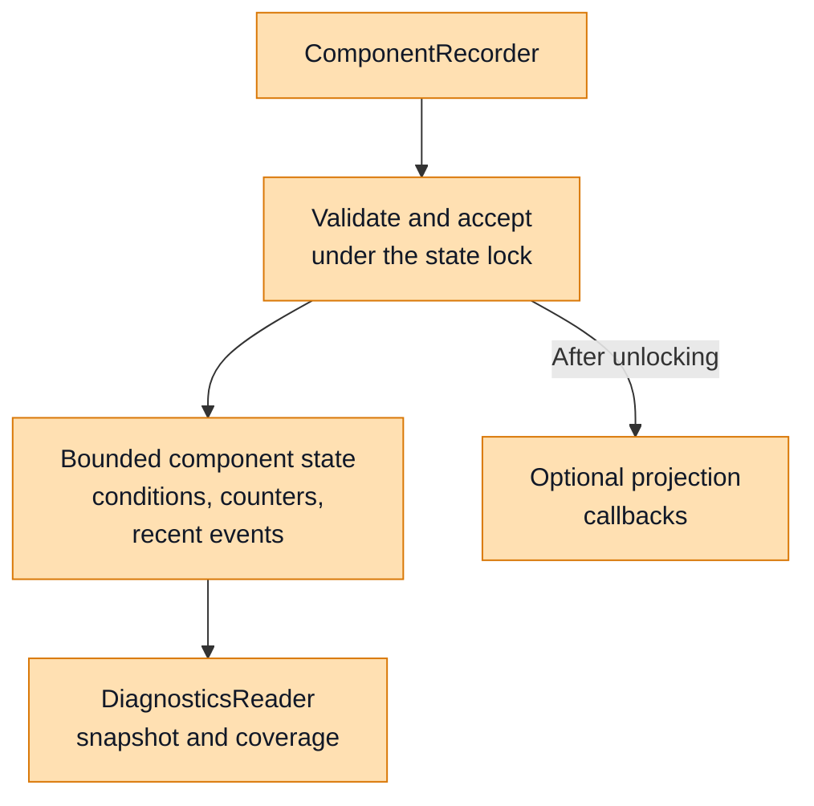
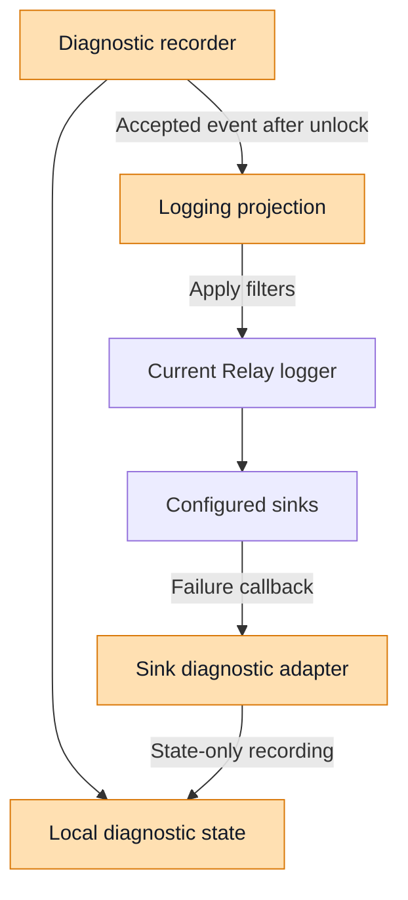
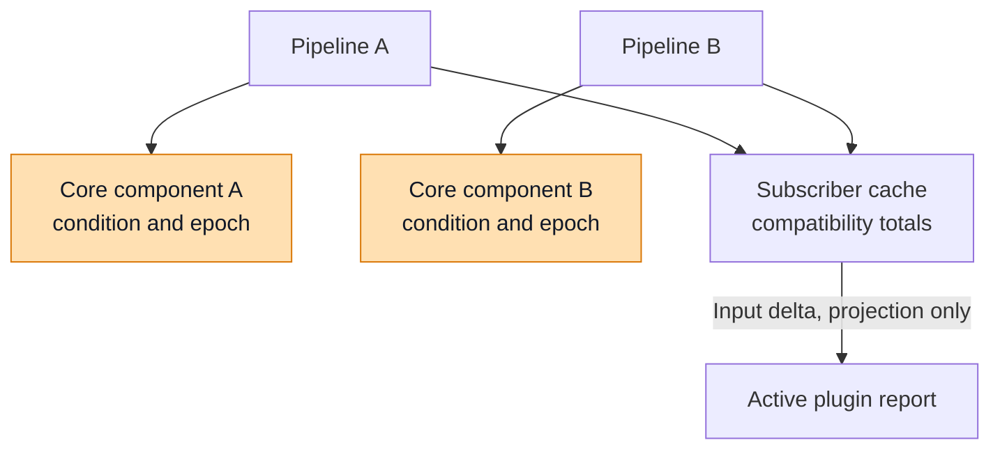
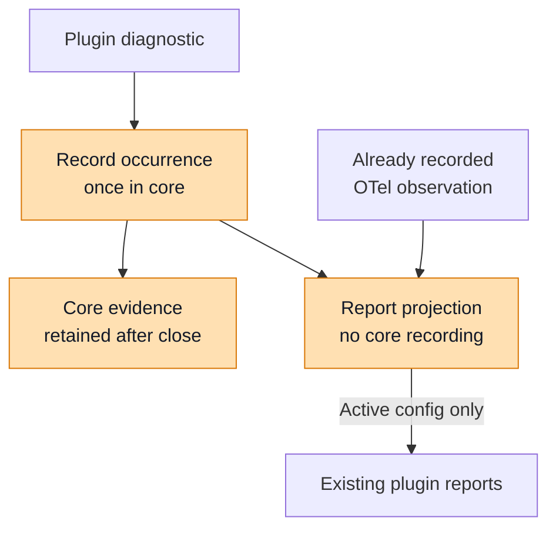

# Diagnostics Foundation Implementation

## Scope and Design Decisions

This implementation follows phase 1 of `diagnostics-implementation-phases.md`.
It starts from upstream main at `c764f793` and keeps executable changes in
`crates/types` and `crates/core`. The user-approved architecture places shared
contracts in the existing types crate and recording/state/query ownership in
the existing core crate. It adds no diagnostics crate.

The deployment discussion established three groups: embedded runtime,
CLI-hosted gateway, and broker/worker deployment. All need the same local
foundation. CLI process composition and the common HTTP router are later
phases; daemon collection, language binding exposure, and dynamic-plugin RPC
extensions are also deferred. The existing worker plugin protocol is distinct
from the daemon's Relay worker process.

## Implementation Overview: Shared Contracts in Types

The `nemo-relay-types` package exposes `nemo_relay_types::diagnostics`, the
vocabulary that producers and consumers share. A producer reports evidence
about a component; a consumer receives it together with identity and coverage.
The same snapshot can later be represented in a binding or an HTTP response without
making those adapters responsible for defining what a failure, count, or
recovery means.

These contracts are serializable data. Registration, synchronization, storage
limits, and callback delivery belong to core. Consequently, constructing or
serializing a diagnostic model requires no logger initialization: the model
contains identities and observations, with no logger handles or output
configuration to initialize.

### Identity and Evidence Model

| Contract | Responsibility | Example interpretation |
| --- | --- | --- |
| `SourceIdentity` | Identifies one process or explicitly owned runtime incarnation. | A new execution has a different UUID even if its PID is reused. |
| `ComponentIdentity` | Identifies one registration within that source. | Replacing an exporter preserves its logical key but changes its instance and generation. |
| `DiagnosticEvent` | Describes one accepted observation, subject to recent-history retention. | An export attempt failed at a particular source sequence. |
| `DiagnosticCondition` | Tracks an active or explicitly recovered condition. | An exporter failure remains unresolved until success is observed. |
| `DiagnosticCounter` | Retains cumulative occurrences within a component's counter epoch. | Ten attempts failed even if only the latest events remain in history. |
| `DiagnosticCoverage` | Describes availability, retention boundaries, and evidence loss. | An empty event list might reflect eviction or query limits. |

Source identity, component identity, and correlation serve different purposes.
The component's logical key identifies its responsibility, such as an exporter
or sink. Its UUID and source-wide registration generation distinguish
replacements. Request and session identifiers remain optional correlation
fields on events, so each request does not create a new aggregate key.

The snapshot composes those contracts into one portable response. This
abbreviated Rust-like pseudocode shows their relationship; fields and derives
unrelated to the explanation are omitted.

```rust
// nemo-relay-types: data returned by any diagnostic reader.
struct DiagnosticSnapshot {
    schema_version: u32,
    source: SourceIdentity,
    captured_at: ObservationTime,
    sequence: DiagnosticNumber,
    components: Vec<ComponentSnapshot>,
    events: Vec<DiagnosticEvent>,
    coverage: DiagnosticCoverage,
}

struct ComponentSnapshot {
    identity: ComponentIdentity,
    registered_at: ObservationTime,
    closed_at: Option<ObservationTime>,
    conditions: Vec<DiagnosticCondition>,
    counters: Vec<DiagnosticCounter>,
}
```

Events, conditions, and counters answer separate questions: what happened
recently, what remains unresolved, and how often something happened. Reading a
snapshot does not add another occurrence. An observed recovery changes the
condition and adds a recovery event without resetting the historical count.
Repeatedly collecting a cumulative counter replaces the previously collected
value for that epoch; adding every polled value would count the same failures
again.

`DiagnosticNumber` preserves unsigned 64-bit values as canonical decimal
strings in JSON. `DiagnosticCount` also exposes saturation, so a consumer can
distinguish an exact value from a lower bound. Coverage makes incomplete
evidence explicit rather than treating missing evidence as success. The local
service produces available or never-observed views; the contracts also provide
unavailable and unsupported states for future adapters.

Implementation source:
[identities, evidence, and snapshot contracts](https://github.com/bbednarski9/NeMo-Relay/blob/935b05aa/crates/types/src/diagnostics.rs).
Source links in this overview refer to the phase-one implementation commit.

## Implementation Overview: Recording, State, Queries, and Projections in Core

`nemo_relay::diagnostics` turns the portable contracts into an independently
owned service. A runtime owner creates `Diagnostics`, gives each producer a
scoped `ComponentRecorder`, and gives consumers a `DiagnosticsReader`.
Recording and reading use the same service, while consumers have no write
authority through their reader handles.

Evidence is held in process memory. Keeping the service independent of logging
allows startup and teardown inspection; it does not provide persistence across
process exit or establish global health, admission, retry, or restart policy.

The component-specific diagram below shows the two results of an accepted
recording operation: updated local evidence and optional event delivery after
the state lock is released. Projection delivery does not require the event to
remain in recent history.



Orange identifies the shared foundation or its integration points in these
diagrams. Each diagram describes one component's responsibilities rather than
an entire deployment topology.

### Ownership and Producer Lifecycle

The following pseudocode follows the public Rust API. An explicitly created
service can observe startup failure before operational logging exists. A
reader keeps the service's evidence accessible without keeping a component
registration open.

```rust
let diagnostics = Diagnostics::new(source_identity, DiagnosticLimits::default());
let reader = diagnostics.reader();
let exporter = diagnostics.register_component("exporter.logs")?;
let component_id = exporter.identity().instance_id;

let receipt = exporter.observe_failure(
    "otel.logs_export_failed",
    "The collector could not be reached",
    1,
    DiagnosticCorrelation::default(),
)?;
// receipt establishes local acceptance, not log or collector delivery.

let snapshot = reader.snapshot(DiagnosticQuery {
    component_instance_id: Some(component_id),
    ..DiagnosticQuery::default()
})?;

// Invoke only after observing a successful export or explicit recovery signal.
exporter.observe_recovery("otel.logs_export_failed")?;

drop(exporter);
// The final recording handle closes this registration.
// The reader can still inspect its retained closed evidence.
```

Cloned recorders share one registration lease. Explicit `close()` or dropping
the final recorder closes that registration; neither operation recovers an
unresolved condition. Registering the same logical key again creates a fresh
instance and counter epoch. Explicit ownership supports isolated runtime
contexts; the optional lazy process default accommodates existing constructors
that do not yet accept a context.

The process default survives logging reconfiguration and plugin replacement.
Its role defaults to `runtime`; deployment owners can supply a specific source
role when they compose the service. Source-local sequences order updates when
wall-clock timestamps coincide or change.

### One Recording Boundary and Bounded State

An observation contains a code, severity, outcome, safe message, occurrence
delta, optional correlation, and an explicit condition-activation flag. The
recording boundary validates that input and updates the component's aggregate
evidence under one lock.

- `observe_failure` counts the supplied occurrences and activates a condition.
- `observe_occurrence` counts evidence without asserting a persistent condition.
- `activate_condition` can update a condition with zero additional occurrences.
- `observe_recovery` resolves an existing active condition without adding a
  failure occurrence. Missing or already recovered conditions are a no-op.

The service bounds component registrations, distinct codes, recent history,
text and correlation sizes, retained encoded bytes, snapshot bytes, and
attached projections. Count and byte budgets work together: history can be
evicted while cumulative counters and active conditions remain. Closed
components can be evicted to admit a registration; live registrations are not
silently displaced. If an observation's component update cannot fit, its
counter and condition changes are rolled back. Reclaiming space can already
have evicted history, and reserved coverage counters report those losses.

Recording recalculates encoded size for the changed component and new event,
using cached sizes for unrelated retained evidence. This bounds the work
performed for each update without repeatedly serializing the entire store.
Producers remain responsible for safe text: truncation limits resource use
and does not redact secrets or application payloads.

### Read and Projection Boundaries

A reader filters a consistent copy of retained evidence into
`DiagnosticSnapshot`. Component key, registration ID, and diagnostic code
select the evidence of interest. `after_sequence` filters recent events while
counters remain cumulative. `active_conditions_only` filters conditions while
leaving matching events and counters available. Response-size truncation is
reported separately from loss in the underlying store. Each read has a new
capture time and does not mutate producer state.

Projections consume accepted typed events outside the state lock. They are
optional subscribers to the recording boundary, rather than owners of
diagnostic truth. This abbreviated pseudocode illustrates both delivery paths:

```rust
let projection = diagnostics.subscribe_projection(|event| {
    // Adapter-specific formatting or output; the state lock is released.
    consume_typed_event(event); // illustrative adapter helper
})?;

component.record(observation)?; // update evidence, then invoke projections

// A sink reporting its own failure updates evidence without re-entering output.
sink_component.record_without_projection(Observation::failure(
    "logging.sink.write_failed",
    "Operational log delivery failed",
    1,
))?;

drop(projection); // unsubscribe from future publication
```

Callbacks execute synchronously and can inherit output latency. Concurrent
writers may deliver callbacks concurrently or out of sequence. Panics are
isolated and counted, and service cycles or excessively deep projection chains
are suppressed. Dropping a general projection guard unsubscribes it; a callback
already copied by a publisher can still finish. Adapters that need stronger
shutdown ordering must supply their own delivery gate.

Implementation source:
[diagnostic service](https://github.com/bbednarski9/NeMo-Relay/blob/935b05aa/crates/core/src/diagnostics/mod.rs),
particularly `register_component`, `record_inner`, `DiagnosticsReader::snapshot`,
and `publish`.

## Implementation Overview: Logging, OpenTelemetry, and Plugin Adapters

These adapters connect existing core components to the shared service. They
translate ownership and reporting conventions at a component boundary while
reusing core recording semantics. HTTP, language bindings, and worker protocol
adapters remain subsequent phases.

| Adapter | Diagnostic context | Integration boundary |
| --- | --- | --- |
| Logging | Explicit context supplied to `configure_with_diagnostics`. | Projects typed events into logs and records failures of logging itself. |
| OpenTelemetry | Existing constructors use the lazy process default. | Records subscriber/exporter evidence while preserving existing subscriber reports. |
| Plugins | Existing runtime-diagnostic entry point uses the process default. | Records evidence across activation boundaries and preserves active-only reports. |

The examples below are Rust-like pseudocode. Public entry points retain their
implemented names; helper functions abbreviate internal control flow.

Adapter keys preserve known producer categories, including the OpenTelemetry
signal, and use stable opaque discriminators for configuration fields. Adapters
preserve valid common codes and map incompatible legacy classifications to
`legacy.code.<sha256>` in shared state. Legacy reports retain their original
classifications. This avoids exposing arbitrary metadata keys through the new
code namespace.

### Logging Adapter: Output and Independent Sink Evidence

`LoggingRuntime::configure_with_diagnostics` connects Relay's operational logging
implementation to an independent diagnostic context. It registers a logging
component and individual stderr/file-sink components, uses the diagnostic
source UUID for root log correlation, and attaches a typed-event projection.
The returned runtime owns logging resources and the projection guard; the
projection holds a weak logger reference.



The typed-event path respects logger severity and sink filters. Those filters
control output without undoing the diagnostic observation. Existing ordinary
operational log calls continue through the logger; they are not parsed into
diagnostic conditions.

The sink-failure path records directly without invoking projections, preventing
a failed sink from receiving a new record about its own failure. It still
updates recent history, counters, and applicable conditions. The diagram's
state-only arrow abbreviates a recorder call rather than a second storage API.

```rust
let diagnostics = Diagnostics::default(); // exists before sink initialization
let logging = match LoggingRuntime::configure_with_diagnostics(config, &diagnostics) {
    Ok(logging) => logging,
    Err(error) => {
        let startup_evidence = diagnostics.snapshot(DiagnosticQuery::default())?;
        inspect_startup_failure(startup_evidence); // illustrative consumer
        return Err(error);
    }
};

fn on_sink_failure(failure) {
    let observation = classify_sink_failure(failure); // fixed, safe explanation
    let _ = sink_recorder.record_without_projection(observation);
    // Preserve the existing emergency stderr reporting path.
}

logging.shutdown(); // detach/quiesce projection, drain pools, flush sinks
let final_view = diagnostics.snapshot(DiagnosticQuery::default())?;
```

Initialization, write, flush, queue-drop, and shutdown evidence have distinct
codes. Queue drops are historical losses; a dropped record does not establish
that the queue remains full. Sink messages exclude raw backend errors, paths,
and dropped payloads. The sink API provides failure callbacks without
per-record success acknowledgments, so the adapter cannot infer delivery
recovery.

Diagnostic registration and projection attachment are best effort: exhausting
their budgets cannot prevent an otherwise valid logger from starting.
Configured file sinks remain required: an initialization failure still fails
logging setup. Optional-sink policy from issue 1297 belongs to phase 2. Existing
logging constructors retain their behavior. Before shutdown drains sinks, a
logging-specific gate detaches the projection and waits for
running delivery. An identity check suppresses superseded logger projections
during reconfiguration. Replacement creates new component identities while old
unresolved evidence remains retained under its original generation. This phase
adds no whole-process shutdown deadline.

Implementation sources:
[runtime composition and shutdown](https://github.com/bbednarski9/NeMo-Relay/blob/935b05aa/crates/core/src/logging/mod.rs),
[sink evidence and typed-event projection](https://github.com/bbednarski9/NeMo-Relay/blob/935b05aa/crates/core/src/logging/diagnostics.rs).

### OpenTelemetry Adapter: Pipeline Conditions and Compatibility Totals

`SignalRuntimeDiagnostics` connects subscriber diagnostics and exporter
delivery observations to core. Exporter pipelines receive independent
component registrations while sharing the subscriber's existing bounded
compatibility cache. This lets a subscriber retain its aggregate failure
report while core identifies which pipeline still has an unresolved failure.



Each pipeline uses a single shared recording boundary. The adapter then
updates the existing subscriber cache and, when applicable, mirrors the
observation into the active plugin report through a projection-only helper.
The forwarded count is the input occurrence delta, never the cache's cumulative
total. The subscriber report retains its established 32-code limit and
distinct-message character budget.
Existing operational emitters keep their established logging and rate limits,
so these adapter updates suppress the new log projection.

```rust
// Pipelines share compatibility totals but own separate component recorders.
let pipeline_a = subscriber_diagnostics.for_exporter("observability.otel.logs.exporter");
let pipeline_b = subscriber_diagnostics.for_exporter("observability.otel.logs.exporter");

fn record_export_failure(pipeline, code, message, count) {
    // Failure activates a condition for known exporter-delivery codes.
    try_record_without_projection(pipeline.component, code, message, count);

    // These compatibility updates never invoke core recording again.
    if pipeline.legacy_cache.accumulate(code, message, count).is_retained() {
        let legacy_diagnostic = make_legacy_diagnostic(code, message, count);
        // count is the input delta, not the updated compatibility total.
        project_active_plugin_runtime_diagnostic(legacy_diagnostic);
    }
}

fn on_observed_export_success(pipeline, code) {
    pipeline.component.observe_recovery_without_projection(code);
    // Historical compatibility counts remain unchanged.
}
```

Success in pipeline B resolves only B's condition. It cannot resolve A's
failure, even when both pipelines contribute to the same subscriber report.
This ownership also applies to metric providers created for different dynamic
resources. Other subscriber diagnostics remain counted observations unless the
adapter explicitly recognizes a persistent export-failure condition.

Compatibility caches continue counting input occurrence deltas if shared
storage rejects a write. Shared coverage reports that rejection; the legacy
report remains subject to its own limits. The legacy report therefore is not
rebuilt by reading core snapshots, and its totals need not imply complete
shared history.

The shared model cannot infer collector partial rejection from an exporter
that does not expose it. That remains an exporter instrumentation gap rather
than an implied guarantee of the common state API.

Implementation sources:
[signal recorder, compatibility cache, and pipeline ownership](https://github.com/bbednarski9/NeMo-Relay/blob/935b05aa/crates/core/src/observability/otel_signal.rs),
[metric resource pipelines](https://github.com/bbednarski9/NeMo-Relay/blob/935b05aa/crates/core/src/observability/otel_metrics.rs).

### Plugin Adapter: Process Evidence Across Configuration Lifetimes

`record_active_plugin_runtime_diagnostic` now attempts shared recording before
updating the existing active-only plugin reports. During an active
configuration, the adapter retains and reuses component recorders keyed by
producer category and an opaque configuration-field discriminator. Before
activation, it uses a temporary registration; dropping its lease closes the
component while leaving bounded evidence available for inspection.



```rust
fn record_active_plugin_runtime_diagnostic(diagnostic) {
    // Reuse a configuration-owned lease, or create a temporary registration.
    let recorder = resolve_component_lease(&diagnostic.component, diagnostic.field.as_deref());

    if let Some(recorder) = recorder {
        let mut observation = Observation::occurrence(
            normalize_legacy_code(&diagnostic.code),
            DiagnosticSeverity::Error,
            diagnostic.message.clone(),
            diagnostic.count,
        );
        observation.outcome = DiagnosticOutcome::Failure;
        let _ = recorder.record_without_projection(observation);
        // An occurrence does not automatically activate a persistent condition.
    }

    // Preserve active-only reports even when shared recording was rejected.
    project_active_plugin_runtime_diagnostic(diagnostic);
}

// OpenTelemetry already crossed the recording boundary; update reports only.
project_active_plugin_runtime_diagnostic(already_recorded_otlp_diagnostic);
```

The projection preserves the existing code-aggregated runtime snapshot and
the detailed report grouped by code, component, and field. Neither view becomes
a complete process history. A missing active configuration suppresses report
updates while still allowing shared evidence to be recorded. Generic plugin
failure observations do not invent persistent conditions or recovery signals.
Existing legacy session identifiers remain in their established report fields
and are not copied into the new shared correlation fields.
The adapter relies on core's reported registration limits, so it adds no
silent recorder-capacity boundary of its own.

Implementation sources:
[recording and report boundaries](https://github.com/bbednarski9/NeMo-Relay/blob/935b05aa/crates/core/src/plugin.rs),
[legacy identity and code normalization](https://github.com/bbednarski9/NeMo-Relay/blob/935b05aa/crates/core/src/diagnostics/compatibility.rs).

## Bounds and Wire Contract

The service bounds registrations, keys, recent events, message/correlation
bytes, retained encoded evidence, snapshots, and attached projections. Count
limits also bound structural allocation overhead; the encoded byte budget is
not an exact heap-allocation measurement. Capacity failures preserve reserved
loss counters. Snapshot omission is explicit and does not evict underlying
state. Active components are not silently evicted to admit new registrations.

Diagnostic counters and sequences use a Rust integer wrapper whose JSON
representation is a canonical unsigned decimal string. This refines the older
reference document's numeric-JSON assumption so Node.js and JSON consumers can
preserve the full unsigned 64-bit range. Existing public legacy APIs retain
their numeric representation. Counter saturation is separately flagged and
means a lower bound.

Schema version 1 allows additive object fields and arbitrary validated producer
codes. Closed enum changes require explicit compatibility handling. UUID,
timestamp, and exact unsigned-integer schemas match serialization. This phase
does not add remote snapshot ingestion or make claims about mixed-version
transport negotiation.

## Validation Strategy

Focused contract tests cover lossless integers, schema bounds, UUID/time
formats, and evidence availability. Core tests cover independent pre-logging
contexts, component replacement, explicit recovery, concurrency, byte/count
limits, projection reentrancy and failures, and retained closed evidence.
Logging and existing producer tests cover strict startup failures, independent
sink diagnostics, exact queue losses, projection filtering/lifetime, and
compatibility views without a second recorded occurrence.

The phase-one implementation passed the canonical `just test-rust` suite: 5,961 tests
passed with none skipped. Focused tests also covered the types schema contract
(nine tests) and the core foundation (18 tests). The Rust run explicitly unset
inherited `NEMO_RELAY_LOG` and `NEMO_RELAY_LOG_STDERR_FORMAT` values because
unrelated CLI tests require their default logging configuration.

`just docs` generated the ignored API references and passed documentation and
link checks. Fern skipped its authenticated missing-redirect check because no
Fern authentication was available. No generated references were edited by hand.

Additional binding or deployment suites are needed only if their exposed
contracts change; new binding APIs and CLI routes remain in their later phases.
A final source audit confirmed that executable changes remain in the types and
core crates, so no CLI or daemon stack is needed for this phase.
