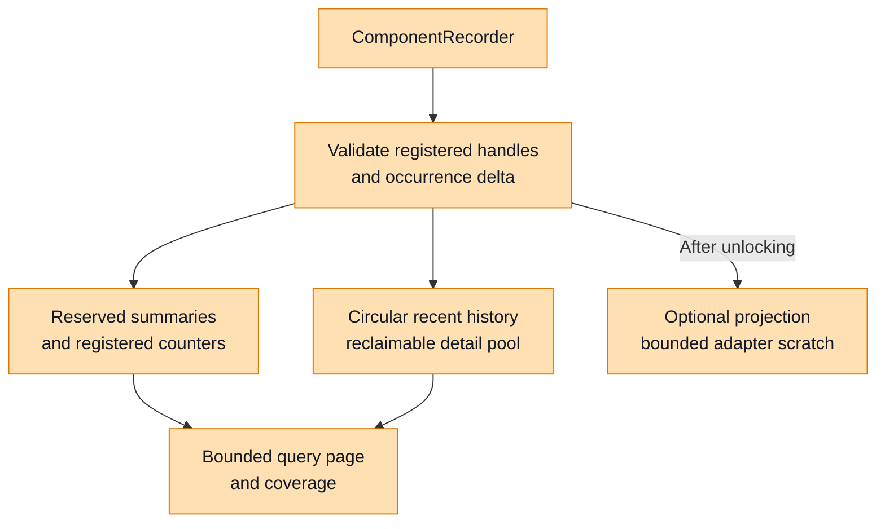
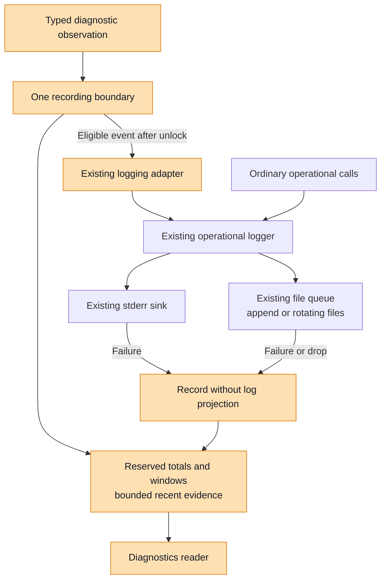
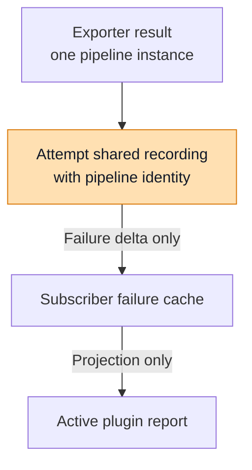
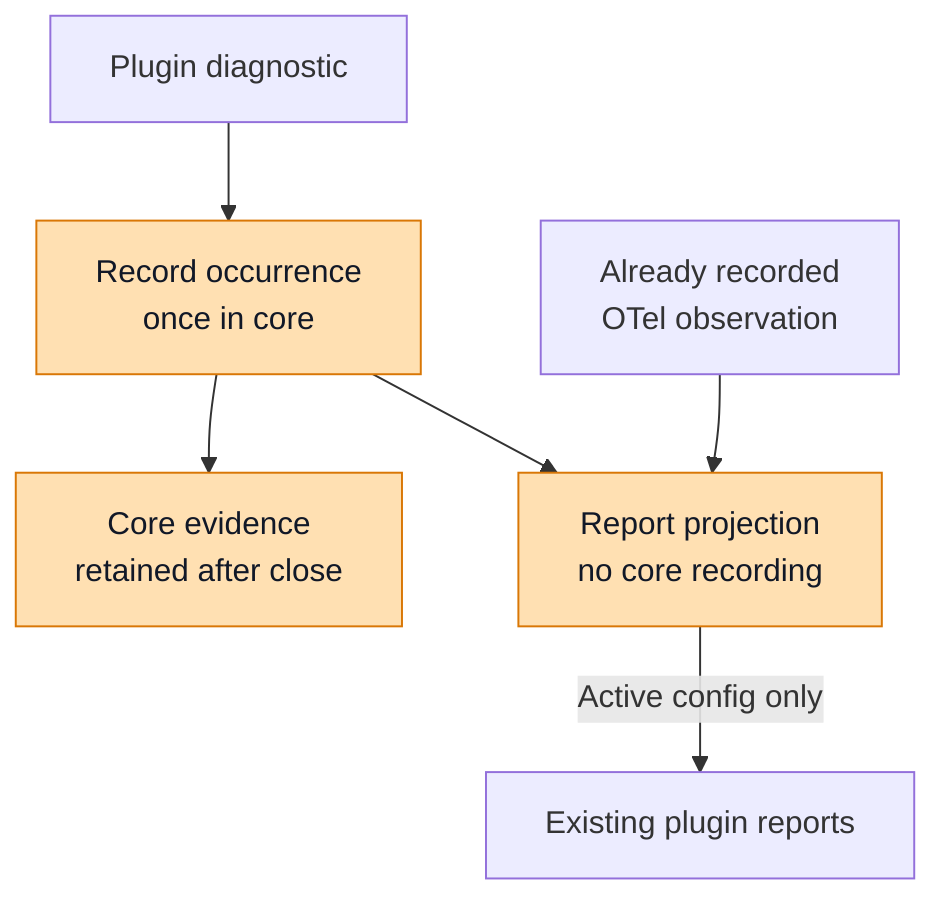

# Diagnostics Foundation Design

## Scope and Design Decisions

This design refines phase 1 of the diagnostics implementation plan. Shared
contracts belong in `nemo-relay-types`; registration, recording, storage, queries,
and projections belong in `nemo-relay-core`. The design uses the existing crates
and operational logging implementation.

The existing implementation on `bbednarski/diagnostics-phase-one`, inspected at
`bf89346d`, supplies the baseline contracts and adapters. This document now
proposes a stricter memory architecture for that foundation. Source links show
the existing integration points; they do not establish that the proposed slot
storage, code catalogue, observation windows, or query budgets are implemented.
Rust examples are architectural pseudocode, including proposed API changes.
The classification catalogue is additive: existing returned errors, legacy codes,
protocol fields, and retry behavior remain compatibility contracts.
[Appendix A](#appendix-a-existing-error-and-protocol-mappings) records their
mappings and the staged implementation work.

The deployment discussion established three groups: embedded runtime,
CLI-hosted gateway, and broker/worker deployment. All need the same local
foundation. CLI process composition and the common HTTP router are later
phases; daemon collection, language binding exposure, and dynamic-plugin RPC
extensions are also deferred. The existing worker plugin protocol is distinct
from the daemon's Relay worker process.

### Recommended Approach: Bounded History and Logging Reuse

1. **Tighten the existing diagnostics history into a preallocated circular buffer
   and bounded detail storage.** New observations reuse event slots by evicting
   the oldest evidence and reclaiming its detail space. Reserve summaries and
   registered counters independently, so they continue updating when history is
   full. This evolves the existing diagnostic store.
2. **Reuse the existing logging adapter and sinks.** Project eligible typed
   observations through Relay's current logger, filters, formatters, stderr sink,
   and file sinks. Retain their lifecycle and sink-failure integration.
3. **Keep history and delivery budgets independently enforceable.** Diagnostic
   retention, query workspaces, pending log delivery, and file retention have
   different ownership and eviction rules. A core memory budget does not bound
   an existing file queue or file growth.
4. **Initially retain typed diagnostic observations.** Ordinary operational log
   calls can share metadata contracts and resource-management helpers without
   automatically creating diagnostic counters or retained events. Capturing
   every ordinary log line would require an additional retention policy.

Retention is in memory for this phase. A process restart creates a new source
identity. Restart persistence remains extensible through versioned snapshots and
adapters; checkpoints, disk spools, journals, and replay are outside this phase.
The [sink architecture review](./diagnostics-sink-architecture-review.md) explains
the existing retention and delivery mechanisms that inform these boundaries.

### Implementation Status

| Area | Existing baseline | Revised design |
| --- | --- | --- |
| Contracts and identity | Serializable evidence, identity, counts, and coverage. | Typed code catalogue, bounded extension registration, summaries, epochs, and window coverage. |
| Local storage | Maps, vectors, and recent-event deque with encoded-byte accounting. | Preallocated circular history and a bounded detail pool; evict oldest evidence and reclaim its space while summary counters continue updating. |
| Recording | Evidence and per-code counts accepted together; capacity can reject the update. | Reserved summaries remain writable when optional detail cannot be retained. |
| Queries | Clone matching data, then trim its encoded response. | Bound materialization, concurrency, and serialization workspace before copying. |
| Logging and producer adapters | Existing logger projection, sink feedback, and compatibility reports. | Reuse those integrations with compact records and explicit retention outcomes. |
| Error compatibility | Existing Rust errors, report codes, and worker protocol fields. | Add classification adapters and new diagnostic views; preserve existing error APIs and behavior. |

### Evidence and Health Ownership

The embedding application or deployment owner owns health classification,
readiness, alerting, and recovery policy. Relay records observed operation
outcomes, occurrence counts, timestamps, registration lifetimes, and coverage.
A diagnostic code identifies an observation; it is not an open issue that the
recorder must later close.

The foundation records evidence without an active/recovered condition model.
Failure recording has no activation side effect, and the common service has no
recovery operation or active-condition query. A subsequent successful operation
is independent evidence. It does not reset earlier failure counts or establish
that previously lost data was delivered. Recent events remain subject to eviction.

| Relay records | The owner decides |
| --- | --- |
| An export attempt failed, followed by a successful attempt. | Whether the exporter is sufficiently reliable for this application. |
| A sink rejected a write or a record was dropped. | Whether that loss affects application health or readiness. |
| A recording registration was created, closed, or replaced. | Whether the component is required and what action to take. |
| Evidence is unavailable, truncated, evicted, or saturated. | Whether the available evidence supports a health decision. |

## Design Overview: Shared Contracts in Types

The `nemo-relay-types` package exposes `nemo_relay_types::diagnostics`, the
vocabulary that producers and consumers share. A producer reports evidence
about a component; a consumer receives it together with identity and coverage.
The same snapshot can later be represented in a binding or an HTTP response
while preserving observed outcomes, counting semantics, and evidence coverage.

These contracts are serializable data. Registration, synchronization, storage
limits, and callback delivery belong to core. Consequently, constructing or
serializing a diagnostic model requires no logger initialization: the model
contains identities and observations, with no logger handles or output
configuration to initialize.

### Identity and Evidence Model

| Contract | Responsibility | Example interpretation |
| --- | --- | --- |
| `SourceIdentity` | Identifies one process or explicitly owned runtime incarnation. | A new execution has a different UUID even if its PID is reused. |
| `ComponentIdentity` | Identifies one registration within that source. | Replacing an exporter preserves its logical key but changes its instance and generation. |
| `DiagnosticEvent` | Describes one accepted observation, subject to recent-history retention. | An export attempt failed at a particular source sequence. |
| `DiagnosticOutcome` | Describes an observed success or failure, or an unspecified outcome. | A successful export describes that attempt; earlier failures remain recorded. |
| `BuiltinDiagnosticCode` / `Classification` (proposed) | Describes a canonical observation and, for failures, a supported common cause class. | A worker invocation failure belongs to Plugin; a legacy code remains available separately. |
| `ComponentSummary` (proposed) | Retains fixed-size lifetime and outcome totals reserved at registration. | Failure totals remain writable when recent evidence is full. |
| `DiagnosticCounter` | Retains cumulative occurrences within a counting epoch. | Ten attempts failed even if only the latest events remain in history. |
| `DiagnosticWindow` (proposed) | Returns bounded aggregate buckets with resolution and coverage. | A five-minute view identifies its actual covered interval. |
| `DiagnosticCoverage` | Describes availability, retention boundaries, and evidence loss. | An empty event list might reflect eviction or query limits. |

Source identity, component identity, and correlation serve different purposes.
The component's logical key identifies its responsibility, such as an exporter
or sink. Its UUID and source-wide registration generation distinguish
replacements. Request and session identifiers remain optional correlation
fields on events, so each request does not create a new aggregate key.

The snapshot composes those contracts into one portable response. This
abbreviated Rust-like pseudocode shows their relationship; fields and derives
unrelated to the explanation are omitted.

```rust
// Proposed revised snapshot/view; existing exported structs remain compatible.
// Choose a new API/schema revision before exposing these added required fields.
struct DiagnosticSnapshot {
    schema_version: u32,
    source: SourceIdentity,
    captured_at: ObservationTime,
    sequence: DiagnosticNumber,
    components: Vec<ComponentSnapshot>,
    events: Vec<DiagnosticEvent>,
    coverage: DiagnosticCoverage,
}

struct ComponentSnapshot {
    identity: ComponentIdentity,
    registered_at: ObservationTime,
    closed_at: Option<ObservationTime>,
    summary: ComponentSummary,       // proposed reserved numeric state
    counter_epoch: CounterEpoch,     // proposed explicit refresh boundary
    counters: Vec<DiagnosticCounter>,
    windows: Vec<DiagnosticWindow>,  // proposed, only for registered series
}
```

Events describe recent observations; summaries and registered code counters
retain cumulative occurrences independently of event retention. Counts describe
observed operations at their owning recording boundary, not unique underlying
incidents across all pipeline stages. Producers use distinct failure and success
codes when those outcomes need separate counts. Reading a snapshot adds no
occurrence, and recording a success resets no failure count. Repeated collection
replaces the previous cumulative value for that epoch; adding every polled value
would count the same observations again.

A new runtime/component instance or successful configuration replacement starts
a fresh counting epoch. A configuration reload does not reset process lifetime.
Polling and logger filter changes do not start a new epoch. Runtime composition
must rotate the epoch explicitly if a component survives a configuration reload.
Every public and stored event carries its counting-epoch identity. Retaining
older events across a reload cannot attach them to the replacement counters.
Queries can select an epoch; closed-epoch retention remains subject to the same
bounded storage policy. Runtime-level totals use a runtime-owned registration
whose lifetime and refresh boundaries are explicit.

`DiagnosticNumber` preserves unsigned 64-bit values as canonical decimal
strings in JSON. `DiagnosticCount` also exposes saturation, so a consumer can
distinguish an exact value from a lower bound. Coverage makes incomplete
evidence explicit rather than treating missing evidence as success. The local
service produces available or never-observed views; the contracts also provide
unavailable and unsupported states for future adapters.

### Core Design: Typed Classification Catalogue

The catalogue is an additional diagnostic interpretation of existing errors.
`FlowError`, `PluginError`, `WorkerSdkError`, `ConfigDiagnostic`, and protocol
`WorkerError` retain their existing variants, fields, codes, and behavior. The
[compatibility mapping appendix](#appendix-a-existing-error-and-protocol-mappings)
defines how adapters derive the new classification without replacing those APIs.
All types and mappings in this section are proposed; the baseline still uses
string observation codes.

The model separates three dimensions:

| Dimension | Responsibility | Example |
| --- | --- | --- |
| Code hierarchy | Identifies the observed event and its owning subsystem. | Plugin / Worker / ProtocolMismatch. |
| Failure class | Identifies a general cause when supported by evidence. | Incompatible, Timeout, InvalidInput, or Unknown. |
| Observation context | Identifies the component instance, operation, and lifecycle phase. | Plugin instance, invocation, runtime phase. |

Nested enums provide composition and broad matching in Rust. A worker-specific
code belongs to the plugin family; a consumer can select that family without
recording a second parent event. Component implementation language is metadata.
A Rust plugin may use either the native ABI or the worker protocol. A dynamic
plugin worker and the daemon's Relay worker process have different owners; the
latter belongs to deployment diagnostics.

```rust
// Proposed authoring contracts in nemo-relay-types::diagnostics.
// All enum payloads are fixed-size classifications, not allocated error text.
#[derive(Clone, Copy, Debug)]
#[non_exhaustive]
enum BuiltinDiagnosticCode {
    Failure(FailureCode),
    Success(SuccessCode),
    Notice(NoticeCode),
}

#[derive(Clone, Copy, Debug)]
#[non_exhaustive]
enum FailureCode {
    Runtime(RuntimeFailureCode),
    Configuration(ConfigurationFailureCode),
    Plugin(PluginFailureCode),
    Upstream(UpstreamFailureCode),
    Observability(ObservabilityFailureCode),
    Logging(LoggingFailureCode),
    Deployment(DeploymentFailureCode),
    Binding(BindingFailureCode),
}

#[derive(Clone, Copy, Debug)]
#[non_exhaustive]
enum PluginFailureCode {
    Common(CommonPluginFailureCode),
    Native(NativePluginFailureCode),
    Worker(WorkerPluginFailureCode),
}

enum CommonPluginFailureCode {
    ConfigurationInvalid, RegistrationFailed, RegistrationConflict, StateConflict,
    ResourceNotFound, InvocationFailed, SerializationFailed, Internal,
    ConfigurationVersionUnsupported, ComponentUnknown, ConfigurationFileMissing,
    ConfigurationSchemaFailed, IntegrityCheckFailed, AttestationFailed,
    PolicyRejected,
}

enum NativePluginFailureCode {
    LibraryLoadFailed, EntryPointMissing, AbiMismatch,
    ValidationFailed, CallbackPanicked, AbiCallFailed,
}

enum WorkerPluginFailureCode {
    LaunchFailed, HandshakeFailed, ProtocolMismatch, ConnectionLost,
    TransportFailed, ResponseInvalid, ProcessExited, ConfigurationMismatch,
    InvalidInput, SerializationFailed, RemoteError, RemoteSdkError,
    InvocationTimedOut, RpcFailed,
}

// Leaf derives are omitted here; all classification enums remain Copy.
// Other initial leaf enums are enumerated by the mapping rows in Appendix A.
// Domains with no mapped producer are expansion points, not empty enums to ship.
enum FailureClass {
    InvalidInput, InvalidState, NotFound, Conflict,
    Authentication, PermissionDenied, Unsupported, Incompatible,
    Timeout, Unavailable, ResourceExhausted, Io, ExecutionFailed,
    PolicyRejected, Internal, Unknown,
}

struct Classification {
    code: BuiltinDiagnosticCode,
    failure_class: Option<FailureClass>,
}
// Constructors enforce Some(class) for Failure and None for Success/Notice.
// FailureClass::Unknown means a failure is observed but its cause is unknown.

// Context does not multiply the code catalogue.
enum PluginExecution { NativeAbi, WorkerProtocol }
enum PluginPhase { Validation, Activation, Runtime, Policy }
// Adapt the existing DynamicPluginFailurePhase into PluginPhase explicitly.
// Keep operation and execution facts on bounded registration/observation metadata.
```

`SuccessCode` initially covers logging initialization/shutdown, sink initialization,
and `ExportSucceeded(Signal)` for logs, traces, and metrics. `NoticeCode` initially
covers `ConfigurationInherited`, `ComponentReenabled`, `GuardrailRejected`,
`WorkerCancelled`, `NativeStreamEnded`, `NativeStreamBackpressured`, and
`CompletedContextExpired(Signal)`. Cancellation or an
expected guardrail decision alone does not establish a failing subsystem.
Severity, operation outcome, and failure class remain separate. Classifications
never set health, readiness, retryability, or recovery state.

Methods such as `code.domain()`, `code.plugin_family()`, and
`code.canonical_name()` derive parent classifications and stable names from one
catalogue entry. Parent queries select existing observations; they do not record
additional occurrences. A producer cannot supply a conflicting independent
parent domain. A common plugin invocation error stays in `Plugin::Common` even
when its execution context is a worker. Worker and native leaves describe facts
specific to those mechanisms.

Each catalogue entry specifies its allowed classes. For example, an observed ABI
mismatch has class `Incompatible`; a generic invocation failure may have class
`Timeout`, `ExecutionFailed`, or `Unknown` depending on the originating evidence.
Adapters select only supported classes. They never infer a timeout, exception
class, permission failure, or ABI mismatch by searching arbitrary message text.

The following aliases keep the recording examples concise. They name catalogue
values, not additional public enum variants:

```rust
const LOG_EXPORT_FAILED: BuiltinDiagnosticCode = BuiltinDiagnosticCode::Failure(
    FailureCode::Observability(ObservabilityFailureCode::ExportFailed(Signal::Logs)),
);
const LOG_EXPORT_SUCCEEDED: BuiltinDiagnosticCode = BuiltinDiagnosticCode::Success(
    SuccessCode::ExportSucceeded(Signal::Logs),
);
const SINK_WRITE_FAILED: BuiltinDiagnosticCode = BuiltinDiagnosticCode::Failure(
    FailureCode::Logging(LoggingFailureCode::SinkWriteFailed),
);
// Explicit catalogue mappings preserve existing names where they already fit:
// LOG_EXPORT_FAILED -> "otel.logs_export_failed"
// LOG_EXPORT_SUCCEEDED -> "otel.logs_export_succeeded"
// SINK_WRITE_FAILED -> "logging.sink.write_failed"
```

### Mapping Existing Errors at Their Owning Boundary

The types crate owns portable classifications and catalogue metadata. Core owns
mappings for `FlowError`, plugin errors, configuration reports, and logging/OTel
adapters. The worker SDK and transport adapters own their respective conversions
in later integration phases. Shared types do not depend on core, SDK error
objects, `tonic`, native ABI libraries, or logger initialization.

```rust
// Proposed worker-side adapter; borrows the error before transport flattens it.
// This function returns metadata and never records an occurrence itself.
fn classify_sdk_error(error: &WorkerSdkError) -> Classification {
    match error {
        WorkerSdkError::InvalidInput(_) => failure(
            PluginWorker(InvalidInput), FailureClass::InvalidInput,
        ),
        WorkerSdkError::Callback(_) => failure(
            PluginCommon(InvocationFailed), FailureClass::ExecutionFailed,
        ),
        WorkerSdkError::Transport(_) => failure(
            PluginWorker(TransportFailed), FailureClass::Unknown,
        ),
        WorkerSdkError::Serialization(_) => failure(
            PluginWorker(SerializationFailed), FailureClass::Unknown,
        ),
    }
}
// PluginWorker/PluginCommon/failure are abbreviated constructors for the enums above.

// Proposed SDK-local producer role; no core dependency is implied.
// Its bounded implementation can emit through a transport adapter/callback.
fn on_sdk_failure(error: WorkerSdkError, producer: &dyn WorkerObservationProducer) -> WorkerError {
    let classification = classify_sdk_error(&error);
    producer.emit(classified_observation(
        classification, safe_bounded_detail(&error), 1,
    )); // illustrative: handle admission/loss through the producer's receipt
    sdk_error_to_worker(error) // existing code/message/retryable conversion is preserved
}
```

`WorkerObservationProducer` names a proposed SDK capability, not an existing
trait or a required implementation of the core recorder. A core-backed adapter
can use `ComponentRecorder`; a standalone SDK can use bounded transport. See
[the six shared interfaces](#reuse-boundaries-six-shared-interfaces) for ownership
and dependency boundaries.

The source owning the operation records it once. Receiving a transported copy or
building a compatibility report does not record the same occurrence again. Until
transport carries source observation identity, the integration must designate
one recording owner; it cannot assume host and worker observations can be
safely summed or automatically deduplicated.

### Wire Representation and Compatibility Views

The typed catalogue is an authoring interface. Wire identifiers use explicit
stable strings or separately assigned numeric identifiers, never enum order or
Rust memory layout. `#[non_exhaustive]` supports Rust source evolution only; it
does not make an older deserializer accept new variants.

A new diagnostic view can pair an existing diagnostic with optional classification:

```rust
// A NEW response/view type; no fields are inserted into existing public Rust DTOs.
struct ClassifiedDiagnosticView {
    original: ExistingDiagnosticView,
    classification: Option<ClassificationWire>,
}

struct ClassificationWire {
    catalogue_version: u32,
    canonical_code: String,          // bounded by wire admission
    failure_class: Option<String>,  // bounded; unknown values remain representable
}

// Illustrative JSON within the NEW view:
// original.code = "worker.error"
// classification.canonical_code = "plugin.worker.remote_error"
// classification.failure_class = "unknown"
```

The existing `code` field and its interpretation remain stable in legacy APIs.
Canonical classification is additional metadata. Adding an optional JSON field
is safe only for consumers that tolerate it; adding a field to a public Rust
struct can break struct literals even if serde supplies a default. Prefer new
view types or accessors at existing API boundaries, with an explicit version for
revised snapshot/counting contracts. Protocol changes remain a later phase and
must account for generated Rust, Python, and other supported consumers.

Unknown catalogue codes and failure classes remain bounded opaque wire values.
They are preserved within admission limits and reported as unknown, never mapped
to a guessed known leaf. Oversized identifiers are rejected or marked truncated
with coverage; they are not claimed to be preserved exactly. An unknown catalogue
version supports an opaque view only when its envelope is supported; otherwise
return an explicit unsupported result. Keep catalogue version separate from
snapshot schema version.

### Extension Codes and Shared Record Metadata

Dynamic plugins and compatibility adapters register bounded extension codes and
receive compact handles. Registration metadata includes producer namespace, code,
optional declared class, and catalogue/mapping version. The same unqualified
legacy string from unrelated producers is not assumed to mean the same thing.
Code count, label length, description length, and total metadata bytes have limits.
Register each component's required subset rather than every global code.

Variable metadata keys, request IDs, paths, and error text belong in bounded
detail or correlation, not new aggregate keys. Unknown/unregistered codes use
reserved overflow accounting when registration capacity is exhausted. Preserve
legacy reports through their existing paths, without retaining an unbounded alias
map in core. Parent families and failure classes are query metadata; they do not
automatically create a component-by-code-by-class-by-operation counter product.
Classification changes must not silently relabel existing epoch totals.

Source/component identity, severity, timestamps, correlation, and loss metadata
can be shared with ordinary operational records. Core supplies bounded copying,
accounting, and truncation helpers at their respective admission boundaries.
Ordinary records use the existing logger without automatically creating diagnostic
counters or retained events. Recorder admission failures (`DiagnosticError`) stay
separate from observed failures; reserved loss accounting does not recursively
record them as ordinary errors.

Public `Vec` and `String` fields describe bounded query output, not internal
storage. Numeric counters use compact registered IDs; optional detail remains in
the bounded evidence pool. Existing compatibility reports preserve their message
representations, code breakdowns, and limits. A revised view must expose absent
detail explicitly rather than changing old report fields in place.

Baseline source:
[existing diagnostics contracts](https://github.com/bbednarski9/NeMo-Relay/blob/bbednarski/diagnostics-phase-one/crates/types/src/diagnostics.rs).
See [Appendix A](#appendix-a-existing-error-and-protocol-mappings) for the initial
catalogue, exact legacy identifiers, mapping ownership, and migration sequence.

## Design Overview: Recording, State, Queries, and Projections in Core

`nemo_relay::diagnostics` turns the portable contracts into an independently
owned service. A runtime owner creates `Diagnostics`, gives each producer a
scoped `ComponentRecorder`, and gives consumers a `DiagnosticsReader`.
Recording and reading use the same service, while consumers have no write
authority through their reader handles.

Evidence is held in process memory. Keeping the service independent of logging
allows startup and teardown inspection; it does not provide persistence across
process exit or establish global health, admission, retry, or restart policy.

The diagram shows the target recording boundary: reserved numeric updates,
optional recent evidence, and optional projection after the state lock is
released. Projection delivery does not require the event to remain in history.
History pressure must not undo an admitted summary update.



Orange identifies the shared foundation or its integration points in these
diagrams. Each diagram describes one component's responsibilities rather than
an entire deployment topology.

### Reuse Boundaries: Six Shared Interfaces

Core owns local recording, retention, and query semantics. The hosting application
owns composition, transport, and interpretation. These six interfaces describe
capabilities within the existing crates and modules; they do not require six new
classes or a separate diagnostics crate. `Diagnostics`, `ComponentRecorder`, and
`DiagnosticsReader` remain the primary core handles. The compact store, detail
pool, indexes, and bucket implementation remain private to core.

The directions below are proposed integration requirements. Existing source
links identify reusable entry points rather than completed cross-crate wiring.
Shared catalogue and wire contracts belong in types; concrete error adapters stay
with the subsystem that understands the original error.

#### 1. Context Construction and Injection

The runtime or process owner constructs `Diagnostics` before logging and component
initialization, selects its source identity and limits, and passes that same
context to the components it composes. Logging, plugin hosts, OTel subscribers,
and runtime producers register within the selected context. Components receive
recorders; query consumers receive readers. Separate embedded runtimes can have
separate contexts when their owner explicitly chooses that isolation.

A CLI gateway task and its wrapper share their enclosing process context. Broker
and Relay (worker) processes each own their local context. Short-lived commands
can use the same service without starting an HTTP listener. The host chooses
source roles and allowance sizes; core implements identity and budget semantics.

Reuse `LoggingRuntime::configure_with_diagnostics`. Add context-aware construction
to existing owned plugin hosts and OTel subscribers; preserve process-default
constructors as compatibility entry points. A reader attached to an explicit
context must not silently miss producers that still select a different global
service. Context propagation is foundation work; deployment bootstrap wiring is
performed in its corresponding integration phase.

Baseline seams: [core service construction](https://github.com/bbednarski9/NeMo-Relay/blob/bbednarski/diagnostics-phase-one/crates/core/src/diagnostics/mod.rs#L335),
[logging context injection](https://github.com/bbednarski9/NeMo-Relay/blob/bbednarski/diagnostics-phase-one/crates/core/src/logging/mod.rs#L146),
[OTel process-default lookup](https://github.com/bbednarski9/NeMo-Relay/blob/bbednarski/diagnostics-phase-one/crates/core/src/observability/otel_signal.rs#L126),
and [plugin process-default lookup](https://github.com/bbednarski9/NeMo-Relay/blob/bbednarski/diagnostics-phase-one/crates/core/src/plugin.rs#L2594).

#### 2. Component and Code Registration

Core admits a registration only after reserving its component summary, declared
code counters, bounded metadata, and requested window series. Types supplies the
catalogue, classification metadata, and portable identity contracts. Registration
returns compact recording handles with generation checks; callers do not manage
slots, arenas, eviction, or byte accounting themselves.

Register the codes a component uses. Dynamic extensions include a bounded producer
namespace and registration metadata, with reserved overflow accounting when
classification capacity is exhausted. Request IDs, arbitrary fields, messages,
and failure-class combinations must not create an uncontrolled aggregate-key
product. Parent catalogue families are selectors over existing observations.

CLI, bindings, and core components all reuse this registration mechanism. They
may choose a component's logical key and declared capabilities, but do not add
independent counter maps or recent-history stores. Registration admission failures
remain separate from observed failures and do not recursively generate events.

#### 3. Pure Classification Adapters

The nested catalogue, allowed-class metadata, and stable wire names live in types.
A mapping function borrows an existing error and returns `Classification` without
recording, logging, transporting, or changing the operation's result. Preserve
the compatibility rules in [Appendix A](#appendix-a-existing-error-and-protocol-mappings).

Core maps `FlowError`, core plugin/native errors, and logging/OTel observations.
CLI maps command and deployment errors. Binding bridges classify language-specific
callback evidence before exception conversion loses information. Worker SDKs map
their local errors before protocol conversion. Shared types never import those
concrete error objects or transport frameworks.

Use structured evidence for leaf and failure-class selection. Generic messages
retain conservative mappings; notices, cancellation, backpressure, and normal
stream completion keep their established meanings. Classification does not set
health, readiness, retryability, or recovery policy. Translating an existing
exception, status, or report must preserve its original public behavior.

#### 4. Single-Owner Observation Recording

The owner of an observed operation crosses the recording boundary once, using a
registered code, explicit outcome, positive occurrence delta, and bounded detail.
Core updates reserved summaries and counters, appends recent evidence by reusing
circular slots and reclaimed detail blocks, and returns the disposition. Full
history or omitted detail does not roll back an accepted total. A projection, legacy report update, or language/protocol conversion
must not count that observation again.

Reuse the existing logging adapter, logger, and sinks. A producer with an existing
operational emitter records without the new log projection; a migrated producer
can use the projection as its emitter. Sink failures use the same recorder with
log projection suppressed. Ordinary operational records can share identity and
bounded-field helpers without automatically entering diagnostic retention.
History and delivery remain independently budgeted.

A Relay (worker) deployment process uses core in the same way as another Relay
host. The dynamic-plugin `worker` SDK has a different boundary: it currently
[depends on types and worker-proto, not core](https://github.com/bbednarski9/NeMo-Relay/blob/bbednarski/diagnostics-phase-one/crates/worker/Cargo.toml#L15).
Its default integration should classify portable observations and use a narrow
SDK producer/callback with bounded transport. Do not duplicate the core store or
require core merely to emit an observation. Independent worker-local retention
would require an explicit optional core-backed integration in the later phase.

Transported observations require an explicit recording owner and provenance.
Until observation identity is carried end to end, host and worker must not both
count the same operation or assume automatic deduplication. Host-observed RPC
failures and remotely reported worker evidence retain their actual attribution.

#### 5. Bounded Reading and Transport Views

Types defines portable selection and response contracts: source/component/epoch
identity, catalogue filters, coverage, and supported schema/catalogue versions.
Core executes those selections through `DiagnosticsReader`, enforcing workspace
admission, page limits, continuation validation, and bounded serialization.
Internal handles and page permits do not become HTTP or language DTO fields.
The current core `DiagnosticQuery` is an integration starting point, not an
already implemented cross-mode wire contract.

Implement the common HTTP adapter once within CLI and reuse it in gateway,
broker, and Relay-worker servers. Hosts supply authorization, listeners, route
mounting, cancellation, and deadlines. Language bindings wrap the same core reader
with language-specific lifetime and conversion handling; they need no HTTP
server or second query engine. Preserve existing daemon status and readiness
contracts when adding the shared diagnostic view. Diagnostic reads must not
activate admission, rotate an epoch, or apply a health decision.

A broker collector preserves each source's identity, capture/receipt time, epoch,
and availability. Polling replaces cumulative views keyed by source, component,
epoch, and code; it does not submit snapshot totals as new occurrence deltas.
A collection cache has its own bounded allowance. Broker-observed state is not
silently presented as worker-local evidence.

Worker-proto owns compatible messages and service extensions, while SDK and host
adapters own encoding, authorization, and unknown-version handling. The existing
[worker diagnostics client](https://github.com/bbednarski9/NeMo-Relay/blob/bbednarski/diagnostics-phase-one/crates/worker/src/lib.rs#L1411)
queries host runtime diagnostics; it is not a worker-local collection endpoint.
New worker observation paths must declare direction and provenance explicitly.

#### 6. Authorized Lifecycle and Epoch Transitions

The runtime, plugin-host, or configuration owner announces successful activation,
replacement, reload, and closure. Core implements identity generation, monotonic
lifetime tracking, epoch rotation, window invalidation, and stale-handle checks.
The owner chooses when a transition has committed; core applies its counting and
retention semantics consistently across deployment modes.

Keep lifecycle authority with the existing owning service or registration owner.
A producer's ordinary recording capability does not grant arbitrary epoch reset
or service reconfiguration, and a reader has neither capability. Use existing
owner methods or a restricted capability rather than requiring a new public
manager class. Final-recorder drop continues to close its registration under the
existing lease model; a snapshot read never changes producer lifecycle.

A successful configuration reload starts a new counting epoch without resetting
process lifetime. Failed candidate activation and polling do not reset current
totals. Capture the epoch associated with in-flight work so a completion cannot
silently enter a replacement epoch. Retain old-epoch state only within its budget;
if it has expired, report the attribution/coverage limitation explicitly rather
than relabeling the completion. Late completions must not pin old storage forever.

Runtime code, CLI orchestration, and binding lifecycle helpers all invoke these
shared transitions. Deployment readiness, restart decisions, and health remain
with the embedding application or deployment owner. Retention remains in memory
for this phase; transport adapters do not introduce implicit disk persistence.

### Ownership and Producer Lifecycle

The following pseudocode retains the public Rust entry-point names while using
the proposed typed code catalogue and recording receipt. Registration reserves
summary and declared-code capacity. An explicitly created service can observe
startup failure before operational logging exists. A reader keeps the service's
evidence accessible without keeping a component registration open.

```rust
let diagnostics = Diagnostics::new(source_identity, DiagnosticLimits::default());
let reader = diagnostics.reader();
let exporter = diagnostics.register_component(ComponentRegistration {
    key: "exporter.logs",
    builtin_codes: &[
        LOG_EXPORT_FAILED,
        LOG_EXPORT_SUCCEEDED,
    ],
    // Summary and these code counters are reserved together.
})?;
let component_id = exporter.identity().instance_id;

let receipt = exporter.observe_failure(
    LOG_EXPORT_FAILED,
    "The collector could not be reached",
    1,
    DiagnosticCorrelation::default(),
)?;
// The reserved summary is updated even if recent detail is dropped.
// receipt.evidence reports Retained, Truncated, or Dropped.
// Local acceptance does not acknowledge log or collector delivery.

let snapshot = reader.snapshot(DiagnosticQuery {
    component_instance_id: Some(component_id),
    ..DiagnosticQuery::default()
})?;

// Record only after observing this successful export attempt.
exporter.observe_success(
    LOG_EXPORT_SUCCEEDED,
    "The export attempt succeeded",
    1,
    DiagnosticCorrelation::default(),
)?;
// The earlier failure counter remains unchanged.

drop(exporter);
// The final recording handle closes this registration.
// The reader can still inspect its retained closed evidence.
```

Cloned recorders share one registration lease. Explicit `close()` or dropping
the final recorder closes that recording registration and retains its bounded
evidence. Closure does not classify the underlying component's health or prove
that a process exited. Registering the same logical key again creates a fresh
instance and counter epoch. Explicit ownership supports isolated runtime
contexts; the optional lazy process default accommodates existing constructors
that do not yet accept a context.

The process default survives logging reconfiguration and plugin replacement.
Its role defaults to `runtime`; deployment owners can supply a specific source
role when they compose the service. That source lifetime is separate from
component counting epochs. Source-local sequences order updates when wall-clock
timestamps coincide or change. Replacing a component creates a new registration;
a successful configuration reload rotates its counters even when the process
and logical component remain in place.

### One Recording Boundary and Independent Retention

An observation contains a registered code, optional canonical classification,
severity, outcome, safe detail, positive occurrence delta, and optional correlation.
The catalogue resolves parent families without creating extra observations.
Failure class describes supported cause evidence and does not determine outcome.
Known notices such as cancellation retain explicit notice handling; adapters must
not classify every error-severity report as a failed operation. Severity controls
output classification without establishing component health. The recording boundary
validates the handles and updates reserved numeric state under a short lock.

- `observe_failure` records occurrences with a failure outcome.
- `observe_success` records occurrences with a success outcome.
- `observe_occurrence` records evidence with an unspecified operation outcome.
- All require a positive count. Success does not clear or reset earlier failures.
- Summary totals count observed outcomes. An error-severity log alone does not
  establish a failed operation.

Registration reserves a component summary and its declared code counters before
returning a recorder. Active registrations are not silently displaced. If a new
registration cannot fit, reject it and increment reserved loss accounting.
Unknown or excess extension classifications can increment a component overflow
summary without admitting another aggregate key. Invalid observations and stale
handles remain explicit errors.

Once admitted, a component's fixed outcome totals remain writable when recent
history or its detail pool is full. Record the occurrence, evict oldest evidence
as needed, and reuse the reclaimed event slots and detail blocks for the new
observation. An oversized detail is truncated or omitted; report the disposition
without rolling back accepted totals. Full history does not stop the recorder.
Fixed loss counters need no allocation and never recursively record ordinary
events.

```rust
// Proposed receipt: counting and detail retention have separate outcomes.
struct RecordReceipt {
    sequence: u64,
    summary_updated: bool,
    code_counter_updated: bool,
    evidence: EvidenceDisposition, // Retained | Truncated | Dropped
}
```

The existing implementation instead couples a counter update to an encoded-byte
budget and can roll it back. Replacing that behavior is required by this design;
current source and prior tests do not demonstrate the new guarantee.

### Circular History and Bounded Detail Storage

The target store reserves component and counter slots separately from a
preallocated circular buffer of event headers and a fixed, reclaimable pool of
detail blocks. Preallocation reserves backing memory up front; the history slots
are reused continuously rather than consumed once. Event headers refer to
registered identities and code metadata by compact handles instead of repeating
strings and UUIDs in every retained record. Registration metadata and loss state
also have explicit budgets.

```rust
// Internal representation in core; not a public wire format.
struct ComponentHandle {
    slot: u16,
    generation: u32,
}

struct StoredObservation {
    sequence: u64,
    observed_tick: u64,
    occurrences: u64,
    component: ComponentHandle,
    counter_epoch: CounterEpochId,
    code: RegisteredCodeId,
    severity: DiagnosticSeverity,
    outcome: DiagnosticOutcome,
    detail: Option<DetailHandle>,
}

struct Store {
    components: FixedSlots<ComponentSlot>,
    counters: FixedSlots<CounterSlot>,
    recent: FixedRing<StoredObservation>,
    detail: FixedBlockPool,
    windows: FixedSlots<WindowBucket>,
    loss: ReservedLossCounters,
}
```

These are illustrative structures, not new public collection APIs. Slot counts
and actual compiled layouts determine the reserved bytes. Validate capacities
and allocate backing storage at initialization; ordinary recording must not
allocate more storage or serialize JSON to determine whether it fits.

When the circular history is full, the next observation evicts the oldest event
and reuses its slot. Its detail blocks are reclaimed at the same time. Detail
pressure may require evicting several older events before the event-count limit
is reached. For example, after 257 single-occurrence observations of the same
code, a 256-slot history keeps the latest 256 events while the cumulative counter
reports all 257 occurrences.

Reserved summaries and counters are not overwritten with recent evidence. Active
component registration has a separate capacity limit: core may reject a new
registration, but it does not overwrite an active component's identity or totals
to admit one. Existing admitted registrations continue recording.

A maximum detail length bounds work per observation. Detail that exceeds its
allowed size is truncated or omitted rather than growing the allocation or
stopping summary updates. Coverage reports eviction, truncation, and omission.
Accept borrowed messages or bounded structured fields and copy only allowed bytes
into the pool. Truncating an unrestricted owned `String`
after allocation cannot establish an allocation-capacity guarantee. Producers
remain responsible for safe content; truncation does not redact secrets.

Identity and code metadata must remain valid while retained observations refer
to it. Before reusing a closed component's metadata slot, expire dependent
history or retain its bounded identity within the same budget. Generation checks
prevent stale handles from resolving to a replacement. External readers do not
pin unbounded history or prevent reclamation.

Start with a short mutex-protected recording boundary. Remove component cloning,
per-record JSON size calculation, and new key allocation from that boundary.
Sharding or lock-free recording requires evidence of contention before adding
complexity.

### Lifetimes, Refresh Epochs, and Observation Windows

Reserved summaries retain monotonic start ticks, epoch start, last observed
failure, and saturating outcome totals. Wall-clock anchors provide presentation
and correlation; elapsed lifetime and time since failure use monotonic time.
A missing last-failure value means never observed, not recovered. CPU attribution
instrumentation is deferred; future typed measurements must identify units and
attribution explicitly.

Aggregate windows use a fixed number of duration buckets for a bounded set of
registered series. Each bucket stores its interval identity and numeric deltas;
stale slots are ignored or reused lazily. Memory depends on bucket and series
counts rather than observation rate. Start with per-component outcome series,
not a window for every component/code combination.

For example, sixty five-second buckets provide an approximately five-minute
view. Return resolution, actual interval coverage, epoch boundaries, and known
loss. Partial edge buckets do not answer arbitrary rolling intervals exactly.
A batched delta is attributed to its observation interval unless the producer
supplies finer timing; a count of five cannot reconstruct five occurrence times.
Reading or exporting a window never resets it. A new counting epoch invalidates
its prior buckets without changing process lifetime.

### Read and Projection Boundaries

A reader materializes a bounded page of retained evidence into the portable
snapshot model. Component key, registration ID, and diagnostic code select the
evidence of interest. `after_sequence` filters recent events while counters
remain cumulative. Capture each page consistently; continuation and coverage
must expose eviction or mutation between pages rather than promise a globally
frozen multi-page snapshot.

Admit at most a configured number of query workspaces before copying data. Copy
only the page that fits, release the store lock, and serialize through a bounded
writer. Reserve envelope/coverage space before adding entries. Response omission
is separate from loss in the underlying store. A new capture time does not
increment producer counters or reset their epochs.

A caller can retain arbitrarily many independently owned snapshot copies. Those
copies are caller-owned; a hard core budget requires leased page buffers or an
equivalent bounded workspace API for core-owned materialization. Slow transport
clients must release permits through cancellation/deadline handling in the later
API adapter. Querying must never pin the underlying history indefinitely.

Projections consume accepted typed events outside the state lock. They are
optional subscribers to the recording boundary, rather than owners of
diagnostic truth. This abbreviated pseudocode illustrates both delivery paths:

```rust
let projection = diagnostics.subscribe_projection(|event| {
    // Adapter-specific formatting or output; the state lock is released.
    consume_typed_event(event); // illustrative adapter helper
})?;

let receipt = component.record(observation)?;
// Update reserved totals, attempt recent evidence, then invoke projections.
// Projection is independent of receipt.evidence retention.

// A sink reporting its own failure updates evidence without re-entering output.
sink_component.record_without_projection(Observation::failure(
    SINK_WRITE_FAILED,
    "Operational log delivery failed",
    1,
))?;

drop(projection); // unsubscribe from future publication
```

Callbacks execute synchronously and can inherit output latency. Concurrent
writers may deliver callbacks concurrently or out of sequence. Panics are
isolated and counted, and service cycles or excessively deep projection chains
are suppressed. Dropping a general projection guard unsubscribes it; a callback
already copied by a publisher can still finish. Adapters that need stronger
shutdown ordering must supply their own delivery gate. Budget core-owned
projection scratch and in-flight materialization explicitly. Arbitrary subscriber
closures and caller-retained copies are outside the core-owned memory guarantee;
built-in adapters must bound their conversions and avoid unbounded queues.
If a projection workspace is unavailable, omit that delivery and increment
reserved projection-loss accounting. Do not allocate a fallback buffer or undo
the accepted summary update. A slow projection cannot hold a store lock.

Implementation source:
[diagnostic service](https://github.com/bbednarski9/NeMo-Relay/blob/bbednarski/diagnostics-phase-one/crates/core/src/diagnostics/mod.rs),
particularly `register_component`, `record_inner`, `DiagnosticsReader::snapshot`,
and `publish`.

## Design Overview: Logging, OpenTelemetry, and Plugin Adapters

The existing adapters provide the integration points for the revised store.
They translate ownership and reporting conventions at a component boundary while
reusing one recording boundary. The target adapts their typed inputs and receipts
without introducing another operational logging implementation. HTTP, language
bindings, and worker protocol adapters remain subsequent phases.

| Adapter | Diagnostic context | Integration boundary |
| --- | --- | --- |
| Logging | Explicit context supplied to `configure_with_diagnostics`. | Projects typed events into logs and records failures of logging itself. |
| OpenTelemetry | Existing constructors use the lazy process default. | Records subscriber/exporter evidence while preserving existing subscriber reports. |
| Plugins | Existing runtime-diagnostic entry point uses the process default. | Records evidence across activation boundaries and preserves active-only reports. |

The examples below are Rust-like target pseudocode. Existing entry-point names
identify the integration points; catalogue resolution, borrowed input, and the
revised recording receipt still require implementation.

The existing adapters preserve known producer categories, including the OTel
signal, and use opaque discriminators for configuration fields. They map
incompatible legacy classifications to `legacy.code.<sha256>` while legacy
reports retain original classifications. Hashing bounds a label's shape, not the
number of labels. The target additionally resolves built-in codes through the
catalogue and admits legacy/plugin extensions through a bounded registry.
Variable metadata keys remain bounded detail rather than expanding canonical code
identity. Exact legacy codes and report grouping remain unchanged. Select mappings
by owning producer and structured error variant before string normalization.
Unknown codes follow the bounded extension/overflow rules in Appendix A. A hash
provides no information about the original failure class. Canonical regrouping is
exposed only in the revised view; existing code-filtered APIs keep their original
semantics. Exhausted extension capacity uses reserved overflow accounting.

### Logging Adapter: Output and Independent Sink Evidence

`LoggingRuntime::configure_with_diagnostics` connects Relay's operational logging
implementation to an independent diagnostic context. It registers a logging
component and individual stderr/file-sink components, uses the diagnostic
source UUID for root log correlation, and attaches a typed-event projection.
The returned runtime owns logging resources and the projection guard; the
projection holds a weak logger reference.



The typed-event path reuses logger severity filters, formatters, stderr writes,
file delivery pools, rotation, and shutdown. Filters control output without
undoing accepted diagnostic counts. The adapter receives the new observation
directly; it does not poll or replay recent history. History eviction cannot
produce repeated operational output.

Ordinary operational calls enter the same logger and can share identity,
severity, correlation, bounded field-copy helpers, and loss metadata. They are
not parsed into typed diagnostics or automatically enrolled in recent evidence.
A future recent-log capture policy must specify its admission and privacy rules,
share appropriate storage primitives, and declare its own retention budget.

| Allocation | Purpose | Full or completion behavior |
| --- | --- | --- |
| Circular diagnostic history and detail pool | Queryable typed evidence. | Evict oldest evidence, reclaim its space, and continue writing; truncate or omit oversized detail while summary counters continue updating. |
| Existing file delivery queue | Records awaiting output. | Consume records after delivery attempts; preserve the existing queue overflow policy. |
| Stderr output | Immediate operational output. | No Relay-owned history; writes may block or fail. |
| Operational files | Serialized records. | Apply configured append/rotation policy and separately defined disk limits. |

One observation may have a compact retained representation and a pending output
representation simultaneously. Their lifetimes and budgets are separate. Shared
references must not let slow sinks pin reclaimed history or bypass detail-pool
limits. This design adds neither a second file writer nor a second logger queue.
The existing file queues limit entry count; they do not yet establish a strict
byte ceiling for arbitrary operational records. A delivery-byte guarantee requires
separate admission work at that boundary.

The sink-failure path records without invoking log projection, preventing a
failed sink from receiving a new record about its own failure. It updates the
reserved summary and attempts bounded evidence retention. The feedback arrow
abbreviates the same recorder call rather than a second storage API. Keep the
existing emergency stderr reporting path and its queue-drop rate limits.

Each producer chooses one operational emitter per observation. A migrated typed
producer can use the shared projection. A producer with established operational
logging and rate limits records without projection and keeps that emitter.
Report projections never count the observation a second time.

The current projection materializes a JSON value tree. The target replaces that
unbudgeted conversion with a bounded formatter/serialization path at the existing
adapter boundary, while retaining the existing logger and sinks. Synchronous
stderr and other output can still contribute caller latency; fixed core memory
alone does not establish a delivery-latency guarantee.

```rust
let diagnostics = Diagnostics::default(); // exists before sink initialization
let logging = match LoggingRuntime::configure_with_diagnostics(config, &diagnostics) {
    Ok(logging) => logging,
    Err(error) => {
        let startup_evidence = diagnostics.snapshot(DiagnosticQuery::default())?;
        inspect_startup_failure(startup_evidence); // illustrative consumer
        return Err(error);
    }
};

fn on_sink_failure(failure) {
    let observation = classify_sink_failure(failure); // fixed, safe explanation
    let _ = sink_recorder.record_without_projection(observation);
    // Preserve the existing emergency stderr reporting path.
}

logging.shutdown(); // detach/quiesce projection, drain pools, flush sinks
let final_view = diagnostics.snapshot(DiagnosticQuery::default())?;
```

Initialization, write, flush, queue-drop, and shutdown evidence have distinct
codes. Queue drops are historical losses; a dropped record does not establish
that the queue remains full. Sink messages exclude raw backend errors, paths,
and dropped payloads. The sink API provides failure callbacks without
per-record success acknowledgments, so the adapter records only the outcomes
that interface exposes. Absence of a new sink error establishes no success.

Diagnostic registration and projection attachment are best effort: exhausting
their budgets cannot prevent an otherwise valid logger from starting.
Configured file sinks remain required: an initialization failure still fails
logging setup. Optional-sink policy from issue 1297 belongs to phase 2. Existing
logging constructors retain their behavior. Before shutdown drains sinks, a
logging-specific gate detaches the projection and waits for
running delivery. An identity check suppresses superseded logger projections
during reconfiguration. Replacement creates new component identities; old
historical evidence remains associated with its original generation only while
retention budgets permit. Successful configuration reload also advances the
counting epoch for any surviving registrations. This phase
adds no whole-process shutdown deadline.

Implementation sources:
[runtime composition and shutdown](https://github.com/bbednarski9/NeMo-Relay/blob/bbednarski/diagnostics-phase-one/crates/core/src/logging/mod.rs),
[sink evidence and typed-event projection](https://github.com/bbednarski9/NeMo-Relay/blob/bbednarski/diagnostics-phase-one/crates/core/src/logging/diagnostics.rs).

### OpenTelemetry Adapter: Pipeline Observations and Compatibility Totals

`SignalRuntimeDiagnostics` connects subscriber diagnostics and exporter
delivery observations to core. Exporter pipelines receive independent
component registrations while sharing the subscriber's existing bounded
compatibility cache. This lets a subscriber retain its aggregate failure
report while core attributes each observed export outcome to its pipeline.



Each pipeline uses a single shared recording boundary for observed failures
and successes. For failures, the adapter then
updates the existing subscriber cache and, when applicable, mirrors the
observation into the active plugin report through a projection-only helper.
The forwarded count is the input occurrence delta, never the cache's cumulative
total. The subscriber report retains its established 32-code limit and
distinct-message character budget.
Existing operational emitters keep their established logging and rate limits,
so these adapter updates suppress the new log projection.

```rust
// Pipelines share compatibility totals but own separate component recorders.
// Matching category names still produce distinct component registrations.
let pipeline_a = subscriber_diagnostics.for_exporter("observability.otel.logs.exporter");
let pipeline_b = subscriber_diagnostics.for_exporter("observability.otel.logs.exporter");

fn record_export_failure(pipeline, code, legacy_code, message, new_failures) {
    // Record the newly observed occurrences once in shared diagnostic state.
    try_record_without_projection(pipeline.component, code, message, new_failures);

    // These compatibility updates never invoke core recording again.
    // Keep the original producer code even if canonical classification differs.
    if pipeline.legacy_cache.accumulate(legacy_code, message, new_failures).is_retained() {
        let legacy_diagnostic = make_legacy_diagnostic(legacy_code, message, new_failures);
        // Forward only this increment, not the subscriber's updated total.
        project_active_plugin_runtime_diagnostic(legacy_diagnostic);
    }
}

fn on_observed_export_success(pipeline) {
    pipeline.record_success(
        LOG_EXPORT_SUCCEEDED,
        "The export attempt succeeded",
    );
    // This state-only observation changes no legacy failure report or total.
}

// Start with empty reports, an active plugin report, and sufficient capacity.
// Each call below reports a group of newly observed failure occurrences.
let failure_code = LOG_EXPORT_FAILED;

record_export_failure(pipeline_a, failure_code, "otel.logs_export_failed", "Export failed", 2);
// Shared diagnostics: A has 2 failures; B has 0.
// Subscriber failure total: 0 + 2 = 2.
// Active plugin failure total: 0 + 2 = 2.

record_export_failure(pipeline_b, failure_code, "otel.logs_export_failed", "Export failed", 3);
// Shared diagnostics: A still has 2 failures; B now has 3.
// Subscriber failure total: 2 + 3 = 5.
// Active plugin failure total: 2 + 3 = 5.
// Forwarding the subscriber total of 5 here would incorrectly produce 2 + 5 = 7.

on_observed_export_success(pipeline_b);
// Shared diagnostics: B gains 1 success; A's 2 and B's 3 failures remain.
// Subscriber and active plugin failure totals both remain 5.
```

Successful trace, log, and metric exports use distinct success codes alongside
the existing failure codes. A success in pipeline B is evidence about B's
operation and changes none of A's history or counts. This attribution also
applies to metric providers created for different dynamic resources.

Success observations bypass the legacy failure cache and plugin-report mirror.
Each successful exporter call contributes one occurrence to its reserved summary
and registered code counter, then attempts recent evidence retention. Successes
share the same recent-evidence budget as other typed observations. Eviction or
omitted detail leaves accepted cumulative counts intact and appears in coverage.
They describe the exporter call's successful return; they do not acknowledge
delivery of a previously failed batch or establish collector durability.

Compatibility caches continue counting input deltas if registration or input
validation prevents shared recording; shared coverage exposes the limitation.
For an admitted valid observation, evidence exhaustion changes its retention
disposition rather than rolling back its reserved totals. Legacy reports remain
subject to their own limits and do not depend on successful core detail retention.
They are not rebuilt by reading core snapshots, and their totals do not imply
complete recent history.

The shared model cannot infer collector partial rejection from an exporter
that does not expose it. That remains an exporter instrumentation gap rather
than an implied guarantee of the common state API.

Implementation sources:
[signal recorder, compatibility cache, and pipeline ownership](https://github.com/bbednarski9/NeMo-Relay/blob/bbednarski/diagnostics-phase-one/crates/core/src/observability/otel_signal.rs),
[metric resource pipelines](https://github.com/bbednarski9/NeMo-Relay/blob/bbednarski/diagnostics-phase-one/crates/core/src/observability/otel_metrics.rs).

### Plugin Adapter: Process Evidence Across Configuration Lifetimes

`record_active_plugin_runtime_diagnostic` now attempts shared recording before
updating the existing active-only plugin reports. During an active
configuration, the adapter retains and reuses component recorders keyed by
producer category and an opaque configuration-field discriminator. Before
activation, it uses a temporary registration; dropping its lease closes the
component while leaving bounded evidence available for inspection.



```rust
fn record_active_plugin_runtime_diagnostic(diagnostic) {
    // Reuse a configuration-owned lease, or create a temporary registration.
    let recorder = resolve_component_lease(&diagnostic.component, diagnostic.field.as_deref());

    if let Some(recorder) = recorder {
        let observation = Observation::failure(
            resolve_registered_legacy_code(producer_namespace, &diagnostic.code),
            diagnostic.message.as_str(),
            diagnostic.count,
        );
        let _ = recorder.record_without_projection(observation);
        // This runtime-failure entry point already supplies a failure observation.
        // Generic ConfigDiagnostic warnings/notices use their separate mapping.
        // Keep diagnostic.code unchanged in the compatibility report below.
    }

    // Preserve active-only reports independently of shared evidence retention.
    // Registration/validation failures also do not suppress legacy reporting.
    project_active_plugin_runtime_diagnostic(diagnostic);
}

// OpenTelemetry already crossed the recording boundary; update reports only.
project_active_plugin_runtime_diagnostic(already_recorded_otlp_diagnostic);
```

The projection preserves the existing code-aggregated runtime snapshot and
the detailed report grouped by code, component, and field. Neither view becomes
a complete process history. A missing active configuration suppresses report
updates while still allowing shared evidence to be recorded. Generic plugin
failure observations retain only the supplied evidence and occurrence delta.
Existing legacy session identifiers remain in their established report fields
and are not copied into the new shared correlation fields.
The adapter relies on core's explicit registration and extension-code limits,
so it adds no silent recorder-capacity boundary. Configuration-owned leases and
counter epochs advance on successful replacement/reload. Retention of prior
configuration evidence remains bounded in the shared store; legacy reports retain
their established active-configuration ownership and separate resource limits.

Implementation sources:
[recording and report boundaries](https://github.com/bbednarski9/NeMo-Relay/blob/bbednarski/diagnostics-phase-one/crates/core/src/plugin.rs),
[legacy identity and code normalization](https://github.com/bbednarski9/NeMo-Relay/blob/bbednarski/diagnostics-phase-one/crates/core/src/diagnostics/compatibility.rs).

## Bounds and Wire Contract

### Owned Memory and Independent Delivery Budgets

The target guarantees configured backing-storage capacities for one diagnostic
service. Validate counts and arithmetic before allocation, using actual compiled
slot sizes and alignment rather than serialized lengths or assumed Rust layouts.

```text
diagnostics-owned memory =
    component_capacity * size_of(ComponentSlot)
  + counter_capacity * size_of(CounterSlot)
  + event_capacity * size_of(EventSlot)
  + bucket_capacity * size_of(WindowBucket)
  + detail_pool_bytes
  + bounded_registration_metadata_and_indexes
  + reserved_loss_and_coverage_state
  + concurrent_queries * query_workspace_bytes
  + bounded_in_flight_projection_workspace
```

Expose reserved capacity and current occupancy separately. Define limits for
maximum detail bytes, extension registrations, window series, query page size,
query concurrency, and built-in projection workspaces. Initialization and
registration admission must account for every supporting backing allocation.
A per-service budget is multiplied by the number of independently owned embedded
runtimes unless their owner assigns a shared process allowance.

This is not a whole-process RSS ceiling. Allocator/runtime overhead, thread
stacks, caller-owned inputs and snapshots, arbitrary callback captures, existing
legacy-report storage, and independently buffered logging/telemetry outputs need
their own ownership and budgets. In particular, this phase does not retroactively
bound unbounded subscriber queues or file record bytes identified by the sink
review. History, delivery, and disk limits must remain separately inspectable.

Reserved component totals and loss counters remain writable under detail
pressure. Active registrations cannot be silently evicted to admit new ones.
Counter saturation is flagged as a lower bound. Snapshot omission does not evict
underlying state. Metadata slot reuse cannot relabel retained observations.

### Serialization and Compatibility

JSON remains the public tooling representation. Counters and sequences retain
canonical unsigned decimal strings so JavaScript consumers preserve every `u64`
value. Existing public legacy APIs retain their numeric representation. Serialize
bounded pages directly through capped writers; avoid JSON trees and repeated
full serialization as storage accounting on the recording path.

Keep internal handles and slot layout separate from public snapshot models.
Built-in codes map explicitly to stable public names; bounded extension codes
remain representable and unknown wire codes must survive supported adapter
handling. Rust enum ordinals, padding, endianness, or `repr` never define a wire
contract.

The baseline schema is version 1. Additive optional fields can evolve within its
compatibility rules; changing required fields, detail availability, enum values,
or counting semantics requires an explicit schema/version decision before
release to consumers. The revised types/schema must expose summaries, epochs,
window resolution, evidence disposition, and optional classification consistently.
Use new response/view types or accessors rather than adding fields to existing
public Rust structs without a compatibility review. The catalogue version and
snapshot version evolve independently; unknown catalogue identifiers have an
explicit bounded representation. Closed authoring enums are not deserialized
directly as extensible public wire enums. Public compatibility reports preserve
existing codes, filtering, counts, and message fields. Their exact old breakdowns
cannot be reconstructed from already merged canonical totals. Keep their existing
projections/data where needed. See the [migration sequence](#a8-migration-sequence-and-compatibility-gates).

Future compact worker transport can use explicit Protobuf fields at the existing
protocol boundary. Binary DTOs should use integer fields rather than blindly
reusing the JSON decimal-string serializer. Compact wire encoding does not bound
decoded strings, repeated fields, or query allocations. Remote ingestion and
mixed-version transport negotiation remain subsequent phases. Preserve
`WorkerError.code`, `message`, and `retryable`, and the `RuntimeDiagnostic` field
numbers. An optional protobuf classification message is a later proposal, not a
change to this phase or a reason to alter existing retry decisions. Generated
Rust API compatibility must be considered even when a wire addition is safe.

No durable store is introduced. Versioned snapshots leave a future persistence
adapter possible without placing disk I/O or replay on the recording path.

## Validation Strategy and Implementation Work Remaining

### Acceptance Criteria for the Revised Design

Implementation must establish these behaviors before rollout:

- Registration reserves component totals and the declared code-counter capacity.
  Full circular history evicts oldest evidence, reclaims detail storage, and
  continues accepting observations within the fixed allocation. Detail/history
  pressure cannot roll back an admitted observation's totals.
- Slot, block, metadata, window, and workspace capacities account for actual owned
  allocations. Oversized inputs cannot retain an oversized allocation in the store.
- The core recording boundary avoids allocation, whole-component cloning, and
  JSON size calculation after registration. Maximum detail and bounded eviction rules also
  limit per-observation work.
- Counter refresh follows runtime/component/configuration epochs; polling and
  successful operations do not reset failures. Monotonic timing survives wall-clock
  changes. Never-observed failures remain explicit; deferred CPU measurement
  is reported as unsupported/unavailable rather than inferred from elapsed time.
- Bucket reuse handles idle intervals, partial coverage, batched deltas, and epoch
  replacement. Window state never expands with event rate or arbitrary labels.
- Query concurrency and page construction are bounded before materialization;
  continuation exposes coverage changes and does not pin producer history.
- A typed observation crosses the recording boundary once. Logging projection
  reuses the existing sinks; retained history is not replayed into operational logs.
  Ordinary log calls are not automatically retained or counted.
- Sink failures update reserved diagnostics without feeding the failing logger.
  Existing queue-drop notices, rate limits, filters, compatibility totals, and
  shutdown ordering retain their defined behavior.
- Every inventoried legacy error/code maps as specified in Appendix A, including
  conservative fallbacks and unknown extension codes. Native ABI numeric statuses
  and normal stream/backpressure behavior remain unchanged. Mapping borrows errors and
  does not alter returned variants, messages, OTel error.type, retryability, or
  cancellation handling. Legacy report occurrence deltas remain unchanged.
- New/old view and eventual host/worker combinations preserve known legacy fields
  and tolerate bounded unknown classifications according to version capability.
  Catalogue parents do not duplicate counts; notices do not acquire failure
  semantics from their severity or transport wrapper alone.
- Allocation, contention, and throughput measurements support the selected
  default profile. Fixed capacities establish a storage bound, not a measured
  latency or throughput guarantee.

These are implementation acceptance criteria. This documentation revision does
not add or run tests, change executable code, or establish the new performance
guarantees. New binding APIs, CLI routes, and deployment adapters remain later
phases; validate their exposed contracts when those surfaces change.

### Historical Baseline Validation

The earlier implementation recorded a successful canonical `just test-rust` run
with 5,962 tests passed and none skipped, plus nine types/schema contract tests,
18 core foundation tests, and 89 selected adapter/report tests. Those results
cover the earlier evidence model, encoded-byte limits and rollback behavior,
legacy compatibility, and existing adapter lifecycle. They do not validate the
proposed slot allocator, independently reserved totals, windows, query pools,
or revised typed catalogue.

The earlier documentation build recorded successful generation and link checks;
Fern skipped its authenticated missing-redirect check because authentication was
unavailable. Those historical results are not a validation claim for this design
revision. No generated references are edited as part of this document update.

## Appendix A: Existing Error and Protocol Mappings

This appendix records the compatibility inventory and proposed classification
mappings against the `bf89346d` baseline. It is the mapping contract for the
[core catalogue design](#core-design-typed-classification-catalogue), not a claim
that adapters or transport extensions are implemented. It covers all variants of
`FlowError`, `UpstreamFailureClass`, `PluginError`, Rust `WorkerSdkError`, and
`NemoRelayStatus`, the
worker error/report fields and built-in worker error codes, and the logging/OTel
and plugin diagnostic producers listed below. Plugin-authored codes form an open
namespace; unknown codes follow the extension rule rather than an invented map.

In tables, `Plugin::Worker::RemoteError` abbreviates
`FailureCode::Plugin(PluginFailureCode::Worker(WorkerPluginFailureCode::RemoteError))`.
Other domain paths follow the same convention. `Notice::X` and `Success::X` denote
`BuiltinDiagnosticCode::Notice(NoticeCode::X)` and
`BuiltinDiagnosticCode::Success(SuccessCode::X)`. Tables enumerate the initial
leaf variants for domains abbreviated in the pseudocode. Wire-name proposals are
explicit catalogue entries, not a rule to derive names mechanically from enums.

### A1. Compatibility Boundaries and Mapping Owners

| Existing surface | Mapping owner | Preserved contract |
| --- | --- | --- |
| `FlowError`, `UpstreamFailureClass` | Core operation/diagnostic adapter. | Rust variants and payloads, Display/source behavior, retry decisions, existing OTel `error.type`. |
| `PluginError` | Core plugin boundary. | Return types, variants, strings, registration and validation behavior. |
| Native `NemoRelayStatus` | Core native ABI adapter. | Numeric values, signatures, stream completion, and backpressure behavior. |
| Rust `WorkerSdkError` | Worker SDK producer before encoding; later integration phase. | SDK variants, error formatting, and existing worker conversion. |
| Python `WorkerSdkError` | Python worker adapter; later integration phase. | Exception class, message, and `worker.sdk_error` emission. |
| `ConfigDiagnostic` / `DynamicPluginFailure` | Owning core producer, then report adapter. | Existing fields, code strings, severity/phase, and report grouping. |
| `WorkerError`, `RuntimeDiagnostic` | Worker/host transport adapters; later integration phase. | Existing protobuf tags, scalar types, meanings, counts, and retryable flag. |
| Operational logging and OTel diagnostics | Existing core adapters. | Existing sink behavior, operational emitters, report codes, occurrence deltas, and limits. |
| `DiagnosticError` | Core recorder caller. | Admission-error API and reserved loss accounting; no recursive observation. |

A new diagnostic view carries canonical classification alongside the original
representation. Preserve legacy fields even when a canonical name differs. No
old code is deprecated by this design. Adding classification must not change
error equality/matching, retry loops, cancellation handling, or whether an
operation returns an error.

### A2. Runtime Errors and Upstream Failures

Source: [FlowError and its existing OTel projection][map-flow]. These are fallback
mappings from the typed error. A producer with additional structured operation
context can select a more specific catalogue code before a wrapper loses detail.

| Existing `FlowError` variant | Proposed code / canonical name | Failure class |
| --- | --- | --- |
| `AlreadyExists(String)` | `Runtime::AlreadyExists` / `runtime.already_exists` | Conflict |
| `NotFound(String)` | `Runtime::NotFound` / `runtime.not_found` | NotFound |
| `InvalidArgument(String)` | `Runtime::InvalidArgument` / `runtime.invalid_argument` | InvalidInput |
| `ScopeStackEmpty` | `Runtime::ScopeStackEmpty` / `runtime.scope_stack_empty` | InvalidState |
| `GuardrailRejected(String)` | `Notice::GuardrailRejected` / `runtime.guardrail_rejected` | None; a rejection decision is not evidence that the guardrail failed. |
| `Upstream(UpstreamFailure)` | Upstream leaf selected by the table below. | From the existing structured class; never from body text. |
| `Internal(String)` | `Runtime::Internal` / `runtime.internal` | Internal; no inferred root cause. |
| `CallbackException { message, exception_type, source }` | `Binding::CallbackException` / `binding.callback_exception` | ExecutionFailed; retain exception type only as bounded detail. |

A notice classification does not rewrite the existing returned error or old
counted outcomes. At new recording sites, an expected rejection/cancellation uses
an unspecified outcome unless the owning operation establishes a specific result.
Do not retrospectively reinterpret stored legacy failures as successful work.

| Existing `UpstreamFailureClass` | Proposed upstream leaf / canonical name | Common class |
| --- | --- | --- |
| `Connection` | `UpstreamConnectionFailed` / `upstream.connection_failed` | Unavailable |
| `Timeout` | `UpstreamTimedOut` / `upstream.timed_out` | Timeout |
| `RetryableStatus` | `UpstreamStatusRejected` / `upstream.status_rejected` | Unknown; retry eligibility does not identify a cause. |
| `ContextWindow` | `UpstreamContextLimit` / `upstream.context_limit` | ResourceExhausted |
| `ModelUnavailable` | `UpstreamModelUnavailable` / `upstream.model_unavailable` | Unavailable |
| `Authentication` | `UpstreamAuthenticationFailed` / `upstream.authentication_failed` | Authentication; existing class groups authentication and authorization. |
| `InvalidRequest` | `UpstreamRequestInvalid` / `upstream.request_invalid` | InvalidInput |
| `Other` | `UpstreamFailed` / `upstream.failed` | Unknown |

Retain `UpstreamFailure.status`, `body`, and `headers` on the existing error.
Only approved bounded details enter diagnostic evidence. `is_retryable()` and
its existing classifications remain authoritative for existing retry behavior.
The new catalogue does not replace `FlowError::otel_error_type()` output, including
`internal_error` for callback exceptions. Adding a canonical diagnostic attribute
is a separate additive projection decision.

### A3. Plugin and Worker SDK Errors

Sources: [PluginError][map-plugin-error], [Rust WorkerSdkError][map-sdk], and
[Python worker conversion][map-python-worker].

| Existing `PluginError` variant | Proposed code / canonical name | Class |
| --- | --- | --- |
| `InvalidConfig(String)` | `Plugin::Common::ConfigurationInvalid` / `plugin.configuration_invalid` | InvalidInput |
| `Conflict(String)` | `Plugin::Common::StateConflict` / `plugin.state_conflict` | Conflict |
| `NotFound(String)` | `Plugin::Common::ResourceNotFound` / `plugin.resource_not_found` | NotFound |
| `Serialization(serde_json::Error)` | `Plugin::Common::SerializationFailed` / `plugin.serialization_failed` | Unknown without structured encode/decode context. |
| `Internal(String)` | `Plugin::Common::Internal` / `plugin.internal` | Internal |
| `RegistrationFailed(String)` | `Plugin::Common::RegistrationFailed` / `plugin.registration_failed` | Unknown; a string alone does not distinguish conflict, invalid input, or another failure. |

| Existing Rust `WorkerSdkError` variant | Proposed code / canonical name | Class |
| --- | --- | --- |
| `InvalidInput(String)` | `Plugin::Worker::InvalidInput` / `plugin.worker.invalid_input` | InvalidInput |
| `Callback(String)` | `Plugin::Common::InvocationFailed` / `plugin.invocation_failed` | ExecutionFailed; worker execution is context. |
| `Transport(String)` | `Plugin::Worker::TransportFailed` / `plugin.worker.transport_failed` | Unknown; transport text does not prove timeout/disconnection. |
| `Serialization(serde_json::Error)` | `Plugin::Worker::SerializationFailed` / `plugin.worker.serialization_failed` | Unknown; typed operation/category may refine this at origin. |

The Rust SDK currently collapses these variants to `worker.error` in
[sdk_error_to_worker][map-sdk-wire]. The Python SDK uses `worker.sdk_error` for its
SDK exception and `worker.error` for other exceptions. A receiver must not infer
which Rust variant produced a generic wire error. Classification before
conversion preserves evidence locally; transmitting that classification requires
the later protocol capability described below.

### A4. Worker Protocol Fields and Lossy Boundaries

Source: [worker protocol definitions][map-proto]. Preserve these field contracts:

| Message.field | Tag and type | Classification treatment |
| --- | --- | --- |
| `WorkerError.code` | 1, string | Keep original value. Map known codes below; bound unknown-code evidence. |
| `WorkerError.message` | 2, string | Keep existing transport behavior. Copy only safe bounded detail into diagnostics. |
| `WorkerError.retryable` | 3, bool | Preserve value and existing interpretation; never derive it from FailureClass. |
| `RuntimeDiagnostic.code` | 1, string | Preserve producer code and existing report lookup/grouping. |
| `RuntimeDiagnostic.message` | 2, string | Preserve legacy message representation and its existing producer limits. |
| `RuntimeDiagnostic.count` | 3, uint64 | Preserve report count semantics; classification is metadata, not another increment. |
| `GetRuntimeDiagnosticsResponse.entries` | 1, repeated RuntimeDiagnostic | Preserve snapshot behavior; repeated polling does not create new occurrences. |

Proposed mappings for existing wire values:

| Existing wire code | Proposed code / canonical name | Class and information limit |
| --- | --- | --- |
| `worker.error` | `Plugin::Worker::RemoteError` / `plugin.worker.remote_error` | Unknown; multiple Rust variants and non-SDK Python exceptions share it. |
| `worker.sdk_error` | `Plugin::Worker::RemoteSdkError` / `plugin.worker.remote_sdk_error` | Unknown; Python SDK classification is broad. |
| `worker.cancelled` | `Notice::WorkerCancelled` / `plugin.worker.cancelled` | None; retain cancellation behavior and do not count a new failure solely from the wrapper. |
| `host.runtime_error` | `Runtime::RemoteError` / `runtime.remote_error` | Unknown after encoding; classify the original FlowError at the host when available. |
| Other producer code | Bounded extension registration in the producer namespace. | Unknown unless a registered contract or supported classification supplies evidence. |

[Host conversions][map-host-wire] flatten `FlowError` into `host.runtime_error`
and several worker/status errors into `FlowError::Internal`. Preserve these
conversions for old callers. Capture classification before flattening; a receiver
of an already flattened error uses the fallback above. Existing structured HTTP
message-prefix handling remains intact. The classifier must not expand that
legacy convention into general message-text inference.

For a typed `tonic::Status` observed before conversion, map `DeadlineExceeded`
to `Plugin::Worker::InvocationTimedOut` (`plugin.worker.invocation_timed_out`,
Timeout), `Cancelled` to `Notice::WorkerCancelled`, and `Unavailable` to
`Plugin::Worker::RpcFailed` (`plugin.worker.rpc_failed`, Unavailable). Other
statuses use `RpcFailed` with Unknown unless an explicit typed-status mapping is
specified. Preserve the numeric status as bounded detail. In particular, generic
`Status::internal` produced from an SDK string does not recover its original cause.

A future protocol revision may add an optional classification submessage on new,
unused tags while retaining all fields above. Field numbers are assigned only
after protocol review. Optional-message presence distinguishes absent metadata;
an unknown numeric enum value must remain representable if enums are used.
Wire-compatible additions still affect generated Rust struct construction and
must be reviewed with SDK consumers. A new host with an old worker uses fallback
mappings. An old host with a new worker must continue receiving its established
codes and behavior. New peers exchange classification only under the supported
capability/version contract; the baseline currently has no such field.

### A5. Configuration, Native, and Dynamic Plugin Reports

`ConfigDiagnostic` has `level`, `code`, optional `component`, optional `field`, and
`message` ([shared model][map-config-model]). `DynamicPluginFailure` has `phase`,
`code`, and `message` ([model][map-dynamic-model]). Preserve each field. A Warning
or Error level alone cannot supply the operation outcome or a specific cause.

| Existing producer code | Proposed classification | Canonical name / class |
| --- | --- | --- |
| `plugin.builtin_registration_failed` | `Plugin::Common::RegistrationFailed` | `plugin.registration_failed` / Unknown |
| `plugin.unsupported_config_version` | `Plugin::Common::ConfigurationVersionUnsupported` | `plugin.configuration_version_unsupported` / Unsupported |
| `plugin.unknown_component` | `Plugin::Common::ComponentUnknown` | `plugin.component_unknown` / NotFound |
| `plugin.duplicate_component` | `Plugin::Common::RegistrationConflict` | `plugin.registration_conflict` / Conflict |
| `plugin.configuration_file_missing` | `Plugin::Common::ConfigurationFileMissing` | `plugin.configuration_file_missing` / NotFound |
| `plugin.configuration_inherited` | `Notice::ConfigurationInherited` | `plugin.configuration_inherited` / None |
| `plugin.component_reenabled` | `Notice::ComponentReenabled` | `plugin.component_reenabled` / None |
| `plugin.native_validate_failed` | `Plugin::Native::ValidationFailed` | `plugin.native.validation_failed` / Unknown |
| `plugin.worker_config_mismatch` | `Plugin::Worker::ConfigurationMismatch` | `plugin.worker.configuration_mismatch` / Conflict |
| `config_schema_failed` from dynamic plugin validation | `Plugin::Common::ConfigurationSchemaFailed` | `plugin.configuration_schema_failed` / Unknown unless the origin supplies a typed validation cause. |
| `integrity_failed` from dynamic plugin trust | `Plugin::Common::IntegrityCheckFailed` | `plugin.integrity_check_failed` / Unknown from the flattened code. |
| `attestation_failed` from dynamic plugin trust | `Plugin::Common::AttestationFailed` | `plugin.attestation_failed` / Unknown from the flattened code. |
| `policy_blocked` from dynamic plugin host policy | `Plugin::Common::PolicyRejected` | `plugin.policy_rejected` / PolicyRejected; reports the existing refusal. |
| Arbitrary plugin-authored diagnostic | Registered extension or explicit unknown/overflow. | No inferred canonical leaf based only on prefix or severity. |

Sources: [static plugin diagnostics][map-plugin-error],
[native validation][map-native-validation], [worker configuration validation][map-worker-validation],
[dynamic configuration][map-dynamic-config], [trust classifications][map-trust],
and [host policy][map-policy]. `plugin.native_validate_failed` currently covers
input serialization, callback status failure, and invalid returned JSON. A
receiver cannot assume one of those causes from the shared code.

When the adapter still holds `DynamicPluginTrustFailure`, it can retain more
specific class evidence without changing the flattened code:

| Existing typed trust variants | Proposed common plugin leaf | Class |
| --- | --- | --- |
| `MissingArtifact`, `MissingIntegrityDigest` | IntegrityCheckFailed | InvalidInput |
| `ArtifactRead { .. }` | IntegrityCheckFailed | Io; no more specific cause inferred from its error string. |
| `IntegrityMismatch { .. }` | IntegrityCheckFailed | InvalidInput; the observed artifact does not match its declared digest. |
| `MissingSignature`, `MissingTrustedKeys` | AttestationFailed | InvalidInput |
| `SignatureRead { .. }` | AttestationFailed | Unknown; the existing variant covers read or decode failure. |
| `SignatureVerification { .. }` | AttestationFailed | Unknown; do not infer a specific trust/key failure from text. |

`DynamicPluginHostPolicyFailure::Blocked` maps to PolicyRejected as above.
`DynamicPluginFailurePhase::{Validation, Activation, Runtime, Policy}` maps
one-for-one into context; it never becomes four additional counters per code.
Additional native/worker leaves such as AbiMismatch, HandshakeFailed, and
ProcessExited require direct typed instrumentation at those operations. They
are proposed catalogue entries, not claims that current generic strings identify
them. Native panic classification applies only where a panic is actually caught;
an in-process crash may leave no observation.

#### Stable Native ABI Status Values

The [native ABI status enum][map-native-status] already has explicit numeric
values. Keep those values and the ABI signatures unchanged. The following
fallback applies when an adapter observes a status before it becomes a string;
the owning operation can supply a more specific code when it has structured
context. Do not count the same host operation again when its result crosses the
ABI boundary.

| Existing `NemoRelayStatus` | Proposed classification | Class / handling |
| --- | --- | --- |
| `Ok = 0` | No failure classification. | An explicitly instrumented operation may record success; do not count every ABI helper automatically. |
| `AlreadyExists = 1` | `Plugin::Native::AbiCallFailed` | Conflict |
| `NotFound = 2` | `Plugin::Native::AbiCallFailed` | NotFound |
| `ScopeStackEmpty = 3` | `Plugin::Native::AbiCallFailed` | InvalidState |
| `GuardrailRejected = 4` | `Notice::GuardrailRejected` | None; preserve the decision and returned status. |
| `Internal = 5` | `Plugin::Native::AbiCallFailed` | Internal; no finer cause inferred. |
| `NullPointer = 6` | `Plugin::Native::AbiCallFailed` | InvalidInput |
| `InvalidJson = 7` | `Plugin::Native::AbiCallFailed` | InvalidInput |
| `InvalidUtf8 = 8` | `Plugin::Native::AbiCallFailed` | InvalidInput |
| `InvalidArg = 9` | `Plugin::Native::AbiCallFailed` | InvalidInput |
| `StreamEnd = 10` | `Notice::NativeStreamEnded` | None; normal stream completion. |
| `Backpressured = 11` | `Notice::NativeStreamBackpressured` | None; preserve the ABI's existing retry/backpressure contract. |

Canonical names are `plugin.native.abi_call_failed`, `plugin.native.stream_ended`,
and `plugin.native.stream_backpressured`; guardrail rejection uses its existing
catalogue entry. Retain the numeric status as bounded detail. Unknown raw status
values require ABI-boundary validation, not construction of an invalid Rust enum.
This classification design neither changes the native ABI nor adds a new ABI
status value.

### A6. Logging and Observability Adapter Codes

For the following existing codes, canonical names remain the listed legacy names
unless a row explicitly says otherwise. Namespace plus owning producer selects
the mapping. Source: [logging diagnostic adapter][map-logging].

| Existing code | Proposed enum leaf | Class |
| --- | --- | --- |
| `logging.initialized` | `Success::LoggingInitialized` | None |
| `logging.initialize_failed` | `Logging::InitializeFailed` | Unknown |
| `logging.shutdown_completed` | `Success::LoggingShutdownCompleted` | None |
| `logging.shutdown_failed` | `Logging::ShutdownFailed` | Unknown |
| `logging.projection_unavailable` | `Logging::ProjectionUnavailable` | Unknown; a typed admission error can supply ResourceExhausted at origin. |
| `logging.sink.initialized` | `Success::SinkInitialized` | None |
| `logging.sink.initialize_failed` | `Logging::SinkInitializeFailed` | Unknown |
| `logging.sink.record_dropped` | `Logging::SinkRecordDropped` | ResourceExhausted; this adapter emits the code for a full queue. |
| `logging.sink.flush_dropped` | `Logging::SinkFlushDropped` | ResourceExhausted; this adapter emits the code for a full queue. |
| `logging.sink.flush_failed` | `Logging::SinkFlushFailed` | Unknown; refine only from structured backend information. |
| `logging.sink.write_failed` | `Logging::SinkWriteFailed` | Unknown; the existing fallback covers several backend error variants. |
| `logging.sink.shutdown_failed` | `Logging::SinkShutdownFailed` | Unknown |

Sources for the following rows: [trace exporter][map-otel-traces],
[log exporter][map-otel-logs], [metric exporter][map-otel-metrics],
[signal diagnostics][map-otel-signal], and [observability configuration][map-otel-config].
`Signal::{Logs, Traces, Metrics}` is a closed internal classification dimension.

| Existing code or explicit code family | Proposed enum leaf | Class |
| --- | --- | --- |
| `otel.logs_export_failed`, `otel.traces_export_failed`, `otel.metrics_export_failed` | `Observability::ExportFailed(Signal)` | Unknown unless typed export-result evidence supplies a more specific class. |
| Corresponding `otel.logs_export_succeeded`, `otel.traces_export_succeeded`, `otel.metrics_export_succeeded` | `Success::ExportSucceeded(Signal)` | None |
| `otel.logs_dropped`, `otel.spans_dropped` | `Observability::RecordsDropped(Signal)` | Unknown unless the producer establishes capacity as the cause. |
| `otel.completed_log_context_expired`, `otel.completed_span_context_expired` | `Notice::CompletedContextExpired(Signal)` | None; expiration alone is not a failed export. |
| `otel.metric_mark_invalid` | `Observability::MetricMarkInvalid` | InvalidInput |
| `otel.log_mark_invalid_severity` | `Observability::LogSeverityInvalid` | InvalidInput |
| `otel.timestamp_out_of_range` | `Observability::TimestampOutOfRange` | InvalidInput |
| `otel.metric_cardinality_limit` | `Observability::MetricCardinalityLimit` | ResourceExhausted |
| `otel.metric_instrument_limit` | `Observability::MetricInstrumentLimit` | ResourceExhausted |
| `otel.metric_descriptor_conflict` | `Observability::MetricDescriptorConflict` | Conflict |
| `otel.resource_metadata_pipeline_limit` | `Observability::ResourcePipelineLimit` | ResourceExhausted |
| `otel.resource_metadata_active_scope_limit` | `Observability::ResourceScopeLimit` | ResourceExhausted |
| `otel.resource_metadata_pipeline_build_failed` | `Observability::ResourcePipelineBuildFailed` | Unknown |
| Producer-generated `otel.{kind}_promotion_value_unsupported.{key}` | `Observability::MetadataValueUnsupported` | Unsupported; canonical name `otel.metadata_value_unsupported`. Kind/key are bounded detail. |
| `observability.invalid_otel_file_sink` | `Observability::FileSinkConfigurationInvalid` | InvalidInput |
| `observability.invalid_plugin_config` | `Observability::ConfigurationInvalid` | InvalidInput |
| `observability.unsafe_otel_destination_collision` | `Observability::DestinationConflict` | Conflict |
| `observability.invalid_otel_endpoint` | `Observability::EndpointInvalid` | InvalidInput |

The variable-suffix mapping applies only at the verified metadata-promotion
producer. It is not a general parser for arbitrary third-party code strings.
Legacy reports keep their original keys, message budgets, and input-delta totals.
The new canonical view can group those observations without proliferating keys.
Existing API code filters must not silently change to this grouping. Known notice
classification does not rewrite historical outcome/counter data; new typed
capture uses the operation outcome actually observed at the producer.

Other observability plugin validation codes remain bounded producer extensions
until individually catalogued. OTel attribute names such as `otel.status_code`
are not diagnostic codes and are excluded from this table.

### A7. Recorder Admission Errors and Extension Limits

Source: [DiagnosticError][map-admission]. These describe inability to record or
query evidence, not errors in a plugin, exporter, or sink operation.

| Existing recorder variants | Preserved handling |
| --- | --- |
| `InvalidComponentKey`, `InvalidCode`, `InvalidCount` | Reject invalid input and update reserved rejection accounting. |
| `ComponentCapacity`, `KeyCapacity`, `ByteCapacity`, `ProjectionCapacity` | Preserve explicit capacity outcomes; the revised store separately preserves admitted summary increments under detail pressure. |
| `ComponentClosed` | Reject stale/closed ownership; do not reclassify as a plugin failure. |
| `SequenceExhausted` | Report sequence exhaustion explicitly. |
| `SnapshotCapacity` | Report insufficient response/envelope capacity. |

No one-to-one observation-code replacement is proposed for these variants. A
logging adapter can separately report that projection attachment was unavailable;
that observation describes its own operation and must suppress recursive logging.
The target summary-versus-detail receipt change is an explicit core API design
change, separate from migration of existing returned error types.

The baseline [legacy normalizer][map-normalizer] leaves valid codes unchanged and
hashes incompatible codes to `legacy.code.<sha256>`. Preserve already exposed
legacy/shared-view behavior where required. Resolve known classifications at the
producer before normalization. Hash values are opaque identity, not failure
classes, and do not cap cardinality. Cap extension registration and any retained
original-code details independently; avoid a new unbounded alias dictionary.

### A8. Migration Sequence and Compatibility Gates

The inventory and proposed mapping design are completed by this document update.
Executable migration remains implementation work. The sequence below identifies
its owners, artifacts, and compatibility gates.

| Step | Work and owner | Completion gate |
| --- | --- | --- |
| 1. Inventory existing contracts | This appendix records public error variants, report fields, worker tags/codes, producer namespaces, and lossy conversions. | Every listed variant has a mapping or an explicit reason to remain outside observation classification. Open extension namespaces are identified. |
| 2. Define the catalogue | Implement the proposed authoring enums, descriptors, parent queries, explicit names, and bounded unknown wire representation in types. | Catalogue matches these tables; class constraints and alias mappings are explicit; existing public error/DTO declarations remain compatible. |
| 3. Add adapters and views | Core classifies borrowed local errors and producer codes; later SDK/worker phases add their mappings and optional transport metadata. | Existing return values, legacy reports, retryable flags, OTel error.type, and operational emitters retain their behavior. New views/versioning account for Rust struct construction and strict wire consumers. |
| 4. Migrate recording sites | Move classification to the owning operation before lossy conversion; use registered typed handles in logging, OTel, plugins, then CLI/bindings/workers. | One occurrence crosses one recording boundary. Compare canonical metadata and old report outputs without dual-recording. Namespace collisions, unknown classes, and saturated capacity remain explicit. |
| 5. Review deprecations individually | No error rename/removal is approved or required here. Any future deprecation gets a separate release/migration proposal. | Concrete benefit, affected callers, compatibility period, and version policy are reviewed before a breaking change. |

Proposed compatibility validation for implementation:

- Cover every existing variant in A2/A3 and all worker fields/codes in A4, including
  Python `worker.sdk_error`. Generic wire errors must not acquire fabricated causes.
- Compare legacy code, message, severity, field grouping, retryable, cancellation,
  and occurrence-delta behavior before/after classification. Preserve established
  HTTP-prefix handling and existing OTel error.type values.
- Check supported old/new reader combinations for absent classification, unknown
  code/class, unsupported catalogue version, and bounded oversized identifiers.
  Future protocol changes also cover old/new host and worker combinations and
  generated SDK API compatibility.
- Exercise known notices, success codes, error-severity logs, and actual failure
  observations separately. Parent/family filters must not multiply counts.
- Verify bounded extension admission, producer namespace separation, and code
  normalization. Canonical regrouping must not alter legacy code-filter queries.
- Validate the public Rust surface before adding fields or changing exhaustive
  enums. Use new wrappers/views where adding an optional wire field would still
  break source compatibility.

These are future acceptance checks, not test results from this documentation
change. Existing memory, epoch, delivery, and health-ownership decisions remain
in force throughout migration.

[map-flow]: https://github.com/bbednarski9/NeMo-Relay/blob/bbednarski/diagnostics-phase-one/crates/core/src/error.rs
[map-plugin-error]: https://github.com/bbednarski9/NeMo-Relay/blob/bbednarski/diagnostics-phase-one/crates/core/src/plugin.rs
[map-sdk]: https://github.com/bbednarski9/NeMo-Relay/blob/bbednarski/diagnostics-phase-one/crates/worker/src/lib.rs#L156
[map-sdk-wire]: https://github.com/bbednarski9/NeMo-Relay/blob/bbednarski/diagnostics-phase-one/crates/worker/src/lib.rs#L3410
[map-python-worker]: https://github.com/bbednarski9/NeMo-Relay/blob/bbednarski/diagnostics-phase-one/python/plugin/src/nemo_relay_plugin/_api.py#L3073
[map-proto]: https://github.com/bbednarski9/NeMo-Relay/blob/bbednarski/diagnostics-phase-one/crates/worker-proto/proto/nemo/relay/worker/v1/plugin_worker.proto#L407
[map-host-wire]: https://github.com/bbednarski9/NeMo-Relay/blob/bbednarski/diagnostics-phase-one/crates/core/src/plugin/dynamic/worker.rs#L4354
[map-native-status]: https://github.com/bbednarski9/NeMo-Relay/blob/bbednarski/diagnostics-phase-one/crates/plugin/src/lib.rs#L137
[map-config-model]: https://github.com/bbednarski9/NeMo-Relay/blob/bbednarski/diagnostics-phase-one/crates/types/src/plugin.rs
[map-dynamic-model]: https://github.com/bbednarski9/NeMo-Relay/blob/bbednarski/diagnostics-phase-one/crates/core/src/plugin/dynamic.rs#L561
[map-native-validation]: https://github.com/bbednarski9/NeMo-Relay/blob/bbednarski/diagnostics-phase-one/crates/core/src/plugin/dynamic/native.rs#L275
[map-worker-validation]: https://github.com/bbednarski9/NeMo-Relay/blob/bbednarski/diagnostics-phase-one/crates/core/src/plugin/dynamic/worker.rs#L265
[map-dynamic-config]: https://github.com/bbednarski9/NeMo-Relay/blob/bbednarski/diagnostics-phase-one/crates/core/src/plugin/dynamic/configuration.rs
[map-trust]: https://github.com/bbednarski9/NeMo-Relay/blob/bbednarski/diagnostics-phase-one/crates/core/src/plugin/dynamic/trust.rs#L20
[map-policy]: https://github.com/bbednarski9/NeMo-Relay/blob/bbednarski/diagnostics-phase-one/crates/core/src/plugin/dynamic/policy.rs#L193
[map-logging]: https://github.com/bbednarski9/NeMo-Relay/blob/bbednarski/diagnostics-phase-one/crates/core/src/logging/diagnostics.rs
[map-otel-traces]: https://github.com/bbednarski9/NeMo-Relay/blob/bbednarski/diagnostics-phase-one/crates/core/src/observability/otel.rs
[map-otel-logs]: https://github.com/bbednarski9/NeMo-Relay/blob/bbednarski/diagnostics-phase-one/crates/core/src/observability/otel_logs.rs
[map-otel-metrics]: https://github.com/bbednarski9/NeMo-Relay/blob/bbednarski/diagnostics-phase-one/crates/core/src/observability/otel_metrics.rs
[map-otel-signal]: https://github.com/bbednarski9/NeMo-Relay/blob/bbednarski/diagnostics-phase-one/crates/core/src/observability/otel_signal.rs
[map-otel-config]: https://github.com/bbednarski9/NeMo-Relay/blob/bbednarski/diagnostics-phase-one/crates/core/src/observability/plugin_component.rs
[map-admission]: https://github.com/bbednarski9/NeMo-Relay/blob/bbednarski/diagnostics-phase-one/crates/core/src/diagnostics/mod.rs#L192
[map-normalizer]: https://github.com/bbednarski9/NeMo-Relay/blob/bbednarski/diagnostics-phase-one/crates/core/src/diagnostics/compatibility.rs
