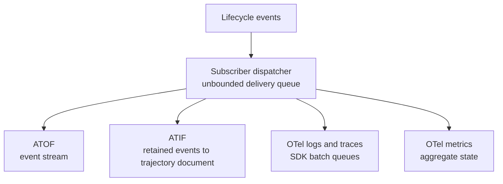

# Diagnostic Sink Architecture Review

## Scope

ATIF uses an in-memory event ledger. Most log outputs use delivery queues and
append streams. OpenTelemetry metrics use aggregates. The phase-one diagnostic
store adds bounded recent history alongside counters. These structures serve
different purposes and have different memory, retention, and delivery contracts.

This review describes the implementation before choosing further changes to the
shared foundations in `nemo-relay-types` and `nemo-relay-core`. It covers the
upstream implementation incorporated into the diagnostics branch and the
current phase-one additions. The shared diagnostic store is a phase-one change;
it should not be read as an existing upstream facility.

Source references point to the `bbednarski/diagnostics-phase-one` branch, inspected
at commit `bf89346d`, which includes upstream main through `1eb02d70`. This is an
architecture inventory, not a proposal to make every sink use the same storage
structure.

## 1. Sink and Storage Inventory

| Surface | Implementation strategy | Retention and bounds | Source |
| --- | --- | --- | --- |
| Operational stderr | Synchronous formatting and writing on the caller thread. | No Relay delivery queue or retained history. | [Stderr sink][stderr] |
| Operational files | Per-file asynchronous FIFO feeding an append or rotating file sink. | Default 1,024 queue entries; maximum 8,192. Incoming work is dropped on overflow. Record bytes are uncapped. Rotation is optional. | [File sink construction][file-sink] |
| ATOF files | Serialize lifecycle events as JSONL, then write and flush each event. | Append or truncate on open. No history cache, rotation, or disk quota. | [File writes][atof-file] |
| ATOF streams | An unbounded endpoint channel feeds a background transport worker. | Additional transport queues can retain data. No disk spool. | [Endpoint delivery][atof-endpoint] |
| ATIF | Retain a `Vec<Event>` and reconstruct a complete trajectory during export. | Run-oriented event ledger with no explicit event-count or byte cap. | [Exporter state][atif-state] |
| OTel traces and logs | SDK batch queues and background exporters. | Normally 2,048 queued entries and 512 entries per export batch. Effective limits depend on configuration and environment. No byte ceiling. | [Trace batching][otel-traces], [log batching][otel-logs] |
| OTLP trace files | Encode a complete export batch and pass it to a shared, locked file writer. | JSONL or framed protobuf; write, flush, and `sync_data` on successful export. No rotation or disk quota. | [File export][otel-file] |
| OTel metrics | Instrument registry plus SDK aggregation and periodic export. | Default 256 instruments and 2,000 attribute sets per instrument/provider. Retains aggregates rather than individual samples. | [Metrics provider][otel-metrics] |
| OTel lineage | Maps of active and completed scope contexts. | Completed contexts have a default 60-second TTL, with expiration processed on later events. A correlation cache rather than event history. | [Lineage retention][otel-lineage] |
| Shared diagnostics — phase one | Component and counter maps plus bounded recent-event `VecDeque` history. | Default 256 recent observations and a 512 KiB combined encoded-evidence budget. This is not a heap or RSS ceiling. | [Store state][diagnostic-state], [limits][diagnostic-limits] |

A `VecDeque` does not by itself imply a bounded circular history. Admission and
eviction policy determine whether it is a recent-history buffer, a pending-work
queue, or another structure. In particular, an unbounded deque of undelivered
messages has a different purpose from a deque that evicts the oldest observation
when a retention budget is reached.

Queue entry limits also differ from byte limits. A queue of 1,024 records can
retain very different amounts of memory depending on message sizes and owned
fields. An encoded-evidence budget accounts for a representation of retained
information; it does not include every allocation, collection overhead,
serialization buffer, or concurrent query result.

## 2. Shared Subscriber Delivery Path

The native runtime subscriber dispatcher is an important upstream retention
point. It uses an unbounded `std::sync::mpsc::channel`; queued messages own event,
context, and callback snapshots. Subscriber callbacks execute serially.
([Dispatcher construction][dispatcher-channel],
[dispatch processing][dispatcher-loop].)

ATOF file I/O and ATIF finalization or remote uploads can delay this dispatcher
while producers continue enqueueing. A bounded queue inside an exporter therefore
does not bound all memory upstream of that exporter. End-to-end accounting must
include the subscriber delivery path as well as each sink's own retained state.

Operational logging and shared diagnostic recording have their own paths; this
diagram describes lifecycle-event subscriber delivery rather than all logging
and diagnostics traffic.

## 3. ATIF: Event Ledger and Complete Snapshots

### Retained state

Here, *ledger* means events retained to reconstruct a trajectory. It does not mean
a durable write-ahead journal.

`AtifExporter` stores compatible events in a `Vec<Event>`; marks are ignored.
Export clones the retained history and constructs steps, observations, ancestry,
and correlation structures. Exporting does not clear the retained events.
Direct users must call `clear()` or release the exporter and its subscriber
references. ([Event collection][atif-collection], [export and clear][atif-export].)

The built-in plugin adds another layer of retention:

- An `observed_events: Vec<Event>` retains events for the root run.
- A deduplication `HashSet` tracks events already observed.
- The exporter retains its own event collection.
- Conversion and serialization create temporary representations during export.

Consequently, memory use includes two retained event collections and temporary
export state. There are no explicit root-count, event-count, or byte caps on this
path. ([Managed root state][atif-plugin-state].)

In the managed path, root completion triggers export and then removal of the
root state and scoped subscriber, including when storage fails. Shutdown also
exports roots that remain open. These lifecycle boundaries limit how long a
completed root remains owned by the plugin, but they do not limit the size or
number of active roots. ([Managed finalization][atif-plugin-finalization].)

### Persistence and delivery

ATIF persists a complete trajectory document rather than incrementally appending
individual events:

- Local storage writes the full payload to a private temporary file, calls
  `sync_all()`, and renames the file into place.
- HTTP and S3 destinations receive complete payloads. Configured remote
  destinations are attempted sequentially.
- A local fallback is used if all remote outputs fail.
- There is no retained retry ledger for completed failed uploads.

The local atomic-write strategy protects the final document from partial
replacement. It does not remove the memory required to construct and serialize
that document. ([Private file writes][private-file],
[storage and fallback][atif-storage].)

## 4. ATOF: Event Streams and Transport Backlogs

### Files

The file exporter serializes events as JSONL, writes a newline, and flushes the
writer for each event. Opening mode controls append versus truncation. The
implementation does not maintain an event-history cache or impose rotation and
a disk quota. File size can therefore grow with emitted event volume for as
long as the file remains in use. ([ATOF file handling][atof-file].)

### Network transports

All ATOF endpoint workers receive work through an unbounded channel. Their
transport-specific retention differs:

| Transport | Additional retained state | Failure behavior |
| --- | --- | --- |
| HTTP POST | One in-flight request, in addition to the endpoint queue. | A failed event is logged and dropped; it is not retried. |
| WebSocket | An unbounded `VecDeque<String>` of pending messages, in addition to the endpoint queue. | The front message is retained until local send succeeds. Drain attempts reconnect and retry as needed. |
| HTTP NDJSON | A second unbounded channel feeding the streaming request body. | The endpoint queue can be empty while substantial data remains in the request-body queue. |

Sources: [HTTP POST worker][atof-http], [WebSocket worker][atof-websocket],
[NDJSON request-body channel][atof-ndjson].

The WebSocket deque holds undelivered work. It has no policy to keep only the
newest N events and should not be interpreted as recent diagnostic history.
Likewise, moving an event from the endpoint channel into the NDJSON body channel
does not release all buffered memory associated with that event.

Flush and completion also have transport-specific meanings:

- HTTP flush means earlier requests have been attempted, not that every request
  succeeded.
- WebSocket send success confirms the local send operation, not remote
  persistence.
- NDJSON flush advances a marker through request-body polling; it is not a
  remote acknowledgement.

These distinctions matter when recording delivery evidence. Local queue progress
and successful remote storage are different observations.

## 5. Existing Diagnostic Reports and Status Surfaces

Most existing diagnostic facilities expose cumulative summaries or current
snapshots. They do not retain chronological event history.

| Surface | Representation | Retention contract | Source |
| --- | --- | --- | --- |
| OTel runtime diagnostics | Map keyed by code, cumulative occurrence count, distinct-message set, and joined display message. | First 32 codes; 1,024-character joined-message budget per code. No chronology. | [OTel diagnostic cache][otel-diagnostics] |
| Active plugin diagnostics | Cumulative map limited to 32 codes, plus a separate configuration-report vector. | Active configuration lifetime. The report vector lacks an equivalent local count and message cap. | [Plugin diagnostics][plugin-diagnostics] |
| Last failed teardown | `Option<ConfigReport>`. | One replacing report, not a ring. | [Teardown report][plugin-teardown] |
| Daemon status APIs | Current registry snapshots. | No retained diagnostic-event history. | [Broker status][daemon-status] |
| Daemon log limiter | Next-emission deadline and suppressed count. | Fixed state; the suppressed count resets on emission. | [Log limiter][daemon-log-limiter] |
| CLI doctor | Report assembled on demand. | Command-invocation lifetime. | [Doctor model][doctor-model] |

The inspected daemon and dynamic-plugin worker spawn paths discard stdout and
inherit stderr. Those paths do not introduce a parent-owned recent worker-log
ring. ([Daemon worker spawning][daemon-worker],
[dynamic-plugin worker spawning][plugin-worker].)

A cumulative count answers how often a retained code occurred during its owning
lifetime. A report vector preserves report entries. A status snapshot describes
current registry state. None of these automatically provides a time window or
complete recent-event chronology.

## 6. Related Storage Patterns Already in Relay

Several adjacent implementations provide useful comparisons without requiring a
single retention policy for all diagnostics consumers.

### Adaptive run telemetry: retained run records

An unbounded event channel feeds a run accumulator containing call records. The
in-memory backend appends completed runs to per-agent vectors. This is another
run-ledger pattern: preserve data for a run and then retain its completed record.
It is not a bounded recent-event window.
([Telemetry drain][adaptive-drain], [in-memory storage][adaptive-memory].)

### ACG observations: a count window

The ACG learner retains observations in a deque and removes the oldest
observation when the configured per-profile count limit is reached. This is a
bounded count window. It does not promise a fixed duration of coverage because
the elapsed time represented depends on observation rate.
([Observation retention][acg-observations].)

### Response cache: accounted bytes and lazy expiration

The response cache uses a map and insertion-order deque with oldest-first
eviction under an approximate accounted-byte budget. TTL expiration is lazy.
Stored values use `Arc`, avoiding deep copies on lookup. This illustrates a
combination of explicit accounting, eviction order, and lifetime rules; its
accounted bytes still differ from an exact allocator or process-memory limit.
([Cache storage][response-cache].)

### OTel metrics: aggregate temporality

Metrics already support cumulative, delta, and low-memory temporality. They
retain aggregate state rather than the complete stream of samples used to
produce it. A collection interval describes when an aggregate is exported; it
does not by itself provide arbitrary rolling-window queries.
([Metrics temporality][metrics-temporality].)

## 7. Findings Before Foundation Design

The existing architecture contains at least seven distinct retention contracts:

| Contract | Existing examples | What the retained data serves |
| --- | --- | --- |
| Complete run history | ATIF events and adaptive run records. | Reconstruct or inspect a run. |
| Pending delivery | Subscriber dispatcher, ATOF transport queues, OTel batch queues. | Preserve work awaiting an attempt or local completion. |
| Persistent event streams | Operational, ATOF, and OTLP files. | Store emitted records outside runtime memory. |
| Aggregate measurements | OTel metrics and diagnostic occurrence counters. | Summarize activity without retaining every sample. |
| Current snapshots | Plugin reports, daemon status, CLI doctor. | Describe the state available when queried. |
| Bounded recent evidence | Phase-one shared diagnostic history. | Inspect recent observations under retention limits. |
| Expiring correlation state | OTel lineage maps. | Associate related events while their context remains relevant. |

This taxonomy is the preliminary boundary for the foundation design. Common
identity, accounting, lifecycle, and loss reporting can be assessed across these
surfaces while preserving each consumer's required retention semantics.

The main memory questions follow the full data path: what is retained upstream,
what a sink adds, whether bounds count entries or bytes, which temporary copies
appear during export, and what releases ownership. Disk retention is a separate
contract: a bounded delivery queue does not constrain file growth.

The current structures also distinguish the questions that motivated this
review. Lifetime counters, elapsed runtime, time since an observed error, recent
event history, and aggregate observation windows require different retained
state. This inventory establishes where those responsibilities currently exist
before specifying their shared contracts or implementing new mechanisms.

This review is based on source inspection; allocation sizes and throughput
remain unmeasured.

[stderr]: https://github.com/bbednarski9/NeMo-Relay/blob/bbednarski/diagnostics-phase-one/crates/core/src/logging/sink.rs#L42
[file-sink]: https://github.com/bbednarski9/NeMo-Relay/blob/bbednarski/diagnostics-phase-one/crates/core/src/logging/sink.rs#L134
[atof-file]: https://github.com/bbednarski9/NeMo-Relay/blob/bbednarski/diagnostics-phase-one/crates/core/src/observability/atof.rs#L620
[atof-endpoint]: https://github.com/bbednarski9/NeMo-Relay/blob/bbednarski/diagnostics-phase-one/crates/core/src/observability/atof.rs#L637
[atif-state]: https://github.com/bbednarski9/NeMo-Relay/blob/bbednarski/diagnostics-phase-one/crates/core/src/observability/atif.rs#L334
[otel-traces]: https://github.com/bbednarski9/NeMo-Relay/blob/bbednarski/diagnostics-phase-one/crates/core/src/observability/otel.rs#L1500
[otel-logs]: https://github.com/bbednarski9/NeMo-Relay/blob/bbednarski/diagnostics-phase-one/crates/core/src/observability/otel_logs.rs#L647
[otel-file]: https://github.com/bbednarski9/NeMo-Relay/blob/bbednarski/diagnostics-phase-one/crates/core/src/observability/otel_file.rs#L255
[otel-metrics]: https://github.com/bbednarski9/NeMo-Relay/blob/bbednarski/diagnostics-phase-one/crates/core/src/observability/otel_metrics.rs#L966
[otel-lineage]: https://github.com/bbednarski9/NeMo-Relay/blob/bbednarski/diagnostics-phase-one/crates/core/src/observability/otel_logs.rs#L914
[diagnostic-state]: https://github.com/bbednarski9/NeMo-Relay/blob/bbednarski/diagnostics-phase-one/crates/core/src/diagnostics/mod.rs#L250
[diagnostic-limits]: https://github.com/bbednarski9/NeMo-Relay/blob/bbednarski/diagnostics-phase-one/crates/core/src/diagnostics/mod.rs#L38
[dispatcher-channel]: https://github.com/bbednarski9/NeMo-Relay/blob/bbednarski/diagnostics-phase-one/crates/core/src/api/runtime/subscriber_dispatcher.rs#L947
[dispatcher-loop]: https://github.com/bbednarski9/NeMo-Relay/blob/bbednarski/diagnostics-phase-one/crates/core/src/api/runtime/subscriber_dispatcher.rs#L1124
[atif-collection]: https://github.com/bbednarski9/NeMo-Relay/blob/bbednarski/diagnostics-phase-one/crates/core/src/observability/atif.rs#L387
[atif-export]: https://github.com/bbednarski9/NeMo-Relay/blob/bbednarski/diagnostics-phase-one/crates/core/src/observability/atif.rs#L419
[atif-plugin-state]: https://github.com/bbednarski9/NeMo-Relay/blob/bbednarski/diagnostics-phase-one/crates/core/src/observability/plugin_component.rs#L2920
[atif-plugin-finalization]: https://github.com/bbednarski9/NeMo-Relay/blob/bbednarski/diagnostics-phase-one/crates/core/src/observability/plugin_component.rs#L3172
[private-file]: https://github.com/bbednarski9/NeMo-Relay/blob/bbednarski/diagnostics-phase-one/crates/core/src/observability/private_file.rs#L90
[atif-storage]: https://github.com/bbednarski9/NeMo-Relay/blob/bbednarski/diagnostics-phase-one/crates/core/src/observability/plugin_component.rs#L3700
[atof-http]: https://github.com/bbednarski9/NeMo-Relay/blob/bbednarski/diagnostics-phase-one/crates/core/src/observability/atof.rs#L886
[atof-websocket]: https://github.com/bbednarski9/NeMo-Relay/blob/bbednarski/diagnostics-phase-one/crates/core/src/observability/atof.rs#L983
[atof-ndjson]: https://github.com/bbednarski9/NeMo-Relay/blob/bbednarski/diagnostics-phase-one/crates/core/src/observability/atof.rs#L1287
[otel-diagnostics]: https://github.com/bbednarski9/NeMo-Relay/blob/bbednarski/diagnostics-phase-one/crates/core/src/observability/otel_signal.rs#L138
[plugin-diagnostics]: https://github.com/bbednarski9/NeMo-Relay/blob/bbednarski/diagnostics-phase-one/crates/core/src/plugin.rs#L2637
[plugin-teardown]: https://github.com/bbednarski9/NeMo-Relay/blob/bbednarski/diagnostics-phase-one/crates/core/src/plugin.rs#L84
[daemon-status]: https://github.com/bbednarski9/NeMo-Relay/blob/bbednarski/diagnostics-phase-one/crates/cli/src/daemon/broker/server.rs#L289
[daemon-log-limiter]: https://github.com/bbednarski9/NeMo-Relay/blob/bbednarski/diagnostics-phase-one/crates/cli/src/daemon/common/logging.rs#L9
[doctor-model]: https://github.com/bbednarski9/NeMo-Relay/blob/bbednarski/diagnostics-phase-one/crates/cli/src/diagnostics/model.rs#L32
[daemon-worker]: https://github.com/bbednarski9/NeMo-Relay/blob/bbednarski/diagnostics-phase-one/crates/cli/src/daemon/mcp/mod.rs#L805
[plugin-worker]: https://github.com/bbednarski9/NeMo-Relay/blob/bbednarski/diagnostics-phase-one/crates/core/src/plugin/dynamic/worker.rs#L1031
[adaptive-drain]: https://github.com/bbednarski9/NeMo-Relay/blob/bbednarski/diagnostics-phase-one/crates/adaptive/src/drain.rs#L22
[adaptive-memory]: https://github.com/bbednarski9/NeMo-Relay/blob/bbednarski/diagnostics-phase-one/crates/adaptive/src/storage/memory.rs#L23
[acg-observations]: https://github.com/bbednarski9/NeMo-Relay/blob/bbednarski/diagnostics-phase-one/crates/adaptive/src/acg_learner.rs#L91
[response-cache]: https://github.com/bbednarski9/NeMo-Relay/blob/bbednarski/diagnostics-phase-one/crates/adaptive/src/response_cache/store.rs#L111
[metrics-temporality]: https://github.com/bbednarski9/NeMo-Relay/blob/bbednarski/diagnostics-phase-one/crates/core/src/observability/otel_metrics.rs#L61
